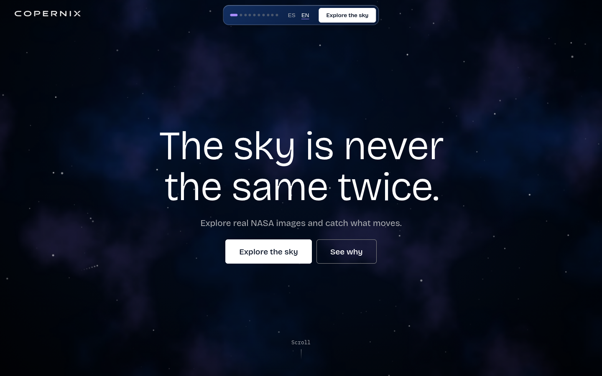
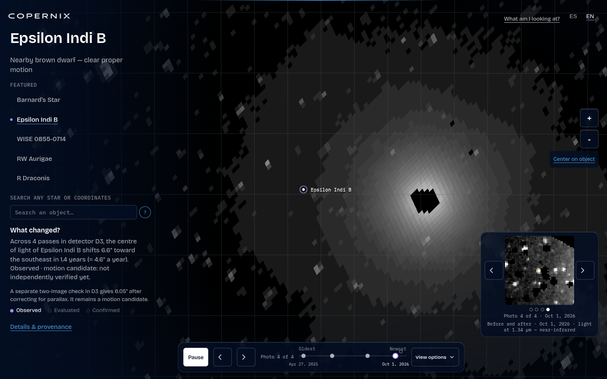
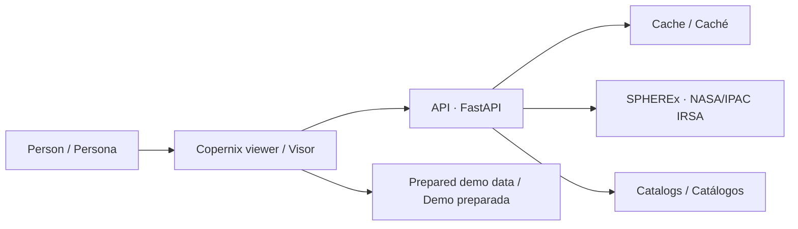

<div align="center">

# COPERNIX

**Explore the sky. See time unfold.**<br>
**Explora el cielo. Observa el paso del tiempo.**

A SPHEREx exploration prototype by **Na za** for NASA Space Apps Challenge 2026.<br>
Un prototipo de exploración de SPHEREx del equipo **Na za** para NASA Space Apps Challenge 2026.

[**Open the live demo · Abrir la demo**](https://demo.copernix.workers.dev/) · [Technical documentation](docs/documentacion-tecnica/README.md) · [API contract](contracts/openapi.yaml) · [Scientific sources](#data-and-scientific-integrity--datos-y-rigor-científico)

</div>



> **Prototype / Prototipo.** A visible difference is an observation to investigate, not a confirmed discovery. / Una diferencia visible es una observación que requiere investigación, no un descubrimiento confirmado.

## The idea / La idea

**EN** · SPHEREx observes the sky in infrared light. Copernix makes a region easier to explore across observation dates: navigate a sky map, choose an object or coordinates, compare available images, and inspect where the data came from and what the comparison can—and cannot—say. Coverage, comparable observations and service availability vary by region.

**ES** · SPHEREx observa el cielo en luz infrarroja. Copernix facilita explorar una región a través de distintas fechas: navega por el mapa, elige un objeto o coordenadas, compara las imágenes disponibles y consulta su procedencia y los límites de la comparación. La cobertura, las observaciones comparables y la disponibilidad del servicio varían según la región.



<sub>Captures from the public demo on 15 November 2026; interface and data availability may change. / Capturas de la demo pública del 15 de noviembre de 2026; la interfaz y la disponibilidad de datos pueden cambiar.</sub>

## Explore / Explorar

1. **[Open Copernix](https://demo.copernix.workers.dev/)** and enter the sky viewer. / Abre Copernix y entra al visor.
2. Choose a featured object or search for a sky position. / Elige un objeto destacado o busca una posición.
3. Explore the available dates and view options; open provenance and interpretation details. / Explora las fechas y opciones disponibles; consulta la procedencia y la interpretación.

The guided ε Indi B case is an **observed candidate**, with scientific controls still under review. The software does not independently confirm discoveries. / El caso guiado de ε Indi B es un **candidato observado** con controles científicos aún en revisión. El software no confirma descubrimientos por sí solo. [Case evidence / Evidencia](docs/specs/0038-caso-guiado-epsilon-indi-b.md).

## How it works / Cómo funciona



**EN** · The browser renders the sky and temporal views. The API searches observations, prepares series and serves visual tiles; the scientific workflow documents data provenance, comparability and uncertainty. PNG sky tiles are for visualization, not scientific measurements. / **ES** · El navegador representa el cielo y las vistas temporales. La API busca observaciones, prepara series y sirve teselas visuales; el flujo científico documenta procedencia, comparabilidad e incertidumbre. Las teselas PNG sirven para visualizar, no para medir científicamente.

| Area / Área | Technology and entry point / Tecnología y punto de entrada |
| --- | --- |
| Web | React, TypeScript, Vite, WebGL2 · [viewer](frontend/copernix/README.md) |
| API | Python, FastAPI, Astropy · [OpenAPI](contracts/openapi.yaml) |
| Science / Ciencia | FITS, WCS, quality controls / controles de calidad · [science](science/README.md) |
| Documentation / Documentación | Architecture, operations, validation, judging / arquitectura, operación, validación y rúbrica · [technical reference](docs/documentacion-tecnica/README.md) |

## Run locally / Ejecutar localmente

Install the tools described in the [environment guide / guía de entorno](docs/context/08-entorno-y-comandos.md), then from the repository root / instala las herramientas de la guía y ejecuta desde la raíz:

```text
mise trust
mise install
mise run setup
mise run copernix-build
mise run copernix
```

Open / Abre **http://127.0.0.1:4410/**. API documentation / Documentación de API: **http://127.0.0.1:8000/docs**. The unified server runs the API and viewer; live data requires network access. / El servidor unificado inicia la API y el visor; los datos en vivo requieren conexión. See [operations / operación](docs/documentacion-tecnica/operacion.md) for alternatives, configuration and troubleshooting.

## Verify / Verificar

```text
mise run api-test
mise run api-lint
mise run web-test
mise run web-lint
mise run web-build
mise run copernix-build
mise run check-contracts
```

Tests and builds verify software behavior, not scientific conclusions. / Las pruebas y compilaciones verifican el software, no las conclusiones científicas. See [verification and limitations / verificación y límites](docs/documentacion-tecnica/README.md#8-verificación-y-reproducibilidad).

## Data and scientific integrity / Datos y rigor científico

- **Source / Fuente:** [NASA/IPAC IRSA — SPHEREx](https://irsa.ipac.caltech.edu/Missions/spherex.html) and [official tutorials / tutoriales oficiales](https://caltech-ipac.github.io/irsa-tutorials/spherex/).
- **Provenance / Procedencia:** observation, collection, date, detector, wavelength and processing are essential context. / La observación, colección, fecha, detector, longitud de onda y procesamiento son contexto esencial.
- **Interpretation / Interpretación:** observed → evaluated → confirmed; the software never assigns confirmed. / observado → evaluado → confirmado; el software nunca asigna confirmado.
- **Attribution / Reconocimiento:** use the acknowledgement requested on the [IRSA mission page](https://irsa.ipac.caltech.edu/Missions/spherex.html) in publications and complete dataset-specific citations before submission. / Incluye el reconocimiento indicado por IRSA y completa las citas específicas de los datos antes de la entrega.

## Documentation / Documentación

| For / Para | Start here / Comienza aquí |
| --- | --- |
| Reviewers and team / Jurado y equipo | [Technical and scientific reference](docs/documentacion-tecnica/README.md) · [Rubric traceability](docs/documentacion-tecnica/README.md#9-trazabilidad-a-la-rúbrica-de-sangolquí) |
| Developers / Desarrollo | [Operations and configuration](docs/documentacion-tecnica/operacion.md) · [API contract](contracts/openapi.yaml) · [Architecture decisions](docs/adr/) |
| Science / Ciencia | [Data map](docs/context/12-mapa-de-datos-spherex.md) · [D3 validation package](data/packages/eps-indi-b-d3/README.md) · [Scientific validation](science/README.md) |
| Project coordination / Coordinación | [Current state](docs/STATE.md) · [Team guide](docs/Onboarding_Planet_X_SPHEREx_v0.1.md) · [AI usage](docs/AI_USAGE.md) |

## Credits and license / Créditos y licencia

Built by **Na za** for the **Planet X and SPHEREx** challenge. SPHEREx data are provided by NASA/IPAC IRSA; external libraries and AI assistance are documented in the repository. / Creado por **Na za** para el reto **Planet X and SPHEREx**. Los datos SPHEREx provienen de NASA/IPAC IRSA; las librerías externas y el uso de IA se documentan en el repositorio.

[AI usage / Uso de IA](docs/AI_USAGE.md) · [MIT license / Licencia MIT](LICENSE)
