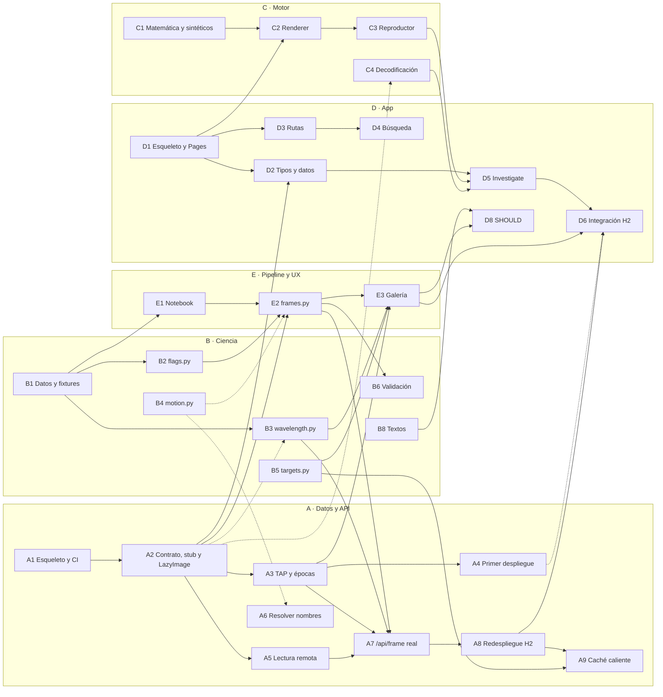

# Roles, flujo y pasos — Planet X and SPHEREx (equipo Na za)

**Sábado 14 de noviembre de 2026, 10:45 (UTC−5).** Este documento manda sobre las secciones 5 y 6 de [plan_tecnico.md](plan_tecnico.md). Los cinco roles **ya están asignados**: la tabla de reparto está al final de la sección 0. Las horas ya incluyen el retraso del reparto.

**Nombre de la app: pendiente.** En los documentos se escribe `[nombre]`. En el código hay una sola constante, `APP_NAME` en `frontend/src/config.ts`, con el valor `"Name TBD"`; cambiar el nombre es cambiar esa línea.

**Fuentes.** El objetivo del reto sale de [problema.md](problema.md); los datos medidos, de [plan_tecnico.md §1](plan_tecnico.md); el producto, de [PRODUCT.md](../PRODUCT.md); la interfaz, de [DESIGN.md](../DESIGN.md) y [ux_spec.md](ux_spec.md). De [investigacion_planet_x.md](investigacion_planet_x.md) se adoptan cinco puntos: comparar a la misma longitud de onda, restar ZODI, la semántica de `FLAGS`, la procedencia en cada fotograma y una página honesta sobre Planet X. Lo marcado **[verificar]** es una inferencia que el rol indicado confirma con datos antes de usarla.

**Cómo leer este documento:**
- **Todo el equipo:** secciones 0, 1, 2 y 5.
- **Cada persona:** además, su rol (6 a 10) y los contratos que toca (sección 4).

---

## 0. Los cinco roles de un vistazo (para elegir)

| | **A. Datos y API** | **B. Ciencia y validación** | **C. Motor de imagen** | **D. Aplicación web** | **E. Pipeline y UX** |
| --- | --- | --- | --- | --- | --- |
| **Misión** | Que el servidor entregue datos reales de IRSA rápido y sin caerse | Que cada fotograma sea comparable y que nada de lo que se diga sea falso | Que los fotogramas se vean bien y el blink funcione en cualquier portátil | Que la app pública sea usable, enlazable y funcione sin backend | Que las imágenes queden alineadas y la demo se entienda en un minuto |
| **Produce** | `backend/` salvo `science/` y `frames.py`; Docker; Hugging Face; README final | `backend/app/science/`; `docs/VALIDATION.md`; textos científicos; guion del pitch | `frontend/src/engine/` y `frontend/src/player/` | El resto de `frontend/`; CI del frontend; GitHub Pages | `backend/app/frames.py`; galería precalculada; `docs/UX_CHECKLIST.md`; diapositivas y video |
| **Decide** | Cómo se lee IRSA, caché, tiempos y despliegue | Tolerancia de λ, máscaras, detector por objeto, qué se afirma | Shaders, paletas, rendimiento del reproductor | Rutas, componentes y estados de la UI | Rejilla común, combinación por época, prioridades de UX |
| **Perfil** | Python asíncrono, HTTP, Docker | Física o astronomía y Python (numpy, astropy) | TypeScript fuerte; WebGL2/GLSL o ganas de aprenderlo rápido | React, TypeScript, CSS y accesibilidad | Python (numpy, astropy), criterio visual, buena comunicación |
| **Carga más alta** | 12:00–19:00 | 16:00–19:00 y pitch | 12:00–19:00 | Todo el sábado | 12:45–17:30 (ruta crítica) y pitch |
| **Pareja de apoyo** | E | E | D | C | A y B |

**Reparto acordado el sábado 14 a las 11:00:**

| Rol | Persona | Usuario GitHub | Etiqueta de issues | Pareja de apoyo |
| --- | --- | --- | --- | --- |
| A. Datos y API | Johann | `Vladimirjon` | `rol-A` | Mateo (E) |
| B. Ciencia y validación | Dax | `daxrpm` | `rol-B` | Mateo (E) |
| C. Motor de imagen | Sebastián Chávez | `cschavezv03-ops` | `rol-C` | Daniel (D) |
| D. Aplicación web | Daniel Flores | `danielife05` | `rol-D` | Sebastián (C) |
| E. Pipeline y UX | Mateo Cumbal | `mateobtw` | `rol-E` | Johann (A) y Dax (B) |

Johann (`Vladimirjon`) es además la persona administradora del repo (sección 2.3). Cada persona se asigna sus issues con su usuario de la tabla.

---

## 1. Flujo de trabajo y dependencias

### 1.1 Mapa de dependencias

Una flecha continua indica que el paso de destino **no puede terminarse** sin el de origen. Una discontinua indica que puede avanzar con un sustituto (stub, valor provisional o archivo local) y se conecta después.



### 1.2 Ruta crítica

La ruta crítica es la cadena más larga: si se atrasa uno de sus pasos, se atrasa el hito H2 de las 19:00.

```text
B1 fixtures (12:30) → B2 flags (13:00) → E2 frames.py (16:00) → A7 /api/frame real (17:45) → A8 redespliegue (18:15) → D6 integración (19:00)
                       B3 wavelength (14:15) ↗
A1 (12:00) → A2 contrato (12:45) → A3 épocas (14:00) ↗
D1 (12:15) → C2 renderer (14:30) → C3 reproductor (15:45) → D5 Investigate (18:00) ↗
```

**Consecuencia:** `frames.py` (E2) es la pieza más arriesgada. A, B y C ayudan primero a E2 y a D5 si terminan antes.

### 1.3 Cómo trabajar sin esperar

Nadie se queda parado esperando a otro rol. Para eso existen cuatro sustitutos:

1. **Stub de la API (A2, 12:45):** `/api/epochs` y `/api/frame` devuelven datos simulados con el esquema exacto. C y D trabajan contra él hasta que llegan los datos reales.
2. **Fixtures locales (B1, 12:30):** dos archivos FITS reales de WISE 0855 en `backend/.data/`. B y E prueban `wavelength.py`, `flags.py` y `frames.py` sin depender de la red ni del código de IRSA de A.
3. **`LazyImage` acepta rutas locales (A2):** la misma clase abre un archivo local, una URL HTTPS o un URI de S3. El código de B y E no cambia al pasar de los fixtures a IRSA.
4. **Contratos escritos (sección 4):** si `contracts/openapi.json` se atrasa, D escribe los tipos a mano desde la sección 4.1 y los sustituye después.

### 1.4 Matriz de dependencias por paso

| Paso | Necesita (de quién) | Desbloquea (a quién) | Si lo que necesita se atrasa |
| --- | --- | --- | --- |
| A1 Esqueleto | — | Todo el backend; la protección de `main` | — |
| A2 Contrato, stub, LazyImage | A1 | D2, C4 y C5 (stub); B3 y E2 (`LazyImage`) | — |
| A3 TAP y épocas | A1 | A7, E3 y B6 | — |
| A4 Primer despliegue | A3 | D6; la variable `API_BASE` | Desplegar solo el stub |
| A5 Lectura remota | A2 | A7 | Usar el servicio de recorte (vía a) |
| A6 Resolver nombres | B4 (blando) | D4 por nombre | Devolver J2000 sin propagar |
| A7 `/api/frame` real | A3, A5, B3, E2 (duros); B2, B4 (blandos) | A8, B6, C6 | Ver el riesgo 1 del rol A |
| A8 Redespliegue | A7 | D6 | La demo de H2 usa la galería |
| A9 Caché caliente | A8, B5 | La demo del domingo | Calentar solo WISE 0855 y Barnard |
| B1 Datos y fixtures | — | B2, B3, E1, E2 | — |
| B2 `flags.py` | B1 | E2, A7 | E usa la lista provisional de la sección 7 |
| B3 `wavelength.py` | B1; A2 (blando) | A7, E3 | Probar con `fits.open` directo y adaptar después |
| B4 `motion.py` | — | A6, E2 (`expected_xy`), B6 | `expected_xy = null` |
| B5 `targets.py` | B1, B3 | E3, A9 | Valores provisionales de la sección 7 |
| B6 Validación | E2 o A7; B4 | Pitch, README | — |
| B8 Textos | — | D8 (páginas About y Planet X) | D muestra «Coming soon» y no publica cifras |
| C1 Matemática | — | C2 | — |
| C2 Renderer | D1 | C3, D5 | Trabajar en una rama a partir de la de D1 |
| C3 Reproductor | C2 | D5 | — |
| C4 Decodificación | A2 (formato) | D5 con datos | Formato de la sección 4.1 |
| D1 Esqueleto | — | C2, D2, D3; Pages | — |
| D2 Tipos y datos | A2 | D5 | Tipos a mano desde la sección 4.1 |
| D5 Investigate | D2, C3, C4 | D6, C5 | Maquetar paneles con un marcador de posición |
| D6 Integración H2 | A8, E3, D5; variable `API_BASE` | Hito H2 | Presentar H2 con la galería |
| D8 SHOULD | B8, E3 (5 objetos) | Demo completa | — |
| E1 Notebook | B1 | E2 | Seguir el tutorial de recortes de IRSA |
| E2 `frames.py` | A2, B2 (duros); B4 (blando) | A7, B6, E3 | Ver el riesgo 1 del rol E |
| E3 Galería | E2, A3, B3, B5 | D6, D8, D9 | Galería solo de WISE 0855 |

### 1.5 Señales de entrega

Cuando un paso desbloquea a otro rol, su dueño escribe en el grupo, con este formato exacto: `LISTO <ID>: <qué quedó> — <enlace al PR>`. Quien espera no pregunta antes de la hora objetivo.

| Hora objetivo | Señal | La da | La espera |
| --- | --- | --- | --- |
| 12:00 | `LISTO A1: backend/ en main` | A | B, E y admin |
| 12:15 | `LISTO D1: frontend/ en main y Pages publicado` | D | C y admin |
| 12:30 | `LISTO B1: fixtures y bits de FLAGS` | B | E |
| 12:45 | `LISTO A2: contrato, stub y LazyImage` | A | C, D, E y B |
| 13:00 | `LISTO B2: flags.py` | B | E |
| 14:00 | `LISTO A3: /api/epochs real` | A | E y B |
| 14:15 | `LISTO B3: wavelength.py` | B | A y E |
| 14:30 | `LISTO C2: renderer` | C | D |
| 14:45 | `LISTO A4: backend en <URL>` | A | Admin y D |
| 15:00 | `LISTO B4: motion.py` | B | A y E |
| 15:30 | `LISTO B5: targets.py` | B | E y A |
| 15:45 | `LISTO C3: reproductor` | C | D |
| 16:00 | `LISTO E2: frames.py` | E | A y B |
| 17:30 | `LISTO E3: galería de WISE 0855` | E | D |
| 17:45 | `LISTO A7: /api/frame real` | A | D, C y B |
| 18:15 | `LISTO A8: backend redesplegado` | A | D |

**Si una señal se atrasa:**
- **30 minutos:** su dueño publica una hora nueva y su pareja de apoyo (sección 0) se suma.
- **60 minutos:** quien espera aplica la columna «Si lo que necesita se atrasa» de 1.4, y el atraso se comenta en la reunión siguiente.

### 1.6 Reuniones cortas

5 minutos de pie, a las **12:15, 14:45, 17:45 y 21:00**, y el domingo a las **07:30**. Cada persona dice tres cosas: qué terminó, qué la bloquea y la hora de su próxima señal. Nada más.

---

## 2. Pasos comunes

### 2.1 Todas las personas (11:00–11:20)

1. Acepta la invitación en <https://github.com/Vladimirjon/NASA_PlanetX_SPHEREX/invitations>.
2. Clona el repo:

   ```bash
   git clone https://github.com/Vladimirjon/NASA_PlanetX_SPHEREX.git
   ```

3. Instala las herramientas de tu rol y comprueba sus versiones:
   - A, B y E: Python 3.12 y [uv](https://docs.astral.sh/uv/). Comprueba `uv --version`. Python se instala con `uv python install 3.12`.
   - C y D: Node 24 LTS y npm. Comprueba que `node -v` empieza por `v24`.
4. Lee, en este orden: [problema.md](problema.md), [PRODUCT.md](../PRODUCT.md), las secciones 1 y 4 de este documento y tu rol. Después:
   - C, D y E: [DESIGN.md](../DESIGN.md) y [maqueta.html](maqueta.html), que se abre en el navegador.
   - D y E: [ux_spec.md](ux_spec.md), secciones 1, 3, 4 y 9.
   - A, B y E: [investigacion_planet_x.md](investigacion_planet_x.md), secciones 3.1–3.4 y 4.1.
5. Crea un issue por cada paso de tu rol. El título es el ID del paso y su nombre, por ejemplo `A3 · TAP y épocas`. Asígnatelo y ponle la etiqueta de tu rol (`rol-A` … `rol-E`).

### 2.2 Flujo de Git, sin excepciones

- Una rama por issue: `feat/NN-descripcion`, `fix/NN-descripcion` o `docs/NN-descripcion`, donde `NN` es el número del issue.
- Commits en formato Conventional Commits (`feat(api): add /api/epochs`).
- Todo entra por PR a `main`, con CI en verde. Nunca hay push directo a `main` ni `git add .`: los archivos se añaden por nombre.
- Fuera de los hitos, el autor integra su propio PR cuando el CI pasa. En los hitos **H2 (19:00)** y **congelación (02:00)** otra persona revisa el PR antes de integrarlo.
- **Dependencias:**
  - Solo A modifica `backend/pyproject.toml` y `uv.lock`, y solo D modifica `frontend/package.json` y `package-lock.json`.
  - Quien necesite una librería nueva la pide a ese dueño. Así no hay conflictos en los archivos de bloqueo.
- Nunca se suben tokens, archivos `.env` ni archivos FITS. El token de Hugging Face vive solo en la máquina de quien despliega.

### 2.3 Persona administradora del repo (Johann, cuenta `Vladimirjon`)

1. **11:20.** Settings → General → Danger Zone: el repo pasa a **público**. La entrega exige enlaces abiertos y así GitHub Pages es gratis.
2. **11:20.** Settings → Pages → Source: **GitHub Actions**.
3. **12:20**, cuando existan los workflows de A1 y D1: Settings → Branches → Add rule para `main`.
   - Marca *Require a pull request before merging*, sin aprobaciones obligatorias.
   - Marca *Require status checks to pass*, con los jobs `backend` y `frontend`.
   - Bloquea los force push.
4. **14:45**, cuando llegue `LISTO A4`: Settings → Secrets and variables → Actions → Variables. Crea `API_BASE` con la URL del backend (por ejemplo `https://<usuario>-<space>.hf.space`; no es un secreto) y vuelve a ejecutar el workflow `pages`.

---

## 3. Estructura del repo y dueños

```text
backend/                     Python 3.12 + uv
  pyproject.toml, uv.lock    A  (nadie más los toca)
  Dockerfile, README.md      A  (README.md lleva la cabecera de Hugging Face)
  .gitignore                 A  (incluye .data/)
  app/main.py                A  FastAPI, CORS, rutas
  app/models.py              A  modelos Pydantic = contrato (sección 4)
  app/irsa.py                A  TAP, épocas, LazyImage
  app/resolve.py             A  nombre → coordenadas y movimiento propio
  app/cache.py               A  diskcache
  app/science/flags.py       B  máscaras de FLAGS
  app/science/wavelength.py  B  longitud de onda en el objeto y selección por época
  app/science/motion.py      B  movimiento propio y paralaje
  app/science/photometry.py  B  flujo de apertura (perfil D1–D6 y curva de luz)
  app/science/targets.py     B  los 5 objetos del reto y su configuración
  app/frames.py              E  rejilla común, reproyección, combinación, codificación
  scripts/export_openapi.py  A  escribe contracts/openapi.json
  scripts/fetch_fixtures.py  B  descarga los FITS de prueba a backend/.data/
  scripts/build_gallery.py   E  galería precalculada
  scripts/warm_cache.py      A  precalienta la caché del servidor
  tests/fixtures.toml        B  lista de FITS de prueba (URLs, no archivos)
  tests/                     cada rol prueba sus módulos
notebooks/                   B y E (exploración; no es código del producto)
contracts/openapi.json       A lo genera; D lo consume
frontend/                    React 19 + TS + Vite
  package.json, lock         D  (nadie más los toca)
  src/config.ts              D  APP_NAME, API_BASE
  src/engine/                C  WebGL2, paletas, overlay, exportar PNG
  src/player/                C  store Zustand, bucle de reproducción, teclado
  src/data/                  D  fuentes live (API) y gallery (estática)
  src/lib/parseCoords.ts     D
  src/routes/, src/components/  D
  src/content/*.md           B  textos científicos en inglés (D los muestra)
  public/gallery/            E  salida de build_gallery.py
.github/workflows/backend.yml   A
.github/workflows/frontend.yml  D
.github/workflows/pages.yml     D
docs/                        VALIDATION.md (B), EXPERIMENTS.md (A), UX_CHECKLIST.md (E)
```

Si necesitas cambiar un archivo de otro rol, avisa a su dueño en el grupo antes de abrir el PR.

---

## 4. Contratos entre roles

Ningún contrato cambia sin un mensaje en el grupo y un PR que actualice los dos lados a la vez. A escribe los modelos de esta sección en `backend/app/models.py` en el paso A2.

### 4.1 API (backend en Hugging Face, prefijo `/api`)

| Método y ruta | Parámetros | Respuesta | Tiempo objetivo |
| --- | --- | --- | --- |
| `GET /api/health` | — | `{"status": "ok", "version": "<git sha>"}` | < 1 s |
| `GET /api/resolve` | `name` | `Resolved` | < 5 s |
| `GET /api/epochs` | `ra`, `dec` | `EpochList` | < 10 s (sin descargar píxeles) |
| `GET /api/frame` | `ra`, `dec`, `size_deg`, `epoch_id`, `detector`, `lambda_um`, `name` (opcional) | `Frame` o `NotComparable` | < 60 s; si se supera, error 504 |

Reglas:

- `ra` está en grados, en el intervalo [0, 360); `dec` en grados, en [−90, 90]. `size_deg` va de 0.05 a 0.3 y vale 0.1 por defecto. `detector` es un entero de 1 a 6. `lambda_um` es opcional; si falta, se usa el centro del detector (`default_lambda`, rol B).
- **Un fotograma por petición.** El frontend pide las épocas una a una y muestra cada fotograma en cuanto llega.
- Errores con forma `{"error": "<código>", "detail": "<texto en inglés>"}`. Códigos: `bad_request` (400), `not_found` (404), `upstream_unavailable` (502, cuando IRSA o SIMBAD fallan), `timeout` (504).
- CORS permite `http://localhost:5173`, `http://localhost:4173` y `https://vladimirjon.github.io`.

```text
Resolved     = { name, ra_j2000, dec_j2000, pmra_masyr, pmdec_masyr, parallax_mas | null,
                 ref_epoch_jyear, ra_2026, dec_2026, source: "SIMBAD" | "Sesame" }
EpochList    = { ra, dec, epochs: Epoch[] }
Epoch        = { epoch_id: "YYYY-MM-DD", t_start_utc, t_end_utc, n_images,
                 n_by_detector: {"1": int, …, "6": int}, collections: string[] }
NotComparable= { status: "not_comparable", epoch_id, detector, lambda_um, reason }
Frame        = {
  status: "ok",
  frame_id,                         # sha1 corto de (ra, dec, size_deg, epoch_id, detector, lambda_um)
  epoch_id, t_mid_utc,
  detector, lambda_target_um, lambda_um, delta_lambda_um,
  collections: string[], obs_ids: string[], n_images,
  grid: { center_ra, center_dec, size_deg, width, height, pixscale_arcsec },
  data_b64,                         # float32 little-endian, fila 0 = NORTE, NaN = sin dato
  stats: { p1, p50, p99_5 },        # en MJy/sr, ignorando NaN
  flags_frac,                       # fracción de píxeles con bits PHOT_MASK_BITS
  saturated_at_target: bool,
  expected_xy: [x, y] | null,       # solo si llegó `name`; coordenadas de la sección 4.3
  simulated: bool,                  # true solo en el stub de A; la UI muestra "SIMULATED"
  provenance: { pipeline_version, git_sha, created_utc, data_release_doi }
}
```

### 4.2 Galería estática (sale de E y la lee D)

```text
frontend/public/gallery/index.json             [{slug, name, kind: "moving" | "variable", ra, dec, size_deg, detector, lambda_um}]
frontend/public/gallery/<slug>/manifest.json   {slug, name, epochs: Epoch[], frames: [frame_id…], not_comparable: NotComparable[]}
frontend/public/gallery/<slug>/<frame_id>.json Frame   (el mismo esquema que /api/frame)
```

Los *slugs* son `wise-0855`, `barnards-star`, `eps-indi-b`, `rw-aur` y `r-dra`.

### 4.3 Convención de píxeles (la escriben E y B, y la usa todo el mundo)

- Rejilla común: proyección TAN centrada en (`ra`, `dec`), norte arriba y este a la izquierda. `CDELT1 = −pix` y `CDELT2 = +pix`, con `pix = 6.15″` (escala nativa según la [investigación](investigacion_planet_x.md); 6.2″ es el valor redondeado). El lado es `n = ceil(size_deg·3600/6.15)`; si sale par, se suma 1 para que el objeto quede en un píxel central.
- `data_b64` va fila por fila, y **la fila 0 es el norte**: E aplica `np.flipud` a la matriz de astropy antes de codificarla.
- `expected_xy` está en **coordenadas de pantalla**: origen en la esquina superior izquierda de la imagen; el píxel `i` ocupa [i, i+1), así que su centro es `i + 0.5`. Desde astropy, con `(xc, yc) = wcs.world_to_pixel(...)` en base 0: `x = xc + 0.5` y `y = height − 0.5 − yc`.
- FITS cuenta desde 1 y astropy desde 0. Cada conversión lleva una prueba (pasos B2 y E2).

### 4.4 Interfaces Python entre A, B y E

```python
# app/irsa.py (A)
@dataclass(frozen=True)
class ImageMeta:
    obs_id: str; collection: str; detector: int      # 1..6
    t_mid_mjd: float; access_url: str; s3_uri: str | None
async def find_images(ra: float, dec: float) -> list[ImageMeta]
def group_epochs(images: list[ImageMeta], gap_days: float = 20.0) -> list[EpochGroup]
class LazyImage:                                     # no descarga el archivo entero
    meta: ImageMeta | None
    @classmethod
    def from_uri(cls, uri: str, meta: ImageMeta | None = None) -> "LazyImage"   # ruta local, https:// o s3://
    def header(self, ext: str) -> fits.Header
    def celestial_wcs(self) -> WCS                   # WCS espacial de la extensión IMAGE (con SIP)
    def hdul(self) -> fits.HDUList                   # para el WCS espectral (B)
    def read_section(self, ext: str, y0: int, y1: int, x0: int, x1: int) -> np.ndarray
async def open_image(meta: ImageMeta) -> LazyImage   # elige S3, HTTPS o recorte según A5

# app/science/flags.py (B)
def display_mask(flags: np.ndarray) -> np.ndarray      # True = poner NaN
def flags_fraction(flags: np.ndarray) -> float
def saturated_at(flags: np.ndarray, x: int, y: int, r: int = 1) -> bool
# app/science/wavelength.py (B)
def wavelength_at(img: LazyImage, ra: float, dec: float) -> tuple[float, float] | None   # (λ µm, ancho µm)
def tolerance_um(detector: int, lambda_um: float) -> float
def select_for_epoch(cands: list[tuple[LazyImage, float]], lambda_um: float, detector: int,
                     max_n: int = 3) -> list[LazyImage]
def default_lambda(detector: int) -> float
# app/science/motion.py (B)
def propagate(ra, dec, pmra_masyr, pmdec_masyr, parallax_mas, ref_epoch_jyear, t: Time) -> tuple[float, float]

# app/frames.py (E)
def common_grid(ra: float, dec: float, size_deg: float) -> tuple[WCS, tuple[int, int]]
def build_frame(images: list[LazyImage], ra: float, dec: float, size_deg: float,
                epoch_id: str, detector: int, lambda_target_um: float, lambdas_um: list[float],
                expected_radec: tuple[float, float] | None) -> Frame
```

### 4.5 Interfaz TypeScript entre C y D

```ts
// frontend/src/engine/index.ts (C)
export type EngineFrame = { id: string; width: number; height: number; data: Float32Array };
export type Mode = 'blink' | 'diff' | 'neg';
export type Colormap = 'gray' | 'inferno' | 'diverging';
export interface Renderer {
  setFrames(frames: EngineFrame[]): void;
  draw(opts: { index: number; refIndex: number; mode: Mode; lo: number; hi: number;
               stretch: 'asinh' | 'linear'; colormap: Colormap; zoom: number; panX: number; panY: number;
               markers: { x: number; y: number; label: string }[] }): void;
  imageToScreen(x: number, y: number): { x: number; y: number };
  exportPNG(caption: string): Promise<Blob>;
  dispose(): void;
}
export function createRenderer(canvas: HTMLCanvasElement, overlay: HTMLCanvasElement): Renderer;
export function decodeFrame(b64: string, width: number, height: number): Float32Array;
// frontend/src/player/store.ts (C): usePlayer = create<{ index, playing, fps: 0.5|1|2|3, mode, refIndex,
//   lo, hi, stretch, colormap, zoom, panX, panY, setFrameCount, play, pause, next, prev, seek, ... }>()
```

---

## 5. Horario e hitos

| Hora | Hito | Criterio de «hecho» | Quién |
| --- | --- | --- | --- |
| 11:00 | Reparto | Tabla de la sección 0 llena | Todos |
| 11:20 | Pasos comunes | Todos con el repo clonado y las herramientas instaladas | Todos |
| **12:15** | **H0 · Esqueletos** | `backend/` y `frontend/` en `main` con CI en verde; Pages publica una página vacía | A, D |
| 12:45 | Contrato | `models.py`, `contracts/openapi.json` y el stub en `main`; `LazyImage` abre los fixtures | A |
| **14:45** | **H1 · Piezas sueltas** | A: backend desplegado con épocas reales. B: `flags.py` y `wavelength.py` con pruebas. C: blink de fotogramas simulados. D: rutas, búsqueda y cliente contra el stub. E: blink de WISE 0855 en el notebook y `frames.py` empezado | Cada uno |
| 17:45 | H1.5 · Fotograma real | `/api/frame` real devuelve WISE 0855 en local; la galería de WISE 0855 está en `main` | A, B, E |
| **19:00** | **H2 · Mínimo de punta a punta desplegado** (revisión obligatoria) | En la URL pública de Pages, escribir `WISE 0855` muestra sus épocas reales en blink; la galería de WISE 0855 funciona sin backend | Todos |
| 20:00 | Test de pasillo | 5 personas ajenas al equipo, protocolo de ux_spec §10 | E |
| 21:00 | Pitch v1 | Guion leído en voz alta en menos de 5 min | B, E |
| 00:30 (dom) | SHOULD terminados | Diferencia, cruz prevista, metadatos, galería de los 5 objetos, páginas About y Planet X | Todos |
| **02:00 (dom)** | **Congelación** (revisión obligatoria) | Solo se corrigen errores; tag `v0.9` | Todos |
| 07:30–10:00 | Integración final | Capturas reales, video de respaldo, README, dos ensayos cronometrados, tag `v1.0` | Todos |
| 10:30–11:00 | Entrega local | Enlaces abren sin pedir permisos | E y B |
| ≤ 23:59 | Entrega global | Formulario de la pestaña Project enviado | Team Owner en la plataforma |

Fuente de las horas de entrega: [reglas_evento.md](reglas_evento.md).

---

## 6. Rol A — Datos y API

### Misión

El servidor responde con datos reales de IRSA en menos de un minuto por fotograma, cachea todo lo que ya calculó, no satura IRSA y está desplegado en una URL pública.

### Decide

- Vía de lectura de IRSA (S3, HTTPS o recorte), con los números de A5.
- Política de caché, límites de tiempo y concurrencia.
- Forma de los errores de la API, dentro de la sección 4.1.

### Recibe y entrega

| Recibe | De | Para qué |
| --- | --- | --- |
| `flags.py`, `wavelength.py`, `motion.py`, `targets.py` | B | Seleccionar imágenes y propagar posiciones en `/api/frame` |
| `frames.py` | E | Construir el fotograma |
| Fixtures FITS | B | Probar `LazyImage` sin red |

| Entrega | A | Cuándo |
| --- | --- | --- |
| `pyproject.toml` con todas las dependencias | B y E | 12:00 |
| Contrato, stub y `LazyImage` | C, D, B y E | 12:45 |
| `/api/epochs` real y `find_images` | E y B | 14:00 |
| URL del backend | Admin y D | 14:45 |
| `/api/frame` real desplegado | D y C | 18:15 |
| README final | Todo el equipo | Domingo 09:30 |

### Pasos

**A1 · Esqueleto del backend y CI (11:20–12:00)**
Necesita: nada. Desbloquea: todo el backend.

```bash
mkdir backend && cd backend
uv init --app --python 3.12 --vcs none --name spherex-api .
uv add fastapi "uvicorn[standard]" pydantic httpx astropy astroquery pyvo reproject numpy fsspec aiohttp s3fs diskcache orjson tomli-w
uv add --dev pytest pytest-asyncio ruff mypy
```

- **Dependencias:** se instala desde ya todo lo que usarán B y E, para que nadie más toque `uv.lock`.
- **`.gitignore`:** `.data/`, `.venv/`, `__pycache__/`, `.cache/` y `*.fits`.
- **`app/main.py`:** crea la app FastAPI, aplica el CORS de 4.1 y añade `GET /api/health`, que devuelve `{"status": "ok", "version": os.environ.get("GIT_SHA", "dev")}`.
- **Marcas de pytest:** declara en `pyproject.toml` las marcas `network` (necesita internet) y `fixtures` (necesita los FITS de `backend/.data/`).
- **Pruebas:** `tests/test_health.py` prueba esa ruta con `fastapi.testclient.TestClient`.
- **CI:** `.github/workflows/backend.yml`, job `backend`, con `astral-sh/setup-uv` y `working-directory: backend`. Ejecuta `uv sync --locked`, `uv run ruff check .` y `uv run pytest -m "not network and not fixtures"`.
- **Comprobación local:** `uv run uvicorn app.main:app --reload --port 8000` y abre `http://localhost:8000/api/health`.
- PR `feat(backend): skeleton`, con `uv.lock` incluido. Señal `LISTO A1`.

**A2 · Contrato, stub y LazyImage (12:00–12:45)**
Necesita: A1. Desbloquea: D2, C4, B3 y E2.

- Escribe en `app/models.py` todos los modelos de 4.1 con Pydantic v2.
- `scripts/export_openapi.py` escribe `app.openapi()` en `../contracts/openapi.json`. Ejecútalo con `uv run python scripts/export_openapi.py`; un test comprueba que el archivo del repo coincide con el generado.
- **Stub:**
  - `/api/epochs` devuelve 4 épocas falsas;
  - `/api/frame` devuelve una matriz de 59×59 con ruido gaussiano, tres estrellas fijas y una que se mueve 0.5 px por época, siempre con `simulated: true`.
- **`LazyImage.from_uri`:** `fits.open(uri, use_fsspec=True, lazy_load_hdus=True)`. Para `s3://` añade `fsspec_kwargs={"anon": True}`; las rutas locales funcionan igual. `read_section` usa `hdul[ext].section[y0:y1, x0:x1]`.
- Prueba marcada `fixtures`: abre un fixture de B y lee una sección de 10×10 de `IMAGE`.
- Señal `LISTO A2`.

**A3 · Consulta TAP y épocas (12:45–14:00)**
Necesita: A1. Desbloquea: A7, E3 y B6.

1. Comprueba primero los nombres reales de las columnas:

   ```python
   from astroquery.ipac.irsa import Irsa
   Irsa.query_tap("SELECT TOP 5 * FROM spherex.obscore WHERE obs_collection = 'spherex_qr3'").to_table()
   ```

   Anota en `docs/EXPERIMENTS.md` las columnas de identificador, colección, URL de acceso, URI de S3 (`cloud_access` u otra), tiempos y región.
2. Consulta de producción (ajusta los nombres según lo anotado):

   ```sql
   SELECT obs_id, obs_collection, access_url, t_min, t_max, s_region
   FROM spherex.obscore
   WHERE obs_collection IN ('spherex_dr1','spherex_qr3','spherex_dr1_deep','spherex_qr3_deep')
     AND CONTAINS(POINT('ICRS', {ra}, {dec}), s_region) = 1
   ```

3. `find_images`:
   - ejecuta la consulta con `asyncio.to_thread`;
   - toma el detector de la cadena `D(\d)` del identificador o del nombre de archivo;
   - calcula `t_mid_mjd = (t_min + t_max) / 2`;
   - elimina duplicados por `obs_id`, prefiriendo `dr1` a `qr3`.
4. `group_epochs`: ordena por tiempo y abre una época nueva cuando el salto supera `gap_days` (20 por defecto; B lo confirma en B6). El `epoch_id` es la fecha UTC de la primera imagen.
5. **Caché:** guarda el resultado de TAP 24 h en `diskcache`, con la clave `(round(ra, 4), round(dec, 4))`. El directorio es `CACHE_DIR`, que vale `/tmp/cache` por defecto.
6. **`GET /api/epochs` real.** La prueba `network` usa WISE 0855 (RA 133.7951°, Dec −7.2451°) y debe dar unas 258 imágenes en 4 ventanas, como en plan_tecnico §1.
7. Pega en el PR el JSON de la respuesta de WISE 0855. Señal `LISTO A3`.

**A4 · Primer despliegue en Hugging Face Spaces (14:00–14:45)**
Necesita: A3. Desbloquea: D6 y la variable `API_BASE`.

Se despliega temprano, con las épocas reales y el fotograma todavía simulado, para que los problemas de despliegue aparezcan a media tarde y no a las 18:00.

- **`backend/Dockerfile`:**

  ```dockerfile
  FROM python:3.12-slim
  COPY --from=ghcr.io/astral-sh/uv:<versión exacta de `uv --version`> /uv /bin/uv
  WORKDIR /app
  COPY pyproject.toml uv.lock ./
  RUN uv sync --locked --no-dev
  COPY app ./app
  ENV CACHE_DIR=/tmp/cache
  EXPOSE 7860
  CMD ["uv", "run", "--no-sync", "uvicorn", "app.main:app", "--host", "0.0.0.0", "--port", "7860"]
  ```

- **`backend/README.md`** empieza con esta cabecera, que pide Hugging Face:

  ```yaml
  ---
  title: SPHEREx blink API
  sdk: docker
  app_port: 7860
  ---
  ```

- **Prueba local:** `docker build -t spherex-api backend` y `docker run -p 7860:7860 spherex-api`.
- **Crear el Space** en <https://huggingface.co/new-space>: SDK **Docker**, hardware **CPU basic · free**, visibilidad pública.
  - **Costo:** gratis. Cualquier otro hardware o el almacenamiento persistente se cobran; no los actives.
  - El Space se duerme tras un tiempo sin uso.
- **Token:** créalo tú en <https://huggingface.co/settings/tokens> con permiso *write* e inicia sesión en tu máquina con `hf auth login`. **No se comparte ni se sube al repo.**
- **Despliegue:**

  ```bash
  hf upload <usuario>/<space> backend . --repo-type space
  ```

- Comprueba `https://<usuario>-<space>.hf.space/api/health` y `/api/epochs` con WISE 0855. Señal `LISTO A4` con la URL.

**A5 · Lectura remota y experimento de coste (14:45–15:45)**
Necesita: A2. Desbloquea: A7.

- **`open_image(meta)`:** usa `LazyImage.from_uri` con el URI de S3 o el de HTTPS. Para HTTPS añade `fsspec_kwargs={"block_size": 65536}`.
- **Concurrencia:** como máximo **6** aperturas a la vez con `asyncio.Semaphore(6)`. Reintenta 2 veces con espera exponencial (1 s y luego 3 s).
- **Experimento E2:** para 10 imágenes de WISE 0855, mide tiempo y bytes de tres vías y anota la mediana y el p95 en `docs/EXPERIMENTS.md`:
  - (a) servicio de recorte `access_url?center=RA,DEC&size=0.1`;
  - (b) fsspec por HTTPS;
  - (c) fsspec por S3.

  La vía por defecto es la de menor p95; la (a) queda de respaldo.

**A6 · Resolución de nombres (15:45–16:15)**
Necesita: B4 (blando). Desbloquea: D4 por nombre.

- `GET /api/resolve` con `astroquery.simbad.Simbad`. Añade los campos de movimiento propio y paralaje con `Simbad.add_votable_fields(...)`, y comprueba los nombres exactos de las columnas con `Barnard's Star`.
- Si SIMBAD falla, usa Sesame (`https://cds.unistra.fr/cgi-bin/nph-sesame/-oI/A?<nombre>`).
- `ra_2026`/`dec_2026` = `propagate(..., Time(2026.0, format="jyear"))` de B4. Si B4 no está listo, devuelve la posición J2000.
- Caché sin caducidad, con el nombre en minúsculas como clave.

**A7 · `/api/frame` real (16:15–17:45)**
Necesita: A3, A5, B3 y E2 (duros); B2 y B4 (blandos). Desbloquea: A8, B6 y C6.

Orden fijo de la ruta:

1. `find_images`, filtrar por `epoch_id` y `detector`, y abrir las candidatas con `open_image` en paralelo.
2. Para cada candidata, `wavelength_at` de B; descarta las que devuelven `None`.
3. `select_for_epoch` de B. Si devuelve una lista vacía, responde `NotComparable` con el motivo `"no image within ±{tol:.3f} µm of {λ} µm in this epoch"`.
4. Si llegó `name`, `resolve` y `propagate` al `t_mid` de la época.
5. `build_frame` de E.
6. Guarda el `Frame` en `diskcache` sin caducidad, con la clave `frame_id`.

Todo con `asyncio.wait_for(..., 55)`; si se supera, responde 504 `timeout`. Prueba `network`: el `Frame` de WISE 0855 en D6 tiene `simulated == false` y `n_images >= 1`. Señal `LISTO A7`.

**A8 · Redespliegue e integración (17:45–19:00)**
Necesita: A7. Desbloquea: D6 y H2.

Repite el `hf upload` de A4. Con D, prueba la URL pública de Pages contra el backend y revisa los errores en la pestaña *Logs* del Space. Señal `LISTO A8`.

**A9 · Caché caliente y medidas (19:00–00:30)**
Necesita: A8 y B5.

`scripts/warm_cache.py` pide al servidor desplegado todos los fotogramas de los 5 objetos de `targets.py`. Ejecútalo después de cada despliegue. Anota en `docs/EXPERIMENTS.md` el tiempo de la primera respuesta y el de la respuesta en caché; son cifras para el pitch.

**A10 · Solo si a las 00:30 todo lo SHOULD está hecho.** Marca los asteroides conocidos del campo con el servicio `sb_ident` de JPL, usando como observador la posición de SPHEREx (Horizons `-163182`), no el centro de la Tierra. Receta en [investigacion_planet_x.md §3.5 y §4.2](investigacion_planet_x.md).

**Domingo**
- **07:30:** despierta el Space y ejecuta `warm_cache.py`.
- **08:00–09:30:** escribe el README final, con la plantilla de la sección 11. E y B lo revisan.

### Revisa

- Los PR de E en `frames.py`, por rendimiento y manejo de memoria.
- Los PR de B que tocan el orden de las llamadas en `/api/frame`.

### No hace

- No decide qué imágenes son comparables: eso es de B.
- No alinea píxeles: eso es de E.
- No sube nada a IRSA ni descarga datos masivos.

### Riesgos y plan B

1. **`/api/frame` tarda más de 55 s.** Plan B, en este orden:
   - bajar a `max_n = 2` imágenes por época;
   - abrir las candidatas solo del detector pedido;
   - precalentar la caché;
   - en la demo, usar la galería.
2. **Hugging Face no arranca.** Revisa en *Logs* el puerto 7860 y que la caché se escriba en `/tmp`. Si a las 18:30 sigue fallando, la demo de H2 se hace con el backend en local (`uvicorn`) y la galería.
3. **SIMBAD cae.** Usa Sesame. Las tarjetas de la galería no dependen de la resolución de nombres.

### Hecho al final

Los 5 objetos responden en vivo desde la URL pública, con la caché caliente. Los tiempos están en `EXPERIMENTS.md` y el README está completo.

---

## 7. Rol B — Ciencia y validación

### Misión

Cada fotograma del blink se compara a la misma longitud de onda, con la máscara correcta y la posición prevista bien calculada. Nada de lo que dice la web o el pitch es falso. **B es la única persona que aprueba afirmaciones científicas.**

### Decide

- La tolerancia de λ, los bits de las máscaras y el detector por objeto.
- El umbral `gap_days`.
- Qué cifras y frases se publican.

### Recibe y entrega

| Recibe | De | Para qué |
| --- | --- | --- |
| `pyproject.toml` con las dependencias | A | Escribir `science/` |
| `LazyImage` | A | La interfaz de `wavelength_at` |
| `frames.py` y fotogramas reales | E y A | Medir desplazamientos en B6 |

| Entrega | A | Cuándo |
| --- | --- | --- |
| Fixtures FITS y bits de `FLAGS` confirmados | E y A | 12:30 |
| `flags.py` | E y A | 13:00 |
| `wavelength.py` | A y E | 14:15 |
| `motion.py` | A y E | 15:00 |
| `targets.py` | E y A | 15:30 |
| Textos en `frontend/src/content/` | D | 00:00 |
| Tabla de validación | E (pitch) y A (README) | 19:00, y la definitiva a las 00:30 |

### Pasos

**B1 · Datos y fixtures (11:20–12:30)**
Necesita: nada. Desbloquea: B2, B3, E1 y E2.

Abre una imagen de WISE 0855 en el notebook `notebooks/b1_wise0855.ipynb`, siguiendo el [tutorial de introducción de IRSA](https://caltech-ipac.github.io/irsa-tutorials/spherex-intro/). Busca con `Irsa.query_sia(pos=(SkyCoord(133.7951, -7.2451, unit="deg"), 0.01*u.deg), collection="spherex_qr3")`.

1. **Fixtures:** elige 2 imágenes del **detector D6** de **épocas distintas** y anota su `obs_id` y su URL en `backend/tests/fixtures.toml`:

   ```toml
   [[image]]
   obs_id = "..."
   detector = 6
   epoch = "2025-05"
   url = "https://..."
   ```

2. **Descarga:** `scripts/fetch_fixtures.py` las baja a `backend/.data/<obs_id>.fits`. Son unos 66 MB cada una y no se suben al repo. Uso: `uv run python scripts/fetch_fixtures.py`.
3. **Notas en `docs/VALIDATION.md`:**
   - **Longitud de onda por píxel.** Cómo lo hace el tutorial: WCS espectral con clave alternativa `W`, del tipo `WCS(hdul["IMAGE"].header, fobj=hdul, key="W")` y luego `pixel_to_world(x, y)`, que devuelve λ y ancho de banda. **[verificar]**
   - **Bits de `FLAGS`.** Léelos de la cabecera de la extensión `FLAGS` y compáralos con la lista de [investigacion_planet_x.md §3.3](investigacion_planet_x.md).
   - **Unidades.** Confirma que `IMAGE` y `ZODI` están en MJy/sr.

Señal `LISTO B1`.

**B2 · `flags.py` (12:30–13:00)**
Necesita: B1. Desbloquea: E2 y A7.

```python
DISPLAY_MASK_BITS = (6, 9, 10, 11)                          # NONFUNC, MISSING_DATA, HOT, COLD → NaN
PHOT_MASK_BITS    = (2, 6, 9, 10, 11, 15, 17, 26, 27, 28, 29)  # conjunto que ignora la fotometría de IRSA
SATURATION_BITS   = (1, 15)                                 # OVERFLOW, NONLINEAR → saturated_at_target
NEVER_MASK        = (19, 21)                                # OUTLIER, SOURCE: un objeto que se mueve ES un outlier
```

- Ajusta los números a lo confirmado en B1. Estos valores son también la **lista provisional** que E usa si B2 se atrasa.
- `NONLINEAR` **no** se enmascara al mostrar la imagen: Barnard es muy brillante y quedaría un agujero justo en el objeto. Se informa con `saturated_at_target`.
- **Pruebas** con matrices pequeñas hechas a mano. Incluye la de convención de píxeles: un bit encendido en `(x, y)` de astropy aparece en la fila `height − 1 − y` tras `flipud`.

Señal `LISTO B2`.

**B3 · `wavelength.py` (13:00–14:15)**
Necesita: B1; A2 (blando). Desbloquea: A7 y E3.

- **Constantes:** `R = {1: 39, 2: 41, 3: 41, 4: 35, 5: 112, 6: 128}`. Rangos en µm: D1 0.75–1.09, D2 1.10–1.62, D3 1.63–2.41, D4 2.42–3.82, D5 3.83–4.41, D6 4.42–5.00 ([fuente](investigacion_planet_x.md)).
- `default_lambda(d)` devuelve el punto medio del rango.
- `tolerance_um(d, λ) = λ / R[d]`, es decir, un canal espectral. Con medio canal casi nunca habría más de una imagen por época.
- `wavelength_at` devuelve `None` si el objeto cae fuera del detector.
- `select_for_epoch` se queda con las candidatas tales que `|λ − λ_objetivo| ≤ tolerancia` y devuelve como máximo las 3 más cercanas.
- **Pruebas** en `tests/test_wavelength.py`:
  - elige la más cercana;
  - devuelve `[]` cuando ninguna está dentro de la tolerancia;
  - `wavelength_at` sobre los dos fixtures da λ dentro del rango de D6 (marca `fixtures`);
  - **regresión:** dos imágenes del mismo campo a λ distintas, fuera de la tolerancia, nunca se combinan.

Señal `LISTO B3`.

**B4 · `motion.py` (14:15–15:00)**
Necesita: nada. Desbloquea: A6, E2 (`expected_xy`) y B6.

- `propagate`:
  1. `SkyCoord(ra, dec, pm_ra_cosdec=pmra, pm_dec=pmdec, distance=Distance(parallax=plx·mas), radial_velocity=0·km/s, obstime=Time(ref_epoch, format="jyear")).apply_space_motion(new_obstime=t)`.
  2. Paralaje: al vector baricéntrico de la estrella (en au) réstale el de la Tierra, `get_body_barycentric("earth", t)`. Convierte el resultado a (ra, dec).
  3. Si `parallax_mas` es `None`, omite el paso 2.
- SIMBAD da `pmra` ya multiplicado por cos δ.
- **Pruebas:**
  - Barnard propagada a `2025.6` queda a 4.4′ ± 0.2′ de su posición J2000 (10.4″/año × 25.6 años; plan_tecnico §1);
  - con movimiento propio cero y sin paralaje, la posición no cambia.

Señal `LISTO B4`.

**B5 · `targets.py` (15:00–15:30)**
Necesita: B1 y B3. Desbloquea: E3 y A9.

Los 5 objetos con `slug`, `name` (identificador de SIMBAD), `kind` (`moving` o `variable`), `detector`, `lambda_um` y `size_deg = 0.1`. Para elegir el detector, mira en el notebook en cuál se ve mejor cada objeto sin saturar. Propuesta inicial:

| Objeto | Detector |
| --- | --- |
| WISE 0855 | D6 |
| Epsilon Indi B | D5 |
| Barnard | D3 |
| RW Aur | D4 |
| R Dra | D4 |

La propuesta de WISE 0855 viene de plan_tecnico §1: es una enana Y fría, brillante cerca de 4.5 µm **[verificar]**.

Señal `LISTO B5`.

**B6 · Tabla de validación (16:00–19:00; la definitiva, a las 00:30)**
Necesita: E2 (o A7) y B4. Desbloquea: pitch y README.

En `docs/VALIDATION.md`, una fila por objeto con estas columnas:

- detector y λ;
- épocas comparables / épocas totales;
- desplazamiento medido entre la primera y la última época (centroide ponderado por flujo en una caja de 5×5 px) frente al previsto por `propagate`;
- saturación;
- visible: sí o no.

Confirma también el `gap_days` de A3.

**Criterio:** para Barnard y WISE 0855, |medido − previsto| < 0.5 px, o la explicación de por qué no se cumple.

**B7 · `photometry.py` (19:00–21:00, SHOULD)**
Necesita: E2.

Flujo de apertura en el fotograma combinado:

- suma en un radio de 2 px menos la mediana de un anillo de 4–7 px multiplicada por el número de píxeles;
- conversión: `× Ω_pix` con `Ω_pix = (6.15/206265)² sr`, y el resultado de MJy a mJy.

Sirve para la curva de luz de RW Aur y R Dra y para el perfil D1–D6. En la UI se rotula «Illustrative» hasta que B valide los números.

**B8 · Textos en inglés en `frontend/src/content/` (21:00–00:00)**
Necesita: nada. Desbloquea: D8.

- `objects/<slug>.md`: «What am I seeing?», 60 palabras como máximo por objeto.
- `about.md`: qué es SPHEREx, qué es un blink, por qué importa la longitud de onda y créditos (texto de reconocimiento de IRSA y DOI de DR1/QR3 copiados de la [página de la misión](https://irsa.ipac.caltech.edu/Missions/spherex.html)).
- `planet-x.md`: «Could SPHEREx see Planet X?». Usa las cifras de [investigacion_planet_x.md §4.1](investigacion_planet_x.md), cada una con su cita:
  - profundidad de una visita, AB ≈ 18.5–19 por debajo de 3.8 µm (predicción previa al lanzamiento);
  - Planet Nine con V > 21 probable;
  - límite de WISE W1 > 16.7.

  Conclusión obligatoria: **«SPHEREx is very unlikely to detect a Planet Nine; this tool shows how the blink method works on known objects.»** Antes de publicar, comprueba cada cifra en el artículo original.

**B9 · Puerta de afirmaciones (todo el evento)**
Revisa todo PR que toque `src/content/`, leyendas o el pitch. Se rechaza cualquier frase con «detect», «discover» o «found» aplicada a nuestro trabajo. Las fórmulas permitidas son «shows the expected motion» y «the observed shift matches the prediction».

**B10 · Pitch y entrega**
- **21:00:** guion científico del pitch con E.
- **Domingo 09:00:** la tabla de validación final, para el README de A.
- **10:30:** entrega local con E.
- Si eres Team Owner en la plataforma, envías el formulario global.

### Revisa

- Los PR de E (`frames.py`, galería) y los de A que cambian la selección de imágenes.
- Todo texto visible al público y las diapositivas.

### No hace

- No escribe la API ni la interfaz.
- No publica una cifra sin fuente ni una afirmación sin validar.

### Riesgos y plan B

1. **El WCS espectral no funciona como dice el tutorial.**
   - **Plan B:** interpola λ con la tabla de la extensión `WCS-WAVE` en la posición del objeto.
   - **Si tampoco funciona a las 14:15:** usa el rango del detector completo como λ y añade en la UI el aviso «wavelength not matched».
2. **El movimiento medido no coincide con el previsto.** Revisa, en este orden: la época de referencia de SIMBAD, el signo de `pmra` y la orientación norte arriba de E. Si a las 00:30 sigue fallando, la cruz prevista no se muestra y no se afirma nada del desplazamiento.
3. **Barnard satura en todos los detectores.** Se muestra igual, con la marca de saturación, y no se mide su centroide.

### Hecho al final

`docs/VALIDATION.md` completa para los 5 objetos. Las páginas About y Planet X tienen sus cifras citadas, y ninguna afirmación del pitch carece de fuente.

---

## 8. Rol C — Motor de imagen

### Misión

Cualquier portátil, incluido el del proyector, dibuja los fotogramas float32 sin suavizado, con contraste y paleta ajustables, y los reproduce como blink a 3 fps como máximo.

### Decide

- Los shaders, las paletas y la fórmula de contraste.
- El rendimiento del reproductor.

### Recibe y entrega

| Recibe | De | Para qué |
| --- | --- | --- |
| Esqueleto `frontend/` | D | Dónde vive el motor |
| Formato `Frame` y stub | A | Decodificar y probar |
| Fotogramas reales | A (en vivo) y E (galería) | Probar con datos reales |

| Entrega | A | Cuándo |
| --- | --- | --- |
| `createRenderer` (sección 4.5) | D | 14:30 |
| `usePlayer` y teclado | D | 15:45 |
| `decodeFrame` | D | 16:30 |
| Diferencia, marcadores y exportar PNG | D | 00:30 |

### Pasos

**C1 · Matemática y datos simulados (11:20–12:15)**
Necesita: nada. Desbloquea: C2.

Mientras D monta el esqueleto, escribe en TypeScript puro, sin depender de Vite:

- `engine/stretch.ts`, con las fórmulas asinh y lineal;
- `engine/colormaps.ts`, con las LUT de 256 colores RGBA;
- `engine/synthetic.ts`, con 5 fotogramas de 59×59: ruido gaussiano, 3 estrellas fijas, una que se mueve 0.4 px por fotograma y unos cuantos `NaN` en una esquina. Todo marcado `simulated`.

Los copias a `frontend/src/engine/` en cuanto llega `LISTO D1`.

**C2 · Renderer WebGL2 (12:15–14:30)**
Necesita: D1. Desbloquea: C3 y D5.

`createRenderer` (sección 4.5):

- **Textura:** `R32F`, una por fotograma, con filtro `NEAREST` (sin suavizado; además, así no hace falta `OES_texture_float_linear`).
- **Fragment shader:**
  - `isnan(v)` pinta el color Night `#07080B`;
  - `asinh`: `t = asinh(10·(v − lo)/(hi − lo)) / asinh(10)`, recortado a [0, 1];
  - `linear`: `t = (v − lo)/(hi − lo)`;
  - `neg`: `t = 1 − t`;
  - `diff`: `v = frame[index] − frame[refIndex]`, mapeado de forma simétrica en ±`(hi − lo)·0.2`.
- **Paletas:** texturas LUT de 256×1:
  - `gray`;
  - `inferno`;
  - `diverging`, azul-blanco-naranja, legible con daltonismo (DESIGN.md exige paletas perceptualmente uniformes).
- **Zoom:** entero (1–16), centrado, con desplazamiento.
- **Marcadores:** en el canvas `overlay` (2D), círculo cian `#5CE1E6` de trazo 1.5 px con el número de época encima, en `imageToScreen(x, y)`. El cian se usa solo para esto (DESIGN.md).
- **Ruta de desarrollo `/dev/engine`:** solo existe con `import.meta.env.DEV` y hace el blink de los fotogramas simulados. Es la prueba de H1.

Señal `LISTO C2`.

**C3 · Reproductor y teclado (14:30–15:45)**
Necesita: C2. Desbloquea: D5.

En `player/store.ts`, con Zustand (sección 4.5):

- el bucle usa `requestAnimationFrame` y avanza cada `1000/fps` ms, con `fps ∈ {0.5, 1, 2, 3}`; **nunca más de 3 fps** (WCAG 2.3.1);
- si `matchMedia("(prefers-reduced-motion: reduce)")` se cumple, no hay autoplay y D ofrece el modo lado a lado.

Teclado en `player/useKeyboard.ts`, según [ux_spec §7.1](ux_spec.md). C hace las teclas del reproductor:

| Tecla | Acción |
| --- | --- |
| Espacio | Play/pausa |
| ← / → | Fotograma anterior / siguiente |
| Home / End | Primer / último fotograma |
| `[` / `]` | Más lento / más rápido |
| B | Modo blink |
| D | Modo diferencia |
| N | Negativo |
| `+` o `=` / `-` / `0` | Zoom más / zoom menos / ajustar a la vista |
| P | Mostrar u ocultar la posición prevista |

D hace las de la app: `1`–`6` (detector), F, M, S, `Ctrl+K`, Escape y `?`. Ninguna tecla actúa cuando el foco está en un `input`.

Señal `LISTO C3`.

**C4 · Decodificación y contraste común (15:45–16:30)**
Necesita: A2. Desbloquea: D5 con datos.

- `decodeFrame`: base64 → `Uint8Array` → `new Float32Array(buf.buffer)`. Comprueba que `byteLength === width·height·4`; si no, lanza un error.
- **Contraste común** a toda la secuencia, para que el brillo no parpadee: `lo = min(p1)` y `hi = max(p99_5)` de los fotogramas cargados. El usuario lo ajusta con un deslizador.
- **Pruebas con Vitest:**
  - decodificación de ida y vuelta;
  - fórmula asinh en 0, 0.5 y 1;
  - el fps se limita a 3;
  - el NaN se mapea al color de máscara.

**C5 · Integración con datos (16:30–19:00)**
Necesita: D5 y el stub de A; después A7 y E3.

- Con D: primero el stub, después la galería de WISE 0855 y por último el backend real.
- Comprueba que la fila 0 es el norte, comparando con el notebook de E.

**C6 · SHOULD (19:00–00:30)**
Necesita: `expected_xy` (A7 con `name`, o E3).

- Modo diferencia con la época 1 como referencia (S1).
- Marcadores de `expected_xy` (S2).
- `exportPNG`: dibuja el fotograma actual con una franja inferior que lleva la fecha, λ, el detector, RA/Dec y «SPHEREx / IRSA» (S5).

**C7 · COULD.** Compuesto D1–D6 en falso color (C3 de ux_spec), solo si B confirma qué se puede mostrar y está rotulado.

**Domingo.** En el portátil del proyector, con zoom 8× y los 5 objetos, se prueba el rendimiento y se corrigen errores.

### Revisa

- Los PR de D que usan el motor.
- Los de E que cambian el formato del fotograma.

### No hace

- No maqueta pantallas ni gestiona rutas: eso es de D.
- No calcula ciencia: los valores llegan ya calibrados.

### Riesgos y plan B

1. **WebGL2 no está disponible** (portátil viejo o navegador antiguo). Plan B: `renderer2d.ts`, un renderer de canvas 2D con `ImageData` y la misma interfaz `Renderer`, solo para gris y blink. Se escribe **solo** si el portátil de la demo falla la prueba del domingo.
2. **El movimiento de 1–2 px no se nota.** Zoom por defecto de 6×, la cruz prevista y el modo diferencia a un clic (ux_spec, riesgo R1).

### Hecho al final

El blink, la diferencia, el negativo, los marcadores y el PNG funcionan con los 5 objetos de la galería en el portátil de la demo, a 3 fps como máximo y sin parpadeo de contraste.

---

## 9. Rol D — Aplicación web

### Misión

La app pública en GitHub Pages: cualquier vista es un enlace y funciona con el backend y sin él (galería). Además, cumple DESIGN.md y ux_spec.

### Decide

- La estructura de rutas y los componentes.
- Cómo se muestran los estados (carga, error, sin conexión).
- Las dependencias del frontend.

### Recibe y entrega

| Recibe | De | Para qué |
| --- | --- | --- |
| `contracts/openapi.json` y stub | A | Tipos y datos de prueba |
| Motor y reproductor | C | Escenario de Investigate |
| Galería | E | Modo sin conexión y tarjetas |
| Textos | B | Páginas About, Planet X y «What am I seeing?» |
| Lista de comprobación de UX | E | Cumplir la especificación |
| URL del backend | A | `API_BASE` |

| Entrega | A | Cuándo |
| --- | --- | --- |
| Esqueleto `frontend/` y Pages | C y admin | 12:15 |
| App de punta a punta desplegada | Todo el equipo | 19:00 |
| Release `v1.0` | Entrega | Domingo 09:30 |

### Pasos

**D1 · Esqueleto, CI y Pages (11:20–12:15)**
Necesita: nada. Desbloquea: C2, D2 y D3.

```bash
npm create vite@latest frontend -- --template react-ts
cd frontend
npm config set save-exact true --location=project
npm install @tanstack/react-router @tanstack/react-query zustand radix-ui lucide-react @observablehq/plot @fontsource/barlow @fontsource/barlow-semi-condensed @fontsource/jetbrains-mono
npm install -D tailwindcss @tailwindcss/vite openapi-typescript vitest jsdom @testing-library/react @playwright/test
```

- `vite.config.ts`: `base: "/NASA_PlanetX_SPHEREX/"` y los plugins `react()` y `tailwindcss()`.
- `src/config.ts`: `export const APP_NAME = "Name TBD"` y `export const API_BASE = import.meta.env.VITE_API_BASE ?? "http://localhost:8000"`.
- `src/styles/tokens.css`: `@import "tailwindcss";` y un bloque `@theme` que copia **exactamente** los colores, tipografías, radios y espacios de la cabecera YAML de [DESIGN.md](../DESIGN.md) (por ejemplo, `--color-night: #07080B`). Las fuentes se cargan desde `@fontsource`, así funcionan sin internet en el coliseo.
- **Workflow `frontend.yml`:** job `frontend` con `npm ci`, `npm run lint`, `npx vitest run` y `npm run build`, con `working-directory: frontend`.
- **Workflow `pages.yml`:** se ejecuta con cada push a `main` y a mano (`workflow_dispatch`). Hace el build con `VITE_API_BASE: ${{ vars.API_BASE }}`, sube `frontend/dist` con `actions/upload-pages-artifact` y despliega con `actions/deploy-pages`.
- **Comprobación:**
  - en local, `npm run dev` abre `http://localhost:5173/NASA_PlanetX_SPHEREX/`;
  - publicado, `https://vladimirjon.github.io/NASA_PlanetX_SPHEREX/` muestra la página vacía.

Señal `LISTO D1`.

**D2 · Tipos y fuentes de datos (12:45–13:30)**
Necesita: A2. Desbloquea: D5.

- Tipos: `npx openapi-typescript ../contracts/openapi.json -o src/api/schema.d.ts`. Añádelo como script `npm run gen:api`.
- `src/data/live.ts`: funciones `resolve`, `epochs` y `frame` sobre `fetch(API_BASE + "/api/…")`.
- `src/data/gallery.ts`: las mismas funciones sobre `import.meta.env.BASE_URL + "gallery/…"`.
- Ambas devuelven los mismos tipos.
- Entre las 12:15 y las 12:45, mientras espera a A2, D adelanta D3.

**D3 · Rutas y estado en la URL (12:15–12:45 y 13:30–14:15)**
Necesita: D1.

TanStack Router con **`createHashHistory`**: GitHub Pages no sirve rutas profundas, y con *hash* cualquier enlace compartido funciona.

| Ruta | Pantalla |
| --- | --- |
| `#/` | Sky |
| `#/investigate?ra=&dec=&size=&det=&lambda=&frame=&mode=&src=live\|gallery&name=` | Investigate |
| `#/gallery` | Gallery |
| `#/about` | About |
| `#/planet-x` | Planet X |

Valida los parámetros de búsqueda con `validateSearch`: `ra` en [0, 360), `dec` en [−90, 90], `size` en [0.05, 0.3] y 0.1 por defecto, `det` de 1 a 6.

**D4 · Búsqueda de coordenadas (14:15–15:00)**
Necesita: D1; A6 para buscar por nombre (antes, el stub).

`src/lib/parseCoords.ts` es una función pura que acepta:

- decimal: `133.7951 -7.2451`;
- sexagesimal con letras: `08h55m10.83s -07d14m42.5s`;
- sexagesimal con espacios o dos puntos: `08 55 10.83 -07 14 42.5`.

Si el texto no es una coordenada, se trata como nombre y pasa por `/api/resolve`, que navega a `ra_2026`/`dec_2026` con `name`. Debajo del campo va la validación en vivo con un ejemplo. Pruebas con Vitest de los tres formatos y de dos entradas inválidas.

**D5 · Investigate (15:00–18:00)**
Necesita: D2, C3 y C4. Desbloquea: D6 y C5.

Layout de [DESIGN.md](../DESIGN.md) (Layout) y [ux_spec §3.2](ux_spec.md). Hasta que lleguen C2 y C3, el escenario es un rectángulo de marcador de posición y D avanza con los paneles.

- **Escenario:** el `<canvas>` de C más el canvas `overlay`, ocupando ~65 % del ancho.
- **Panel lateral de 352 px:** tabla de épocas (# en cian, fecha, λ, estado), chips D1–D6, metadatos del fotograma.
- **Barra de transporte:** Play de 48 px, anterior/siguiente, deslizador, velocidad 0.5/1/2/3 y modos con su atajo visible.
- **Identidad del fotograma:** fecha · λ · detector · colección, en la esquina inferior izquierda.
- **Peticiones:** con TanStack Query, una consulta por época, con clave `["frame", params, epoch_id]`, `staleTime: Infinity` y `retry: 1`. Cada fotograma se dibuja al llegar.
- **Progreso:** barra segmentada (M8): hecho en el color del detector, descargando con pulso, fallido en rojo con reintento individual.
- **Estados especiales:**
  - un `NotComparable` aparece en la tabla con su motivo, nunca se oculta;
  - si `simulated` es `true`, se muestra la etiqueta «SIMULATED».

**D6 · Integración de H2 (18:00–19:00)**
Necesita: A8, E3 (WISE 0855), D5 y la variable `API_BASE`. Desbloquea: H2.

Comprueba en la URL pública:

1. Escribir `WISE 0855` hace el blink con datos reales.
2. Con el backend apagado, `#/gallery` sigue funcionando.

PR con revisión de otra persona.

**D7 · Errores y modo sin conexión (19:00–20:30)**

- **Servidor dormido:** la primera llamada a `/api/health` muestra «Waking up the data server (up to a minute)».
- **Error de red:** pantalla de DESIGN.md con el título «Couldn't reach the data server», la acción principal «Load precomputed data» (lleva a la galería del objeto si existe) y la secundaria «Retry connection».
- **Respaldo del proyector:** sin Service Worker. El portátil de la demo corre el build local, y así la galería se sirve desde el disco:

  ```bash
  npm run build && npx vite preview --port 4173
  ```

**D8 · SHOULD (20:30–00:30)**
Necesita: B8 y E3 con los 5 objetos.

- **Sky:** Aladin Lite v3 a pantalla completa (S0). Se instala con `npm install aladin-lite`, con la versión que quede fijada, y usa el HiPS `https://irsa.ipac.caltech.edu/data/hips/SPHEREx/spherex_allsky_cube`. Si falla, un fondo fijo.
- **Tarjetas:** las 5 de los objetos, a partir de `gallery/index.json`.
- **Compartir:** botón «Copy link» (S5).
- **Páginas About y Planet X:** muestran los `.md` de B importados con `?raw`.
- **Pie de página:** créditos de SPHEREx, IRSA y DOI (M13).

**D9 · Calidad (00:30–02:00)**

- **Prueba de humo con Playwright** (`tests/smoke.spec.ts`): para cada uno de los 5 *slugs*, `#/investigate?src=gallery&…` muestra al menos 2 fotogramas.
- **Accesibilidad:** foco visible en Warm Gold, `aria-label` en los botones de icono, nada por debajo de 12 px y contraste AA.

**Domingo.** A las 09:30, tag `v1.0` y release con el enlace de Pages.

### Revisa

- Los PR de C, por integración.
- Los de B en `src/content/`, por formato.

### No hace

- No escribe shaders: eso es de C.
- No inventa textos científicos: eso es de B.
- No cambia el contrato de la API sin A.

### Riesgos y plan B

1. **Aladin Lite da problemas.** Fondo fijo y las tarjetas; S0 es SHOULD, no MUST.
2. **El backend no está listo a las 19:00.** H2 se presenta con `src=gallery`, y la conexión al backend se integra después.
3. **Falta tiempo.** Recorta en este orden: Missions, Aladin, Share. Nunca recortes los estados de error ni la galería.

### Hecho al final

Las 5 tarjetas abren su blink sin conexión. La búsqueda por coordenadas y por nombre funciona en vivo, todo estado tiene su pantalla, y Playwright y el CI están en verde.

---

## 10. Rol E — Pipeline de fotogramas y UX

### Misión

Las imágenes seleccionadas se convierten en fotogramas alineados y honestos, la galería de respaldo existe para los 5 objetos y un recién llegado entiende lo que ve en menos de un minuto.

### Decide

- La rejilla común y cómo se combinan las imágenes de una época.
- El tamaño de la galería.
- Las prioridades de UX cuando hay que recortar.
- La propuesta de nombre.

### Recibe y entrega

| Recibe | De | Para qué |
| --- | --- | --- |
| Fixtures | B | Probar sin red |
| `LazyImage` y `find_images` | A | Leer secciones y buscar imágenes |
| `flags.py`, `wavelength.py`, `motion.py`, `targets.py` | B | Máscara, selección, posición prevista y lista de objetos |
| Validación de B6 | B | Diapositivas |

| Entrega | A | Cuándo |
| --- | --- | --- |
| `docs/UX_CHECKLIST.md` | D y C | 13:15 |
| `frames.py` | A y B | 16:00 |
| Galería de WISE 0855 | D | 17:30 |
| Galería de los 5 objetos | D | 00:30 |
| Diapositivas y video | Entrega | 21:00 y domingo 08:30 |

### Pasos

**E1 · Prueba de alineación en un notebook (11:20–12:45, `notebooks/e1_align.ipynb`)**
Necesita: B1 (fixtures; antes de las 12:30 puedes seguir el [tutorial de recortes](https://caltech-ipac.github.io/irsa-tutorials/spherex-cutouts/)). Desbloquea: E2.

Con los 2 fixtures de WISE 0855 en D6:

1. Lee una sección de `IMAGE`, `ZODI` y `FLAGS` alrededor del objeto.
2. Calcula `IMAGE − ZODI` y pon `NaN` donde lo marque la lista provisional de la sección 7 (B2).
3. Reproyecta con `reproject_interp` a la rejilla de la sección 4.3.
4. Haz el blink con matplotlib, sin suavizado (`interpolation="nearest"`).

Captura del blink en el grupo.

**E4a · Lista de comprobación de UX (12:45–13:15)**
Necesita: nada. Desbloquea: D5 y C2, que la usan como criterio.

`docs/UX_CHECKLIST.md`, con una lista de comprobación por pantalla a partir de [ux_spec §4](ux_spec.md) (estados) y de DESIGN.md (Do's and Don'ts). Como máximo 15 puntos por pantalla.

**E2 · `frames.py` (13:15–16:00) — ruta crítica**
Necesita: A2 y B2 (duros); B4 (blando). Desbloquea: A7, B6 y E3.

- **`common_grid`:** según la sección 4.3.
- **Lectura alineada**, por imagen:
  1. Píxel del objeto con `celestial_wcs().world_to_pixel`.
  2. Caja de `n//2 + 8` px de margen; sus bordes se recortan al detector de 2040×2040.
  3. `read_section` de `IMAGE`, `ZODI` y `FLAGS`.
  4. WCS de la sección: `wcs[y0:y1, x0:x1]` (astropy ajusta `CRPIX` y conserva SIP).
  5. `data = IMAGE − ZODI`, con `NaN` donde `display_mask` sea verdadero.
  6. `reproject_interp((data, wcs_sec), grid_wcs, shape_out, order="bilinear")`.
  7. `FLAGS` se reproyecta con `order="nearest-neighbor"`.
- **Combinación por época:** `np.nanmedian` del montón de imágenes, en `float32`.
- **Salida:**
  - `np.flipud` y luego `base64.b64encode(a.astype("<f4").tobytes())`;
  - `stats` con `np.nanpercentile`;
  - `flags_frac` y `saturated_at_target` con las funciones de B;
  - `expected_xy` según la sección 4.3, o `null` si no llegó `expected_radec`;
  - `provenance` con `git_sha` (`git rev-parse --short HEAD`) y la fecha UTC.
- **Pruebas** en `tests/test_frames.py`:
  - la fila 0 tiene mayor declinación que la última;
  - el centro de la rejilla cae en el píxel central;
  - una fuente sintética colocada en (ra, dec) conocidos sale en `expected_xy` con un error menor de 0.1 px;
  - la sección de WCS da las mismas coordenadas de cielo que el WCS completo con el desplazamiento aplicado;
  - con los fixtures, `build_frame` devuelve un `Frame` válido para el modelo Pydantic de A (marca `fixtures`).

Señal `LISTO E2`.

**E3 · Galería (16:00–17:30 para WISE 0855; hasta las 00:30 para los 5)**
Necesita: E2, A3, B3 y B5. Desbloquea: D6, D8 y D9.

```bash
uv run python scripts/build_gallery.py --out ../frontend/public/gallery --only wise-0855
uv run python scripts/build_gallery.py --out ../frontend/public/gallery            # los 5 objetos
```

- Usa `targets.py` de B y las mismas funciones que la API, llamadas directamente y no por HTTP.
- Escribe la estructura de la sección 4.2.
- Se niega a ejecutarse si `git status --porcelain` no está vacío, salvo con `--allow-dirty` en pruebas.
- Comprueba el tamaño total: menos de 10 MB.

Señal `LISTO E3`.

**E4b · Revisión de UX (17:30–19:00, y en cada PR de C y D)**

- En cada PR de C o D, comenta lo que no cumple `UX_CHECKLIST.md`. No bloquea, salvo en los hitos.
- **14:00:** propón al grupo 3 nombres para la app. Se decide antes de las 21:00 y D cambia `APP_NAME`.

**E5 · Test de pasillo (20:00)**
Necesita: H2.

Protocolo de [ux_spec §10](ux_spec.md), con 5 personas ajenas al equipo y en la URL pública. Anota los resultados en `docs/UX_CHECKLIST.md` y esa noche aplica, con D, la tabla «Qué hacer con los resultados».

**E6 · Pitch y video**
Necesita: B6 y H2.

- **21:00, diapositivas v1:** como máximo 5 minutos; el formato global se confirma en [reglas_evento.md](reglas_evento.md). Orden: problema → demo en vivo de WISE 0855 → por qué importa la longitud de onda → validación (tabla de B) → límites honestos (Planet X).
- **Domingo 07:30–08:30:** capturas reales y video de respaldo de la demo con datos reales.
- **09:00–10:00:** dos ensayos cronometrados con todo el equipo.
- **10:30:** entrega local con B.

### Revisa

- Los PR de C y D, por UX.
- Los de A que tocan `frames.py`.
- El README de A, por claridad.

### No hace

- No decide la tolerancia de λ ni las máscaras: eso es de B.
- No escribe código React: eso es de D.
- No es la única persona que presenta.

### Riesgos y plan B

1. **`frames.py` no está a las 16:00.** A (pareja) se suma al paso E2 y aplaza A6. Si a las 17:00 sigue sin estar, se recorta a una sola imagen por época, sin combinación.
2. **La reproyección deja bordes `NaN` grandes.** Aumenta el margen de lectura a `n//2 + 16` px.
3. **El test de pasillo falla.** Se aplican las acciones de ux_spec §10 antes de cualquier SHOULD.

### Hecho al final

La galería de los 5 objetos está en `main`, generada desde un árbol limpio, y el test de pasillo está documentado. El pitch y el video están listos y ensayados.

---

## 11. Plantilla del README final (la escribe A el domingo)

1. Qué es, en una frase, y el enlace a la app.
2. Cómo usarla: buscar, hacer el blink, la diferencia y la galería.
3. Datos y créditos: SPHEREx, IRSA, DOI y el texto de reconocimiento (B lo entrega).
4. Cómo funciona: arquitectura en 5 líneas.
5. Validación: la tabla de B6.
6. Límites honestos y Planet X.
7. **Uso de IA:** una tabla verdadera con herramienta, para qué se usó y quién verificó el resultado. Las reglas del evento exigen declararlo ([reglas_evento.md](reglas_evento.md)).
8. Equipo y licencia.

## 12. Reglas que valen para todo el mundo

1. **Píxeles honestos.** Cada fotograma muestra su fecha, λ, detector y colección. Nada se suaviza ni se inventa. Lo sintético se rotula «SIMULATED» y lo ilustrativo, «Illustrative render».
2. **Comparable o no se muestra.** Un fotograma fuera de la tolerancia de λ no entra en el blink; se muestra su motivo.
3. **Sin descubrimientos.** La app muestra el movimiento previsto de objetos conocidos. Planet X es la motivación, no un resultado.
4. **Créditos.** Se nombran SPHEREx, IRSA y el DOI; no se usan logos de la NASA ([DESIGN.md](../DESIGN.md)).
5. **Respeto a IRSA.** Como máximo 6 conexiones a la vez, caché siempre y ninguna descarga masiva.
6. **Costos.** GitHub Pages y Actions son gratis en un repo público, y Hugging Face también en CPU basic. Nadie activa hardware de pago, almacenamiento persistente ni tarjetas.

## 13. Lo que no se construye

Búsqueda de Planet X en todo el cielo, GPU o *shift-and-stack*, motor n-body propio, base de datos, cuentas de usuario, detección con IA, espectros completos de 102 bandas, envío automático al Minor Planet Center ([PRODUCT.md](../PRODUCT.md); [investigacion_planet_x.md §11](investigacion_planet_x.md)).
