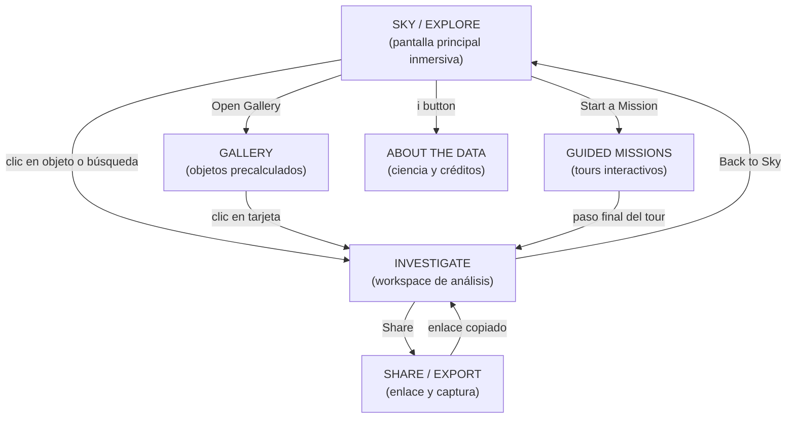

# Especificación UX — [nombre pendiente]

**Visor de series temporales SPHEREx para el reto NASA Space Apps "Planet X and SPHEREx"**
Equipo Na za · 13 de noviembre de 2026 · Responsable: rol E (pipeline + UX) · Documento de diseño, no de código.

> **Procedencia:** borrador redactado por Antigravity (Claude Opus 4.6) a partir de PRODUCT.md y del plan; revisado y corregido por Claude Code. Las afirmaciones científicas marcadas "(validar: rol B)" deben comprobarse con los datos antes de aparecer en la web.

> [!IMPORTANT]
> La interfaz es en **inglés**. Todos los textos de UI propuestos en este documento van en inglés.
> La dirección visual es **inmersiva y oscura** (cielo a pantalla completa estilo Stellarium Web, oscuridad cinematográfica estilo SpaceX), **pero rica y completa**: NO minimalista. Densidad de información alta con jerarquía clara.

---

## Índice

1. [Arquitectura de información y mapa de pantallas](#1-arquitectura-de-información-y-mapa-de-pantallas)
2. [Flujos paso a paso](#2-flujos-paso-a-paso)
3. [Layout de cada pantalla](#3-layout-de-cada-pantalla)
4. [Inventario de estados](#4-inventario-de-estados)
5. [Heurísticas de Nielsen](#5-heurísticas-de-nielsen)
6. [Laws of UX](#6-laws-of-ux)
7. [Atajos de teclado y accesibilidad](#7-atajos-de-teclado-y-accesibilidad)
8. [Microinteracciones y momento pico](#8-microinteracciones-y-momento-pico)
9. [Lista MoSCoW para 25 h](#9-lista-moscow-para-25-h)
10. [Riesgos de UX y test del sábado](#10-riesgos-de-ux-y-test-del-sábado)

---

## 1. Arquitectura de información y mapa de pantallas

### Mapa de pantallas



### Propósito de cada pantalla

| Pantalla | Slug en URL | Propósito | Qué ve el usuario primero |
|---|---|---|---|
| **Sky / Explore** | `/` | Punto de entrada inmersivo. Cielo a pantalla completa con Aladin Lite v3 + HiPS de SPHEREx. Barra de búsqueda flotante y accesos rápidos. El usuario siente que "está en el cielo". | Cielo infrarrojo completo, ligeramente atenuado en los bordes; barra de búsqueda centrada con placeholder *"Enter RA, Dec or an object name…"*; 5 tarjetas flotantes de los objetos del reto en la parte inferior (carousel horizontal). |
| **Investigate** | `/investigate?ra=…&dec=…&det=…&λ=…&frame=…` | Workspace de análisis donde convive el visor de blink/diferencia con el cielo de contexto. Aquí ocurre el trabajo real: reproducir, comparar, medir. | Panel principal con el blink player (izquierda o centro); cielo atenuado visible detrás; panel lateral derecho con épocas, metadatos, perfil D1–D6. |
| **Gallery** | `/gallery` | Colección precalculada de los 5 objetos del reto. Funciona **100 % offline** desde GitHub Pages. Es el plan B de la demo y la puerta de entrada más rápida. | Grid de 5 tarjetas con miniatura animada (3 fotogramas en loop), nombre, tipo de fenómeno ("Moving brown dwarf", "Variable star") y un badge "Offline ready". |
| **Guided Missions** | `/missions` | Tours interactivos paso a paso para recién llegados. Cada misión explica qué buscar y por qué. 2-3 misiones: "Spot a Moving World", "Watch a Star Pulse", "Your First Blink". | Lista de misiones con ilustración, duración estimada (~60 s) y botón "Start". |
| **About the Data** | `/about` | Explicación de SPHEREx, qué es un blink, por qué importa la longitud de onda (LVF), créditos IRSA/SPHEREx/DOI, enlace al reto, el equipo. | Texto con diagramas simples; sección de créditos con logos y texto requerido por IRSA. |
| **Share / Export** | Modal sobre Investigate | Generar un enlace directo (URL con todo el estado), copiar al portapapeles, descargar PNG del fotograma actual o GIF de la secuencia. | Modal con el link pre-seleccionado, botones "Copy Link", "Download Frame (PNG)", "Download Sequence (GIF)". |

### Navegación global

- **Barra superior** (siempre visible, semitransparente sobre el cielo, opaca sobre paneles): logo con el nombre (pendiente) a la izquierda (enlaza a `/`), pestañas centrales *Sky · Gallery · Missions · About*, barra de búsqueda compacta a la derecha (se expande al hacer foco).
- **En Investigate**, la barra de búsqueda está expandida y muestra la coordenada actual. Cambiar la búsqueda navega a una nueva investigación sin perder la anterior en el historial del navegador.
- **Atajo global**: `Ctrl+K` / `⌘K` abre el buscador en modo comando (acepta RA/Dec, nombres, "gallery", "missions").

---

## 2. Flujos paso a paso

### Flujo A — Recién llegado sin conocimientos (meta: ver moverse a WISE 0855 en < 60 s)

| Paso | Tiempo acum. | Pantalla | Acción del usuario | Qué pasa en la interfaz |
|---|---|---|---|---|
| 1 | 0 s | Sky | Llega desde el enlace del proyecto NASA Space Apps. | Cielo inmersivo aparece con fade-in (1 s). Texto *"Explore the infrared sky. Spot what moves."* se desvanece tras 3 s. En la parte inferior, 5 tarjetas de objetos con miniaturas animadas. |
| 2 | 3 s | Sky | Mira las tarjetas. La primera dice **"WISE 0855 — The coldest neighbor"** con una miniatura parpadeante y un badge *"60-second challenge"*. Hace clic. | La tarjeta se expande. La galería precalculada se carga instantáneamente (offline-first). Transición: el cielo hace zoom suave hacia la posición de WISE 0855 y se atenúa. Se abre el workspace Investigate con los datos precalculados. |
| 3 | 6 s | Investigate | Ve el player con 3-4 fotogramas ya cargados. El blink está en pausa con el primer fotograma visible. Un tooltip pulsante dice *"Press Play to see a year of the sky"*. | Player muestra el fotograma con fecha, longitud de onda y detector visibles. Barra de progreso con marcas por época. |
| 4 | 8 s | Investigate | Pulsa ▶ Play. | Blink arranca a 1 fps. Los fotogramas alternan. Un indicador con flecha animada señala *"Watch near the center — do you see it shift?"*. |
| 5 | 15 s | Investigate | Observa. El movimiento es sutil (1.3 px). | Después de 2 ciclos, aparece un botón *"Can't see it? Try Difference mode"* (affordance sutil, no modal). |
| 6 | 20 s | Investigate | Hace clic en "Difference mode". | Se muestra la resta (última – primera época). El punto de movimiento aparece como un dipolo blanco-negro claro. Un caption dice *"The bright-dark pair shows the object moved about 8 arcseconds in a year."* (validar: rol B) |
| 7 | 30 s | Investigate | Hace clic en *"Show predicted path"*. | Una cruz animada marca la posición esperada del objeto en cada época, propagada con movimiento propio y paralaje (Gaia DR3 cuando el objeto está en Gaia; SIMBAD o la literatura para WISE 0855, que es demasiado débil para Gaia). Debe coincidir con lo observado (validar: rol B). |
| 8 | 40 s | Investigate | Explora: cambia velocidad, hace zoom (scroll), prueba otra paleta de color. | Controles responden instantáneamente (WebGL2). |
| 9 | 55 s | Investigate | Hace clic en *"What am I seeing?"* (panel lateral). | Se despliega una explicación: "WISE 0855−0714 is one of the coldest brown dwarfs known…" con el perfil D1–D6 mostrando en qué detectores brilla (se espera D5–D6; validar: rol B). |
| **Total** | **< 60 s** | | **Ha visto el movimiento y entiende qué es.** | |

### Flujo B — Experto que pega RA/Dec

| Paso | Pantalla | Acción | Respuesta |
|---|---|---|---|
| 1 | Cualquiera | Hace `Ctrl+K`, pega `269.45, +4.69` (o `17h57m48.5s +04d41m36s`). | El parser acepta ambos formatos. Autocompletado sugiere "Barnard's Star" si coincide con un objeto conocido, pero no fuerza la selección. |
| 2 | Investigate | Pulsa Enter. | Se envía la petición al backend. El cielo centra la posición. El panel Investigate se abre con un skeleton loader y la barra de progreso honesta: *"Querying IRSA for epochs…"* |
| 3 | Investigate | Espera ~3 s. | Llega la lista de épocas. Se muestra la tabla de épocas en el panel lateral con fechas, detectores y λ. El backend empieza a enviar fotogramas uno a uno. |
| 4 | Investigate | Ve el primer fotograma llegar (~10 s). | El player lo muestra inmediatamente. Barra de progreso: *"Frame 1 of 4 — downloading…"* con un indicador de cuántos faltan y ETA. |
| 5 | Investigate | Mientras espera los demás, abre el panel de metadatos, cambia el detector con el selector D1–D6, ajusta el stretch (asinh/zscale/linear). | Todo responde al instante porque WebGL2 recalcula en el shader. Si cambia el detector, se lanza una nueva petición y la barra de progreso se reinicia. |
| 6 | Investigate | Todos los fotogramas llegan. Activa blink. | Blink a velocidad configurable (0.5–3 fps). |
| 7 | Investigate | Usa teclas `D` para diferencia, `N` para negativo, `C` para compuesto D1–D6. | Modos se alternan. Un badge en el player dice qué modo está activo. |

### Flujo C — Compartir un hallazgo

| Paso | Acción | Respuesta |
|---|---|---|
| 1 | En Investigate, el usuario ve algo interesante y pulsa el botón **Share** (icono de enlace, esquina superior derecha del player). | Se abre el modal Share/Export. La URL ya contiene todo el estado: `ra`, `dec`, `det`, `lambda_um`, `frame`, `mode`, `stretch`, `cmap`. |
| 2 | Pulsa *"Copy Link"*. | El enlace se copia al portapapeles. Toast: *"Link copied — anyone with this URL will see exactly what you see."* |
| 3 | Opcionalmente, pulsa *"Download Frame (PNG)"*. | Se genera un PNG del canvas WebGL con la paleta actual, la fecha, la coordenada y el crédito SPHEREx/IRSA como watermark sutil en la esquina inferior. |
| 4 | El destinatario abre el enlace. | Ve directamente el workspace Investigate con la misma posición, fotograma, modo y paleta. Si los datos no están en caché del backend, se descargan de nuevo con la misma UX de streaming. Si está offline, se muestra un mensaje: *"This view requires a live connection to IRSA. Try one of our offline Gallery objects."* con enlace a Gallery. |

### Flujo D — Demo offline en proyector con wifi inestable

| Paso | Acción | Respuesta |
|---|---|---|
| 1 | Antes de la demo, la persona del rol E abre la web con conexión y navega a Gallery. Los 5 objetos están en caché del Service Worker (precalculados como assets estáticos en GitHub Pages). | Gallery muestra badge "Offline ready ✓" en cada tarjeta. |
| 2 | El wifi del coliseo falla. | La barra superior muestra un icono de nube tachada y un banner sutil: *"Offline — showing precomputed data."* La búsqueda libre se deshabilita (grayed out con tooltip *"Search requires a connection"*). Gallery y Missions siguen funcionando. |
| 3 | Abre WISE 0855 desde Gallery. | Investigate se abre con los datos precalculados. Todos los modos (blink, diferencia, overlay, paletas) funcionan porque WebGL2 opera localmente sobre los datos cacheados. |
| 4 | Navega entre los 5 objetos desde Gallery. | Cada uno carga instantáneamente. |
| 5 | El wifi vuelve. | El banner desaparece. La búsqueda libre se reactiva. Un toast dice *"Back online."* |

---

## 3. Layout de cada pantalla

> En los diagramas, los emojis y `[icon]` solo marcan dónde va un ícono. En la web se usan íconos SVG de una sola familia, nunca emojis.

### 3.1 Sky / Explore (pantalla principal)

```
┌─────────────────────────────────────────────────────────────────┐
│  NAV BAR (semitransparente, z-30)                               │
│  [Logo]             Sky · Gallery · Missions · About   [🔍]     │
├─────────────────────────────────────────────────────────────────┤
│                                                                 │
│                                                                 │
│              ALADIN LITE v3 — CIELO COMPLETO                    │
│              HiPS SPHEREx infrarrojo                            │
│              (ocupa 100% del viewport)                          │
│                                                                 │
│                                                                 │
│          ┌──────────────────────────────────┐                   │
│          │  🔍 Enter RA, Dec or object name… │  ← centrado      │
│          └──────────────────────────────────┘    verticalmente  │
│                                                   en el 40%     │
│                                                   superior     │
│                                                                 │
│   "Explore the infrared sky. Spot what moves."                  │
│   (texto que se desvanece tras 3 s en primera visita)           │
│                                                                 │
├─────────────────────────────────────────────────────────────────┤
│  OBJECT CARDS (carousel horizontal, z-20, fondo con blur)       │
│  ┌─────────┐ ┌─────────┐ ┌─────────┐ ┌─────────┐ ┌─────────┐ │
│  │WISE 0855│ │Barnard  │ │Eps Ind B│ │RW Aur   │ │R Dra    │ │
│  │ 🎬 blink│ │ 🎬 blink│ │ 🎬 blink│ │ 🎬 blink│ │ 🎬 blink│ │
│  │"Coldest │ │"Fastest │ │"Binary  │ │"Erratic │ │"Pulsing │ │
│  │neighbor"│ │star"    │ │dwarfs"  │ │youth"   │ │ giant"  │ │
│  └─────────┘ └─────────┘ └─────────┘ └─────────┘ └─────────┘ │
└─────────────────────────────────────────────────────────────────┘
```

**Jerarquía visual (qué se ve primero):**
1. El cielo inmersivo (fondo completo, impacto emocional).
2. La barra de búsqueda (acción principal, centrada y luminosa sobre fondo oscuro).
3. Las tarjetas de objetos (descubrimiento guiado, atraen con la miniatura animada).
4. El texto "Explore the infrared sky…" (contexto, se desvanece).
5. La navegación (siempre accesible pero no protagonista).

**Cómo convive el cielo inmersivo con la interacción:**
- El cielo de Aladin Lite es **interactivo**: se puede hacer pan/zoom con el ratón.
- Al escribir en la barra de búsqueda, el cielo se atenúa levemente (opacity 0.7) para dar foco al texto. Al confirmar, el cielo hace un zoom suave hacia la coordenada y transiciona a Investigate.
- Las tarjetas flotan sobre el cielo con `backdrop-filter: blur(16px)` y fondo `rgba(0,0,0,0.6)`.

### 3.2 Investigate (workspace de análisis)

```
┌─────────────────────────────────────────────────────────────────┐
│  NAV BAR (opaca)                                                │
│  [← Sky]  [🔍 17h57m48.5s +04°41'36" | Barnard's Star]  [Share]│
├──────────────────────────────────────────┬──────────────────────┤
│                                          │  PANEL LATERAL       │
│                                          │  (ancho: 360px,      │
│       PLAYER PRINCIPAL                   │   scroll vertical)   │
│       (ocupa el resto del ancho)         │                      │
│                                          │  ┌────────────────┐  │
│  ┌────────────────────────────────────┐  │  │ EPOCHS TABLE   │  │
│  │                                    │  │  │ ● May 2025     │  │
│  │     CANVAS WebGL2                  │  │  │ ○ Nov 2025     │  │
│  │     Fotograma actual               │  │  │ ○ Apr 2026     │  │
│  │     (con crosshair de posición     │  │  └────────────────┘  │
│  │      prevista si está activo)      │  │                      │
│  │                                    │  │  ┌────────────────┐  │
│  │     Esquina inf-izq:               │  │  │ DETECTOR SEL.  │  │
│  │     Fecha · λ · Det · Colección    │  │  │ D1 D2 D3 D4    │  │
│  │                                    │  │  │ D5● D6         │  │
│  │     Esquina inf-der:               │  │  │ λ = 4.1 µm     │  │
│  │     Zoom level · Scale bar         │  │  └────────────────┘  │
│  │                                    │  │                      │
│  └────────────────────────────────────┘  │  ┌────────────────┐  │
│                                          │  │ FRAME METADATA │  │
│  ┌────────────────────────────────────┐  │  │ Date: ...      │  │
│  │  TRANSPORT BAR                     │  │  │ λ_center: ...  │  │
│  │  [|◁] [◁] [▶ PLAY] [▷] [▷|]      │  │  │ Collection:... │  │
│  │  ───●──────────── 2/4              │  │  │ Flags: 2.1%    │  │
│  │  Speed: [0.5] [1●] [2] [3 fps]   │  │  │ Obs IDs: ...   │  │
│  │  Mode: [Blink●] [Diff] [Neg] [D1-6]│  │  └────────────────┘  │
│  │  Stretch: [Asinh●] [Linear] [Zsc] │  │                      │
│  │  Cmap: [Grayscale●] [Viridis] […] │  │  ┌────────────────┐  │
│  └────────────────────────────────────┘  │  │ D1–D6 PROFILE  │  │
│                                          │  │  ╭──╮           │  │
│  ┌────────────────────────────────────┐  │  │  │  │  ╭──╮     │  │
│  │  PROGRESS BAR (solo durante carga) │  │  │──┘  └──┘  └──  │  │
│  │  ██████░░░░ Frame 2/4 · ETA ~18s  │  │  │ 0.75    5.0 µm │  │
│  └────────────────────────────────────┘  │  └────────────────┘  │
│                                          │                      │
│  ALADIN CONTEXT (colapsable, 200px alto) │  ┌────────────────┐  │
│  ┌────────────────────────────────────┐  │  │"What am I      │  │
│  │  Aladin Lite minimap               │  │  │ seeing?"       │  │
│  │  (muestra la posición en el cielo  │  │  │ [▼ Expand]     │  │
│  │   completo, con recuadro del FOV)  │  │  └────────────────┘  │
│  └────────────────────────────────────┘  │                      │
├──────────────────────────────────────────┴──────────────────────┤
│  FOOTER: SPHEREx/IRSA acknowledgment · DOI · Na za team        │
└─────────────────────────────────────────────────────────────────┘
```

**Jerarquía visual (qué se ve primero):**
1. El canvas WebGL2 con el fotograma (centro de la atención, ~65% del ancho).
2. La barra de transporte (acción inmediata: Play).
3. La tabla de épocas (orientación temporal).
4. Los metadatos del fotograma (contexto científico).
5. El perfil D1–D6 y la explicación (profundidad).
6. El minimapa Aladin (contexto espacial, colapsable para ganar espacio).

**Cómo conviven cielo y análisis:**
- El cielo de Aladin Lite NO ocupa el fondo completo en Investigate. Aparece como un **minimapa contextual** debajo del player, colapsable. Esto evita que distraiga del análisis.
- Al colapsar Aladin, el player gana esa altura.
- En la **transición Sky → Investigate**, el cielo completo se "contrae" animadamente hacia el minimapa mientras el player y el panel lateral se despliegan desde los lados. Esto mantiene la continuidad visual.

### 3.3 Gallery

```
┌─────────────────────────────────────────────────────────────────┐
│  NAV BAR                                                        │
├─────────────────────────────────────────────────────────────────┤
│                                                                 │
│  GALLERY — Five Windows into the Infrared Sky                   │
│  "These objects are preloaded and work offline."                │
│                                                                 │
│  ┌──────────────┐  ┌──────────────┐  ┌──────────────┐          │
│  │  ████████    │  │  ████████    │  │  ████████    │          │
│  │  ████████    │  │  ████████    │  │  ████████    │          │
│  │  (blink gif) │  │  (blink gif) │  │  (blink gif) │          │
│  │              │  │              │  │              │          │
│  │ WISE 0855    │  │ Barnard's    │  │ Epsilon      │          │
│  │ The coldest  │  │ The fastest  │  │ Indi B       │          │
│  │ neighbor     │  │ star         │  │ Binary brown │          │
│  │              │  │              │  │ dwarfs       │          │
│  │ ☁️✓ Offline  │  │ ☁️✓ Offline  │  │ ☁️✓ Offline  │          │
│  │ [icon] Moving│  │ [icon] Moving│  │ [icon] Moving│          │
│  │ [Investigate]│  │ [Investigate]│  │ [Investigate]│          │
│  └──────────────┘  └──────────────┘  └──────────────┘          │
│                                                                 │
│  ┌──────────────┐  ┌──────────────┐                            │
│  │  ████████    │  │  ████████    │                            │
│  │  (blink gif) │  │  (blink gif) │                            │
│  │ RW Aurigae   │  │ R Draconis   │                            │
│  │ Erratic      │  │ Pulsing      │                            │
│  │ youth        │  │ giant        │                            │
│  │ ☁️✓ Offline  │  │ ☁️✓ Offline  │                            │
│  │ [icon] Variable│  │ [icon] Variable│                            │
│  │ [Investigate]│  │ [Investigate]│                            │
│  └──────────────┘  └──────────────┘                            │
└─────────────────────────────────────────────────────────────────┘
```

- Tarjetas grandes (min 280px) para que la miniatura animada sea legible en proyector.
- Dos categorías señaladas con badges: "Moving" (movimiento propio) y "Variable" (cambio de brillo).
- Cada tarjeta tiene una frase de gancho que cuenta la historia del objeto.

### 3.4 Guided Missions

```
┌─────────────────────────────────────────────────────────────────┐
│  NAV BAR                                                        │
├─────────────────────────────────────────────────────────────────┤
│                                                                 │
│  MISSIONS — Learn by Doing                                      │
│                                                                 │
│  ┌───────────────────────────────────────────────────────────┐  │
│  │ 🔭 MISSION 1: Spot a Moving World                (~60 s) │  │
│  │ "In 1930, Pluto was discovered by blinking    │  │
│  │  two photos. You'll do the same — with a cold brown      │  │
│  │  dwarf, using NASA's newest infrared telescope."         │  │
│  │                                               [Start →]  │  │
│  └───────────────────────────────────────────────────────────┘  │
│                                                                 │
│  ┌───────────────────────────────────────────────────────────┐  │
│  │ [icon] MISSION 2: Watch a Star Pulse                 (~45 s) │  │
│  │ "Some stars breathe — their brightness rises and falls   │  │
│  │  over months. Find the rhythm of R Draconis."            │  │
│  │                                               [Start →]  │  │
│  └───────────────────────────────────────────────────────────┘  │
│                                                                 │
│  ┌───────────────────────────────────────────────────────────┐  │
│  │ 🎯 MISSION 3: Your First Blink                   (~30 s) │  │
│  │ "Learn the controls: blink, difference, zoom, color.     │  │
│  │  Then pick any object and explore on your own."           │  │
│  │                                               [Start →]  │  │
│  └───────────────────────────────────────────────────────────┘  │
└─────────────────────────────────────────────────────────────────┘
```

- Cada misión es una secuencia de 4-6 pasos con tooltips directivos superpuestos al workspace Investigate (estilo onboarding con spotlight).
- Al completar una misión, aparece un badge/confetti sutil y un CTA: *"Now try your own coordinates."*

### 3.5 About the Data

- Estructura de scroll vertical largo (one-pager informativo).
- Secciones: **What is SPHEREx?** (diagrama del telescopio, 6 detectores, LVF explicado visualmente) → **What is a blink?** (descubrimiento de Plutón, con la imagen histórica) → **Why wavelength matters** (diagrama LVF: misma estrella, distinto brillo por longitud de onda) → **The five test objects** (tabla con datos) → **Credits & Acknowledgments** (texto IRSA obligatorio, DOI, logos SPHEREx/NASA/IRSA, enlace al reto) → **Team Na za** (fotos y roles).

### 3.6 Share / Export (modal)

- Modal centrado, fondo oscuro con blur.
- URL pre-seleccionada en un campo de texto readonly.
- Tres botones: **Copy Link** (icono clipboard), **Download Frame (PNG)** (icono imagen), **Download Sequence (GIF)** (icono película).
- El PNG incluye un watermark sutil: fecha, coordenada, "SPHEREx / IRSA / [nombre]".
- Si no hay datos cargados (offline parcial), los botones de descarga se deshabilitan con tooltip explicativo.

---

## 4. Inventario de estados

### 4.1 Sky / Explore

| Estado | Visual | Comportamiento |
|---|---|---|
| **Primera visita** | Texto de bienvenida visible, cielo con animación lenta de rotación, tarjetas con animación de entrada staggered (cada una aparece con 100 ms de retardo). | `localStorage` guarda que ya visitó; en la segunda visita el texto de bienvenida no aparece. |
| **Cargando Aladin HiPS** | El fondo muestra un gradiente oscuro radial (simulando el cielo) con un spinner circular sutil y *"Loading the sky…"*. | Si falla tras 10 s, se muestra una imagen estática del cielo con un aviso *"Sky view unavailable — you can still search and use the Gallery."* |
| **Sin cobertura** | N/A (Sky muestra todo el cielo). | — |
| **Error de Aladin/CDN** | Fondo estático oscuro, búsqueda y tarjetas funcionan. Banner: *"Interactive sky map unavailable. Search and Gallery still work."* | — |
| **Offline** | Nube tachada en la barra. Cielo estático o cacheado. Búsqueda deshabilitada (input gris, tooltip: *"Search requires a connection"*). Tarjetas de Gallery siguen funcionando (enlace directo). | — |
| **Móvil (< 768px)** | Cielo ocupa viewport. Barra de búsqueda en la parte superior (no centrada). Tarjetas en carousel de scroll horizontal, más pequeñas. Navegación en hamburger. | Touch: tap para buscar, swipe para tarjetas. |
| **Teclado** | `Tab` → barra de búsqueda → tarjetas (en orden). `Enter` en tarjeta la abre. `Ctrl+K` abre búsqueda. | Focus ring visible de 2 px con el color de foco de DESIGN.md. |

### 4.2 Investigate

| Estado | Visual | Comportamiento |
|---|---|---|
| **Cargando — consulta de épocas** | Player muestra skeleton con pulso. Texto: *"Querying IRSA for observations at 17h57m…"*. Spinner orbital sutil. | Si tarda > 5 s, aparece *"IRSA is responding slowly. Hang tight…"* |
| **Cargando — streaming de fotogramas** | **Barra de progreso honesta** debajo del player: barra segmentada (un segmento por fotograma esperado). Segmentos se llenan de izquierda a derecha. Texto: *"Frame 1 of 4 — downloading… ~18 s remaining"*. El primer fotograma aparece en el player en cuanto llega; los demás se añaden al slider conforme llegan. | ETA basada en el tiempo del primer fotograma (8-10 s × fotogramas restantes). Si un fotograma falla, su segmento se marca en rojo con icono de retry. |
| **Parcial (1 de N fotogramas)** | Player muestra el fotograma disponible. Blink deshabilitado (necesita ≥ 2). Diferencia deshabilitada (necesita ≥ 2). Texto: *"1 frame loaded — waiting for more to enable blink."* | El usuario puede hacer zoom, cambiar paleta, ver metadatos. |
| **Completo** | Barra de progreso desaparece (fade out). Todos los controles habilitados. Badge: *"All 4 frames loaded ✓"* (desaparece tras 3 s). | — |
| **Sin cobertura SPHEREx** | Player muestra un icono de cielo vacío. Texto: *"No SPHEREx observations found at this position. SPHEREx covers the full sky, but not all regions have multiple epochs yet."*. CTA: *"Try one of our Gallery objects →"*. | No se muestra un error, sino una explicación honesta. |
| **Error de IRSA/backend** | Icono de servidor con rayo. Texto: *"Couldn't reach the data server. This might be temporary."*. Botón: *"Retry"*. Debajo: *"Or explore offline: [Gallery →]"*. Si el objeto es uno de los 5 precalculados, botón adicional: *"Load precomputed data"*. | Retry automático 1 vez tras 5 s. Después, manual. |
| **Error de backend dormido (HF Spaces)** | Texto específico: *"Our server is waking up — this can take up to 30 seconds."*. Barra de progreso indeterminada. | TanStack Query con retry y backoff. |
| **Offline con galería** | Si el objeto es precalculado: se carga desde caché. Badge: *"Offline — showing precomputed data"*. Si no: mensaje *"This position requires a live connection."* + CTA Gallery. | — |
| **Movimiento reducido (`prefers-reduced-motion`)** | Blink NO arranca automáticamente. En lugar de animación, se muestra un layout **side-by-side** (2 fotogramas juntos) con un slider para comparar. El botón Play dice *"Animate (motion)"* con un icono de advertencia. | Diferencia estática funciona igual. |
| **Daltonismo** | Las paletas perceptualmente uniformes (Viridis, Inferno, Cividis) llevan la etiqueta "CVD-safe" en el selector. La paleta por defecto es Grayscale (segura para todos). | — |
| **Fotosensibilidad** | Con `prefers-reduced-motion` el blink no arranca solo y se ofrece side-by-side. Sin esa preferencia, la velocidad máxima es **3 fps** (WCAG 2.3.1: no más de tres destellos por segundo). | — |
| **Móvil** | Panel lateral se convierte en un **bottom sheet** deslizable (empieza colapsado mostrando solo las épocas). Player ocupa el ancho completo. Transport bar simplificada: Play/Pause, slider, modo. | Gestos: pinch-to-zoom en el canvas, swipe horizontal en el slider de fotogramas. |
| **Teclado** | Ver sección 7. Todos los controles son alcanzables con Tab. El canvas tiene `tabindex=0` y responde a flechas (pan) y +/- (zoom). | — |

### 4.3 Gallery

| Estado | Visual | Comportamiento |
|---|---|---|
| **Normal** | 5 tarjetas con miniaturas animadas. | — |
| **Offline** | Idéntico a normal (todo es estático). Banner sutil: *"Offline mode — Gallery is fully available."* | — |
| **Móvil** | Tarjetas en columna de 1, scroll vertical. | — |

### 4.4 Guided Missions

| Estado | Visual | Comportamiento |
|---|---|---|
| **Normal** | Lista de misiones. | — |
| **En progreso** | La misión activa se superpone como una barra de pasos en la parte inferior del workspace Investigate. Paso actual destacado. Botones: *"Next"*, *"Skip"*, *"Exit Mission"*. | El progreso no se persiste (es una sesión). |
| **Completada** | Badge de completado. Confetti sutil (respeta `prefers-reduced-motion`). CTA: *"Now try your own coordinates."* | — |
| **Offline** | Funciona si usa objetos de Gallery (los datos están precalculados). Misiones que necesiten búsqueda libre se marcan: *"Requires connection"*. | — |
| **Móvil** | Pasos de misión como bottom toast en lugar de barra inferior. | — |

---

## 5. Heurísticas de Nielsen

| # | Heurística | Implementación concreta en la app |
|---|---|---|
| **1** | **Visibilidad del estado del sistema** | **Barra de progreso segmentada durante la descarga de fotogramas.** Cada segmento = 1 fotograma. Se llena en tiempo real. Muestra ETA numérica basada en el primer frame (ej: *"Frame 2/4 · ~18 s remaining"*). Al completar, badge verde *"All frames loaded ✓"*. Indicador offline/online persistente. Modo actual (Blink/Diff/Neg) visible como badge en el player. |
| **2** | **Coincidencia entre el sistema y el mundo real** | Lenguaje llano en la capa pública: *"Spot what moves"*, no "execute astrometric analysis". Metáfora de blink = "parpadear entre fotos", como en el descubrimiento de Plutón (la historia del About). Los 6 detectores se muestran como botones D1–D6 con el rango de longitud de onda en µm, no como códigos internos. Fechas en formato humano (*"May 2025"*) con la fecha ISO en tooltip. |
| **3** | **Control y libertad del usuario** | **Undo implícito:** el historial del navegador registra cada cambio de estado en la URL (TanStack Router). Atrás/Adelante del navegador funciona como undo/redo de la vista. Botón *"← Back to Sky"* siempre visible. En Guided Missions: *"Exit Mission"* en cada paso. |
| **4** | **Consistencia y estándares** | La barra de transporte usa los iconos estándar de reproductores de video (⏮ ⏪ ▶ ⏩ ⏭). "Play" siempre está en la misma posición. Atajos de teclado siguen convenciones de video (Space = play/pause, ← → = frame anterior/siguiente). Copy link usa el icono de clipboard estándar con feedback *"Copied"*. |
| **5** | **Prevención de errores** | **Coordenadas:** el parser acepta múltiples formatos (decimal, sexagesimal, con/sin separadores). Si el formato no se reconoce, muestra en tiempo real *"Try: 269.45, +4.69 or 17h57m48.5s +04°41'36""*. **Detector:** si el usuario elige un detector donde el objeto no es visible (ej: D1 para WISE 0855), se muestra un aviso *"This object is very faint below 3 µm — try D5 or D6"* en vez de un frame negro. **Longitud de onda:** el selector solo ofrece valores con datos reales. |
| **6** | **Reconocimiento antes que recuerdo** | Las 5 tarjetas de Gallery están siempre a un clic (en Sky y en el sidebar de Investigate como *"Quick picks"*). El detector y la longitud de onda activos se muestran en el canvas, no solo en el selector. La URL contiene todo el estado: el usuario no necesita recordar qué configuración usó; al volver al enlace, todo está igual. |
| **7** | **Flexibilidad y eficiencia de uso** | **Novatos:** tarjetas de un clic, misiones guiadas, tooltips. **Expertos:** atajos de teclado completos (ver sección 7), búsqueda por comando (`Ctrl+K`), URL con todos los parámetros (bookmarkeable), panel de metadatos expandible. **Acelerador:** doble clic en el cielo de Sky va directo a Investigate con esas coordenadas. |
| **8** | **Diseño estético y minimalista** | El player no tiene bordes ni decoración; la imagen es el protagonista. Los metadatos están en el panel lateral, no sobre la imagen. La información progresiva (disclosure) evita mostrar todo a la vez: el perfil D1–D6 y el bloque *"What am I seeing?"* están colapsados por defecto y se expanden al hacer clic. Los textos decorativos (bienvenida) se desvanecen solos. **Pero la interfaz es rica:** muchos controles y datos están presentes, solo jerarquizados. |
| **9** | **Ayudar al usuario a reconocer, diagnosticar y recuperarse de errores** | **Error de IRSA:** mensaje específico (*"Couldn't reach the data server"*), no genérico (*"Error 500"*). Acción clara (*"Retry"* + *"Load precomputed data"*). **Sin cobertura:** explicación educativa, no error (*"SPHEREx covers the full sky, but…"*). **Frame fallido:** solo ese segmento se marca en rojo; los demás siguen; botón retry individual. **Backend dormido:** mensaje honesto con progreso (*"Our server is waking up…"*). |
| **10** | **Ayuda y documentación** | **Contextual:** tooltip en cada control con su atajo de teclado. *"What am I seeing?"* en el sidebar de Investigate con explicación del objeto y del fenómeno. **Estructural:** About the Data explica SPHEREx, blink y LVF. **Onboarding:** Guided Missions son la documentación interactiva. **Último recurso:** enlace al reto NASA y a los tutoriales de IRSA en About. |

---

## 6. Laws of UX

| Ley | Aplicación concreta en la app |
|---|---|
| **Ley de Jakob** | La barra de transporte imita un reproductor de video (YouTube, Spotify): Play central, slider, velocidad. Los usuarios ya saben usarla. La búsqueda con `Ctrl+K` imita VS Code / Spotlight. La galería es un grid de tarjetas como Netflix. El share modal es idéntico al de Google Maps/Docs. |
| **Ley de Fitts** | El botón **Play** (acción principal) es el más grande de la barra de transporte (48×48 px mínimo, 64×64 en desktop). Las tarjetas de Gallery son áreas de clic grandes (280×360 px mínimo). El botón *"Retry"* en errores es grande y centrado. En móvil, los controles del player están en el borde inferior (zona del pulgar). |
| **Ley de Hick** | **En Sky:** el usuario decide entre exactamente 3 caminos claros: (1) buscar coordenadas, (2) elegir un objeto precalculado, (3) iniciar una misión guiada. No hay un cuarto. **En Investigate:** los modos son 4 botones excluyentes (Blink, Diff, Neg, D1–6), no un menú desplegable con 12 opciones. Las paletas son 5 (Grayscale, Viridis, Inferno, Cividis, Cubehelix), no 25. |
| **Ley de Miller (7±2)** | La tabla de épocas muestra 3-5 filas (el máximo real de SPHEREx en este periodo). Los detectores son 6 botones (D1–D6). Las tarjetas de Gallery son 5. Los pasos de una misión son 4-6. Los atajos de teclado son ~12 (memorizables). Todo está dentro de 7±2. |
| **Doherty Threshold (< 400 ms)** | **Problema:** IRSA tarda 8-10 s por fotograma. **Solución en 4 capas:** (1) **Respuesta inmediata (< 100 ms):** al pulsar Play, el blink inicia al instante con los fotogramas ya descargados. Al cambiar paleta/stretch/zoom, WebGL2 recalcula en < 16 ms (un frame de GPU). (2) **Feedback instantáneo (< 400 ms):** al enviar una búsqueda, el cielo inicia el zoom en < 300 ms. El skeleton del player aparece en < 200 ms. La barra de progreso empieza a llenar el primer segmento inmediatamente (indeterminate → determinate al llegar datos). (3) **Streaming:** los fotogramas llegan de uno en uno y se muestran conforme llegan; el usuario interactúa con el primero mientras los demás descargan. (4) **Precálculo:** los 5 objetos de Gallery cargan en < 50 ms desde caché/Service Worker. **Resultado:** la *percepción* es de < 400 ms porque siempre hay algo nuevo que ver o hacer, aunque el dato subyacente tarde 10 s. |
| **Ley de Tesler (conservación de la complejidad)** | La complejidad irreductible de SPHEREx (longitud de onda variable, detectores, reprojectión) la absorbe el backend, NO el usuario. El usuario no elige longitud de onda manualmente en el primer uso: el sistema elige la λ con mejor señal para ese objeto (para WISE 0855 se espera D5–D6; validar: rol B). El selector de detector y λ está en el panel lateral para quien quiera ajustar. La alineación por WCS es automática y transparente. |
| **Ley de Postel (robustez)** | El campo de búsqueda acepta: coordenadas decimales (`269.45 4.69`), sexagesimales (`17h57m48.5s +04°41'36"`), con coma o espacio, con o sin signos, nombres de objetos (`Barnard's Star`, `wise 0855`, `WISE 0855-0714`), y coordenadas en la URL (`?ra=269.45&dec=4.69`). Salida siempre consistente: coordenadas en J2000 decimal con 5 decimales. |
| **Peak-End Rule** | El **momento pico** es cuando el usuario ve el movimiento por primera vez (ya sea en blink o en la imagen de diferencia). Se refuerza con el indicador de posición prevista que confirma: "sí, esto es real". El **momento final** es el modal de Share con el mensaje *"You just spotted a moving object in NASA's infrared sky"* y la posibilidad de descargar la imagen con la coordenada impresa. Ver sección 8 para más detalle. |
| **Efecto Von Restorff (aislamiento)** | La tarjeta de WISE 0855 en la Gallery tiene un badge dorado pulsante: *"60-second challenge"*. Es la única con ese badge, la hace memorable y la diferencia de las demás. En la imagen de diferencia, el dipolo de movimiento (blanco-negro) destaca naturalmente del ruido gris; la flecha animada lo señala. En la barra de progreso, el segmento que está descargándose tiene un brillo pulsante distinto de los ya completados (estáticos) y los pendientes (dim). |
| **Efecto Zeigarnik** | La barra de progreso segmentada crea tensión al mostrar cuántos fotogramas faltan: *"Frame 2 of 4"*. El usuario quiere quedarse hasta que se complete. En Guided Missions, la barra de pasos (3/6) crea el mismo impulso de completar. En Gallery, si el usuario ha explorado 3 de 5 objetos, los no visitados podrían mostrar un indicador sutil *"Not explored yet"* (si da tiempo). |
| **Goal-Gradient** | En la barra de progreso, el texto cambia conforme se acerca al final: *"Almost there — 1 frame left"*. La velocidad percibida de la barra no es lineal: el segmento actual muestra un progreso interno (la descarga HTTP) además del progreso global. En Guided Missions, el paso final dice *"Last step!"* |
| **Serial Position (primacía y recencia)** | En las tarjetas de Gallery, **WISE 0855** va primero (es el mejor para la demo: movimiento claro, historia atractiva) y **R Draconis** va último (el caso más complejo: variable Mira). El primer y último objeto son los que mejor se recuerdan. En la barra de transporte, Play va al centro (posición de honor) y los modos de visualización van al final (se descubren después). |
| **Aesthetic-Usability Effect** | La estética oscura e inmersiva (cielo real como fondo, transiciones suaves, tipografía limpia) genera una primera impresión de calidad que hace que los usuarios toleren los 8-10 s de espera de IRSA. Un diseño utilitario tipo WiseView haría que la espera se sienta como un bug; un diseño cinematográfico la hace sentir como preparación. |
| **Occam's Razor** | Solo un campo de entrada, no un formulario con RA, Dec, radio, detector, colección y formato por separado (como IRSA Firefly). Las tarjetas de Gallery no tienen filtros ni ordenamiento: son solo 5. La barra de transporte tiene un solo slider (fotogramas), no uno por dimensión. |
| **Gestalt — Proximidad** | En Investigate, la fecha, la longitud de onda y el detector del fotograma actual están agrupados en la esquina inferior izquierda del canvas, formando un bloque de "identidad del frame". En el panel lateral, la tabla de épocas y el selector de detector están contiguos (ambos son "elección temporal/espectral"). |
| **Gestalt — Región común** | El panel lateral de Investigate tiene un fondo ligeramente más claro que el canvas (`rgba(255,255,255,0.04)` sobre el fondo `#0a0a0f`), creando una región visual que agrupa épocas + metadatos + perfil. La barra de transporte tiene su propio fondo con blur, separándola del canvas. |
| **Gestalt — Similitud** | Todos los botones de modo (Blink, Diff, Neg, D1–6) tienen la misma forma (pill), tamaño y color de fondo. Los botones de velocidad (0.5, 1, 2, 3 fps) son idénticos entre sí pero distintos de los de modo (chips más pequeños). Esto comunica "estos son un grupo de opciones del mismo tipo". |
| **Gestalt — Conexión uniforme** | En el perfil D1–D6, los puntos de cada detector están conectados por una línea que muestra la forma espectral. La línea une visualmente lo que de otro modo serían 6 puntos sueltos. En la tabla de épocas, una línea vertical (timeline) conecta las fechas. |
| **Gestalt — Prägnanz (simplicidad)** | El layout de Investigate es un split sencillo: canvas grande a la izquierda, panel estrecho a la derecha. No hay paneles flotantes sobre el canvas ni layouts anidados complejos. Las tarjetas de Gallery son rectángulos uniformes con imagen arriba y texto abajo. Toda la estructura es parseable en < 2 s. |

---

## 7. Atajos de teclado y accesibilidad

### 7.1 Atajos de teclado

| Tecla | Contexto | Acción | Tooltip en el control |
|---|---|---|---|
| `Space` | Investigate | Play / Pause blink | "Play (Space)" |
| `←` | Investigate | Fotograma anterior | "Previous frame (←)" |
| `→` | Investigate | Fotograma siguiente | "Next frame (→)" |
| `Home` | Investigate | Primer fotograma | — |
| `End` | Investigate | Último fotograma | — |
| `[` | Investigate | Velocidad más lenta | — |
| `]` | Investigate | Velocidad más rápida | — |
| `B` | Investigate | Modo Blink | "Blink (B)" |
| `D` | Investigate | Modo Difference | "Difference (D)" |
| `N` | Investigate | Modo Negative | "Negative (N)" |
| `C` | Investigate | Modo Composite D1–D6 | "Composite (C)" |
| `1`–`6` | Investigate | Seleccionar detector D1–D6 | "D1 (1)" … "D6 (6)" |
| `+` / `=` | Investigate | Zoom in | — |
| `-` | Investigate | Zoom out | — |
| `0` | Investigate | Zoom reset (fit to view) | — |
| `F` | Investigate | Fullscreen del player | "Fullscreen (F)" |
| `M` | Investigate | Toggle metadata panel | — |
| `P` | Investigate | Toggle predicted position overlay | — |
| `S` | Investigate | Abrir Share modal | "Share (S)" |
| `Ctrl+K` / `⌘K` | Global | Abrir búsqueda / command palette | — |
| `Escape` | Global | Cerrar modal / salir de fullscreen / exit mission | — |
| `?` | Global | Mostrar cheatsheet de atajos (overlay) | — |

### 7.2 Accesibilidad — WCAG 2.2 AA

| Criterio WCAG | Implementación |
|---|---|
| **1.1.1 Non-text Content** | Cada fotograma tiene `aria-label` con la descripción: *"SPHEREx observation of [object] on [date] at [λ] µm, detector [D], epoch [n] of [total]"*. Las miniaturas de Gallery tienen alt text. |
| **1.2.1 Audio-only / Video-only** | El blink es una secuencia de imágenes, no un video. Cada fotograma es accesible individualmente con su descripción. El modo side-by-side (reduced motion) proporciona la alternativa estática. |
| **1.4.1 Use of Color** | El movimiento no se comunica solo con color. En modo Difference, el dipolo tiene labels textuales *"moved from"* / *"moved to"* además del contraste visual. Los badges "Moving" y "Variable" usan íconos SVG de una misma familia (p. ej. Lucide) además de color. |
| **1.4.3 Contrast (Minimum)** | Texto sobre fondos oscuros: mínimo 4.5:1. Texto blanco (`#F4F4F6`) sobre fondo oscuro (`#0a0a0f`) = ratio ~18:1. Texto sobre paneles con blur: el fondo tiene un minimum `rgba(0,0,0,0.6)` que garantiza el contraste. Verificar con axe-core en el build. |
| **1.4.11 Non-text Contrast** | Bordes de controles, iconos y gráficos: mínimo 3:1 contra el fondo. Los botones del player tienen borde `rgba(255,255,255,0.2)` sobre `#0a0a0f` = ~3.5:1. |
| **2.1.1 Keyboard** | Todos los controles son alcanzables con Tab (ver tabla de atajos). El canvas WebGL tiene `tabindex=0` y maneja flechas/+/-. |
| **2.1.2 No Keyboard Trap** | `Escape` cierra cualquier modal o overlay. `Tab` siempre avanza; nunca queda atrapado en el canvas (Tab sale al siguiente control). |
| **2.3.1 Three Flashes or Below Threshold** | El blink está limitado a **3 fps máximo**: nunca más de tres cambios por segundo. Con `prefers-reduced-motion`, no arranca solo y se usa side-by-side. **Nunca hay un flash a blanco completo.** |
| **2.4.7 Focus Visible** | Focus ring de 2 px con desplazamiento de 2 px en todos los controles, con el color de foco de DESIGN.md y contraste ≥ 3:1 sobre el fondo. |
| **2.5.1 Pointer Gestures** | Pinch-to-zoom en el canvas tiene alternativa: botones +/- y teclas +/-. Pan con drag tiene alternativa: flechas del teclado. |
| **4.1.2 Name, Role, Value** | Radix UI primitives proporcionan los roles ARIA correctos. El slider del player es `role="slider"` con `aria-valuemin`, `aria-valuemax`, `aria-valuenow` y `aria-valuetext` (ej: *"Frame 2 of 4, November 2025"*). |

### 7.3 Daltonismo

- **Paleta por defecto: Grayscale.** Segura para todos los tipos de daltonismo.
- Paletas marcadas como **CVD-safe** (aptas para deficiencias de visión del color): Viridis, Cividis, Inferno, con esa etiqueta de texto en el selector.
- Paletas **no recomendadas** para CVD (rainbow, jet): **no se incluyen**. Solo paletas perceptualmente uniformes.
- El perfil D1–D6 usa colores + formas de marcador distintas (círculo, cuadrado, triángulo…) + labels directos por detector.
- Los badges "Moving" y "Variable" usan icono + texto, no solo color.

### 7.4 Fotosensibilidad del blink

- `prefers-reduced-motion: reduce` → blink no arranca automáticamente; se ofrece **side-by-side** con slider como alternativa principal. El botón Play dice *"Animate (motion)"* como advertencia opt-in.
- Sin esa preferencia, velocidad máxima 3 fps (WCAG 2.3.1).
- El modo Difference es **estático** (no parpadea) y se promueve como alternativa para ver el movimiento sin blink.
- El blink NUNCA alterna con un fotograma blanco o negro entre imágenes (sería el patrón más peligroso). Siempre alterna entre dos imágenes de brillo similar.

---

## 8. Microinteracciones y momento pico

### 8.1 Microinteracciones clave

| Momento | Microinteracción | Duración | Detalle |
|---|---|---|---|
| **Búsqueda: validación de coordenadas** | Mientras el usuario escribe, un indicador debajo del input muestra en tiempo real si el formato es válido (✓ verde) o no (sugerencia del formato correcto). Al reconocer un nombre de objeto conocido, aparece su miniatura a la derecha del input. | Instantáneo | Parser en cada keystroke (debounced 150 ms para la miniatura). |
| **Transición Sky → Investigate** | El cielo de Aladin hace un **zoom suave** (ease-out, 800 ms) hacia la coordenada. Simultáneamente, el fondo se oscurece (`opacity` del cielo baja de 1 a 0.3), el player se desliza desde la izquierda y el panel lateral desde la derecha. Al terminar, el cielo se reduce al minimapa. | 800 ms | Con `prefers-reduced-motion`, es un crossfade instantáneo (200 ms). |
| **Llegada de un fotograma** | El segmento correspondiente en la barra de progreso se llena con una animación de "pour" (izquierda a derecha, 300 ms). El fotograma aparece en el player con un fade-in rápido (200 ms). Si es el primer fotograma, el skeleton desaparece. | 300 ms | Sonido deshabilitado por defecto (no estándar en web). |
| **Play/Pause** | El icono muta de ▶ a ⏸ con un morph SVG sutil (150 ms). Al pausar, el fotograma actual recibe un borde pulsante tenue (1 s) para indicar "estás aquí". | 150 ms | — |
| **Cambio de modo (Blink → Diff)** | Crossfade entre el fotograma de blink y la imagen de diferencia (200 ms). El botón de modo activo recibe un fondo más brillante con una transición de 150 ms. | 200 ms | — |
| **Cambio de paleta/stretch** | El canvas WebGL actualiza en < 16 ms (un frame de GPU). No hay transición perceptible: es instantáneo, lo que refuerza la sensación de control directo. | < 16 ms | — |
| **Copy Link** | El botón cambia de "Copy Link" a "✓ Copied!" con un scale bounce (scale 1 → 1.1 → 1, 300 ms). El texto vuelve a "Copy Link" tras 2 s. | 300 ms + 2 s | — |
| **Error / Retry** | El segmento fallido en la barra de progreso se marca con un shake horizontal sutil (3 ciclos, 300 ms) y cambia a rojo con un icono de retry. Al hacer clic en retry, el segmento vuelve a su estado de "descargando" (azul pulsante). | 300 ms | — |
| **Badge "All frames loaded ✓"** | Aparece con un slide-down (200 ms) y desaparece tras 3 s con un fade-out (500 ms). | 200 ms + 3 s | — |
| **Tooltip de posición prevista** | Al activar *"Show predicted path"*, la cruz de posición aparece con una animación de "drawing" (el trazo se dibuja en 400 ms). Cada cruz de época aparece con un delay staggered de 200 ms. | 400 ms por cruz | Refuerza la narrativa temporal. |

### 8.2 El momento pico de la demo

> [!IMPORTANT]
> **El momento pico es la primera vez que el usuario (o el juez) ve el objeto moverse.** Todo el diseño de la app converge en este instante. Debe ser inconfundible, emocionante y rápido.

**Secuencia diseñada para el pico (con WISE 0855, el objeto de demo principal):**

1. **Contexto previo (5 s):** El cielo inmersivo centra a WISE 0855. El texto *"One of the coldest brown dwarfs known, just 7.4 light-years away"* aparece brevemente (validar: rol B). El player muestra el primer fotograma con la posición estática.

2. **El pico — opción A: Blink** (10 s): El presentador pulsa Play. Los 3-4 fotogramas alternan a 1 fps. Hay una pausa dramática natural entre cada fotograma. El indicador *"Watch near the center"* dirige la atención. El movimiento de ~1.3 px es sutil pero real. Si el público no lo ve, el presentador pulsa D para diferencia (pico B).

3. **El pico — opción B: Difference** (instantáneo): La imagen de diferencia revela el dipolo blanco-negro de movimiento. Este es el momento "¡ajá!". Se refuerza con:
   - Una caption animada: *"It moved about 8 arcseconds in a year."* (validar: rol B)
   - La cruz de posición prevista que aparece y **coincide** con el dipolo.
   - El perfil D1–D6 se despliega mostrando en qué detectores brilla WISE 0855: *"So cold it shines mostly at the longest infrared wavelengths."* (validar: rol B con el perfil real)

4. **Resolución emocional** (5 s): El presentador explica: "We didn't discover this — this tool helps anyone confirm known motion with real NASA data." El botón Share está visible: *"You could share this exact view with anyone in the world."*

**Por qué funciona:** El pico combina sorpresa visual (el objeto SE MUEVE o el dipolo APARECE) con comprensión intelectual (la cruz confirma que es real, el perfil explica por qué). Peak-End Rule: este momento pico y el momento final (Share con mensaje celebratorio) son lo que los jueces recordarán.

**Fallback para la demo:** Si IRSA no responde o el wifi falla, todo lo anterior funciona con datos precalculados de Gallery. El pico no depende de la conexión.

---

## 9. Lista MoSCoW para 25 h

> [!NOTE]
> Roles (ver `ROLES.md`): **A** = infraestructura de datos y API, **B** = ciencia, **C** = motor WebGL, **D** = app React e implementación visual, **E** = pipeline de fotogramas + UX. Donde abajo dice "E" para construir interfaz, **construye D con la especificación y la revisión de E**.

### MUST HAVE (sin esto no se presenta)

| # | Función | Rol principal | Apoyo | Horas est. | Entregable |
|---|---|---|---|---|---|
| M1 | Campo de búsqueda RA/Dec (parser multi-formato) | D | E (diseño del input) | 2 h | Input funcional que parsea decimal y sexagesimal |
| M2 | Resolución de nombres (SIMBAD/Sesame → RA/Dec + PM) | A | B (verificación de PM) | 2 h | `/api/resolve` en producción |
| M3 | Consulta de épocas en IRSA TAP | A | B (selección de λ) | 3 h | `/api/epochs` con filtro por λ y detector |
| M4 | Descarga de recortes en paralelo + caché en disco | A | — | 4 h | `/api/frames` streaming frame a frame |
| M5 | Reproyección y alineación por época a λ comparable | E (pipeline) | B (algoritmo de λ), A (integración en API) | 4 h | Módulo `science/` con tests para los 5 objetos |
| M6 | Player WebGL2: renderizar float32 con stretch (asinh) y paleta (grayscale, viridis) | C | — | 4 h | Canvas que muestra 1 fotograma con contraste ajustable |
| M7 | Blink: alternar fotogramas con Play/Pause/velocidad/slider | C | D (controles UI) | 2 h | Blink a 0.5-3 fps con ≥ 2 fotogramas |
| M8 | Barra de progreso honesta (streaming) | D | E (diseño) | 1 h | Barra segmentada con ETA |
| M9 | Galería precalculada de 5 objetos (offline-first) | E (pipeline) | D (Service Worker) | 2 h | Assets estáticos en Pages, cargables sin red |
| M10 | Coordenadas en la URL (linkable state) | D | — | 1 h | `?ra=…&dec=…` restaura la vista completa |
| M11 | Layout de Investigate con player + panel lateral | E | D (componentes) | 2 h | Estructura responsiva |
| M12 | 5 tarjetas de objetos (Gallery cards) con miniatura | E | D | 1 h | Tarjetas en Sky y en Gallery |
| M13 | Créditos SPHEREx/IRSA/DOI en About y footer | E | — | 0.5 h | Textos requeridos visibles |
| M14 | Accesibilidad básica: focus ring, aria-labels, contraste AA | E | D | 1 h | Verificación con axe-core |
| **Total MUST** | | | | **~29.5 h** | **Distribuidas entre 5 personas = ~6 h cada uno** |

> [!WARNING]
> El total de horas MUST (~30 h) excede las 25 h individuales, pero se distribuye en 5 personas trabajando en paralelo. La ruta crítica es A→B→integración con C+D; las horas de E están repartidas a lo largo del día. Hay margen si M9 (galería) se genera con un script automatizado (reduce de 2 h a 0.5 h).

### SHOULD HAVE (mejoran significativamente la demo)

| # | Función | Rol | Horas est. |
|---|---|---|---|
| S0 | **Cielo inmersivo en Sky** (Aladin Lite a pantalla completa con HiPS de SPHEREx, transición a Investigate y fondo estático si falla). Es la dirección elegida por el equipo: primera en la cola de SHOULD | D (E revisa) | 2 h |
| S1 | Modo Difference (resta entre épocas) en WebGL | C | 1.5 h |
| S2 | Cruz de posición prevista (proper motion overlay) | B + C | 2 h |
| S3 | About the Data (página informativa con explicación de SPHEREx, blink, LVF) | E | 1.5 h |
| S4 | Aladin Lite minimapa contextual en Investigate | D | 1.5 h |
| S5 | Share modal con Copy Link + Download PNG | D + C (captura canvas) | 1.5 h |
| S6 | Navegación completa (Sky → Investigate → Gallery → About) con transiciones | D + E | 2 h |
| S7 | Perfil espectral D1–D6 (Observable Plot) | B + D | 2 h |
| S8 | Metadatos del fotograma en panel lateral | D | 1 h |
| S9 | `prefers-reduced-motion`: side-by-side y blink limitado | C + E | 1 h |

### COULD HAVE (impresionan si hay tiempo)

| # | Función | Rol | Horas est. |
|---|---|---|---|
| C1 | Guided Missions (onboarding interactivo, al menos 1 misión) | E + D | 3 h |
| C2 | Modo Negative en WebGL | C | 0.5 h |
| C3 | Composite D1–D6 en WebGL (color falso) | C | 2 h |
| C4 | Selector de detector D1–D6 con botones | D | 1 h |
| C5 | Curva de luz para variables (RW Aur, R Dra) | B + D | 2 h |
| C6 | Download GIF de la secuencia | C + D | 1.5 h |
| C7 | Command palette (`Ctrl+K`) | D | 1 h |
| C8 | GitHub Action semanal que regenera la galería con los datos nuevos de QR3 | E | 1 h |

### WON'T HAVE (en este hackathon)

| Función | Razón |
|---|---|
| Detección automática con IA | Fuera de alcance definido en PRODUCT.md |
| Espectros completos de 102 bandas | Complejidad excesiva para 25 h |
| Cuentas de usuario | No aportan a la demo |
| Modo oscuro/claro toggle | La web es oscura por defecto; no hay modo claro |
| i18n (español, etc.) | Interfaz solo en inglés |
| PWA completa con sync | El Service Worker de galería basta |

---

## 10. Riesgos de UX y cómo probarlos el sábado

### Riesgos identificados

| # | Riesgo | Severidad | Probabilidad | Impacto en la demo |
|---|---|---|---|---|
| R1 | **El movimiento de 1-2 px no se ve en blink** sin ayuda visual | Alta | Alta | El jurado no ve nada → no entiende el producto |
| R2 | **La espera de 8-10 s por fotograma** se percibe como un bug | Alta | Alta | El jurado se impacienta o cree que está roto |
| R3 | **El usuario no sabe qué coordenadas escribir** (RA/Dec es críptico) | Alta | Alta | Abandono en la pantalla inicial |
| R4 | **El wifi del coliseo falla** durante la demo | Alta | Media | La demo muerta si no hay fallback |
| R5 | **El backend de HF Spaces está dormido** y tarda 30+ s en despertar | Media | Alta | Primera impresión arruinada |
| R6 | **El texto sobre fondo oscuro no se lee en el proyector** (brillo bajo, sala iluminada) | Media | Media | Jurado no puede leer la interfaz |
| R7 | **El usuario confunde la paleta de color con datos reales** (falso color) | Media | Baja | Malinterpretación científica |
| R8 | **El parser de coordenadas rechaza un formato válido** | Baja | Media | Frustración del usuario experto |
| R9 | **Las paletas no son distinguibles para daltónicos** | Baja | Baja | Exclusión |
| R10 | **El blink causa molestia en personas fotosensibles** | Baja | Baja | Exclusión / riesgo de salud |

### Plan de test de pasillo — Sábado a las 19:00 (después del hito de las 18:00)

**Formato:** Test de 5 usuarios de pasillo (otros participantes del hackathon). 5 minutos por persona. Sin explicación previa.

**Setup:** Laptop con la web desplegada (no localhost). Si es posible, proyector. Grabación de pantalla con OBS (si está instalado) o notas manuales.

**Protocolo:**

| Tarea | Qué observar | Criterio de éxito | Riesgo que valida |
|---|---|---|---|
| **T1.** "Quiero que veas si algo se mueve en el cielo infrarrojo. Abre esta página y explora." (sin más instrucciones) | ¿Hace clic en una tarjeta? ¿Usa la búsqueda? ¿Se queda paralizado? | 4/5 usuarios llegan al blink en < 60 s | R3 |
| **T2.** "¿Ves algo moverse?" (durante el blink de WISE 0855) | ¿Lo ve? ¿Necesita ayuda? ¿Prueba difference por su cuenta? | 3/5 ven el movimiento (en blink o en diff) sin que se les diga que existe el modo diferencia | R1 |
| **T3.** "La web está cargando datos." (se simula la espera real) | ¿Se impacienta? ¿Entiende la barra de progreso? ¿Intenta irse? | 4/5 entienden que está descargando y no es un error | R2 |
| **T4.** "Comparte lo que estás viendo con alguien." | ¿Encuentra el botón Share? ¿Entiende qué se copió? | 4/5 copian el enlace en < 15 s | — |
| **T5.** (Desconectar el wifi y observar) | ¿Nota el estado offline? ¿Encuentra Gallery? | 3/5 encuentran Gallery sin ayuda | R4 |

**Qué hacer con los resultados:**

| Resultado | Acción inmediata (sábado noche) |
|---|---|
| < 3/5 llegan al blink | Hacer la tarjeta de WISE 0855 más prominente; añadir flecha pulsante "Start here" |
| < 3/5 ven el movimiento | Hacer que el modo Difference se active automáticamente después de 2 ciclos de blink con un tooltip *"Can't see it?"* |
| < 3/5 entienden la espera | Añadir un mensaje más explícito: *"Each image takes ~10 seconds to download from NASA's archive"* |
| < 3/5 encuentran Gallery offline | Añadir un redirect automático a Gallery cuando se pierde la conexión |

> [!TIP]
> **La persona del Rol B no hace el test de pasillo:** conoce el producto demasiado bien. Lo ejecuta la persona del Rol E o quien esté más libre. Los 5 testers deben ser personas que NO estén en el equipo Na za.

---

## Apéndice: sistema visual

Los colores, tipografías, radios y tiempos de animación **no se fijan aquí**. Los decide `DESIGN.md` una vez elegida la dirección visual inmersiva. Este documento solo exige:

- Contraste AA sobre el cielo y los paneles.
- Un color de foco visible.
- Estados de color con significado (cargando, listo, error).
- Ninguna estrella decorativa que pueda confundirse con datos.

El borrador proponía Inter con un azul genérico sobre negro. Se descartó: es el aspecto por defecto de esta categoría de herramientas.
