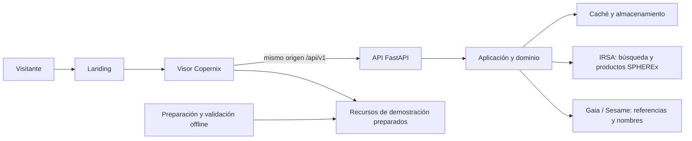

# Copernix / SkyShift: referencia técnica y científica

**Equipo:** Na za · **Reto:** Planet X and SPHEREx · **Sede:** Sangolquí, 2026<br>
**Corte:** 15 de noviembre de 2026 · **Revisión base:** `5ae7964` y estado local de esa fecha<br>
**Estado:** borrador técnico para revisión humana; no constituye certificación de NASA ni validación científica independiente.

## Control y alcance

Este documento integra evidencia del repositorio para el equipo, revisores técnicos y jurado. El nombre público registrado es **Copernix**; SkyShift identifica componentes y contratos. La autoridad sobre el producto es [AGENTS.md](../../AGENTS.md), la guía del equipo y las decisiones humanas; el estado operativo cambia y se consulta en [STATE](../STATE.md). Ante discrepancias, manda el código y contrato vigente para su comportamiento verificable, y la revisión científica humana para sus conclusiones. No se afirma que cada funcionalidad se haya probado en producción.

**Etiquetas:** implementado = código presente, no garantía de funcionamiento en todos los entornos; documentado = evidencia previa en el repositorio; pendiente = requiere prueba, integración o revisión; propuesto = no se atribuye al producto actual. Las mediciones y pruebas históricas son resultados fechados, no garantías actuales.

## 1. Resumen ejecutivo / Executive summary

**ES.** Copernix es un prototipo web para explorar regiones del cielo en imágenes infrarrojas SPHEREx y comparar observaciones de distintas fechas. Integra un mapa, búsqueda, una API para localizar y preparar observaciones, visualización temporal y un caso guiado. La interpretación permanece vinculada a la procedencia y a las limitaciones científicas. El sistema no descubre ni confirma Planet X automáticamente.

**EN.** Copernix is a web prototype for exploring sky regions in SPHEREx infrared imagery and comparing observations from different dates. It combines a sky map, search, an API for finding and preparing observations, temporal visualization, and a guided case. Interpretation remains tied to provenance and scientific limitations. The system does not automatically discover or confirm Planet X.

## 2. Reto, usuarios y límites

La [guía del equipo](../Onboarding_Planet_X_SPHEREx_v0.1.md) define la comparación temporal de la misma región como la respuesta acordada por las personas del equipo, con prioridad para público sin formación astronómica. El reto y los recursos disponibles se sintetizan en [reto y jurado](../context/01-reto-y-jurado.md). La página oficial del enunciado del reto no respondió durante esta revisión; por ello no se reproduce aquí su enunciado como cita verificada. Confirmar el texto completo y los recursos obligatorios directamente en la plataforma antes de entregar.

**Actores:** visitante que explora, integrante que prepara la demo, responsable científico que revisa controles, y desarrollador que instala y mantiene. El recorrido esperado es elegir una región u objeto, consultar datos, observar fechas y explicar límites. Su disponibilidad depende de cobertura, calidad, conectividad y del estado real del despliegue. No se garantiza que cualquier coordenada produzca una serie comparable. NEOSSat no forma parte del MVP acordado.

**No objetivos:** descubrir Planet X, confirmar objetos nuevos, monitorizar todo el cielo en tiempo real, entrenar IA astrofísica, ni convertir una diferencia visual en diagnóstico científico. La detección y el impacto real en usuarios requieren validación independiente.

## 3. Contexto científico y procedencia

SPHEREx observa el cielo en infrarrojo cercano; [IRSA](https://irsa.ipac.caltech.edu/Missions/spherex.html) publica datos, herramientas y documentación. Los [tutoriales oficiales](https://caltech-ipac.github.io/irsa-tutorials/spherex/) describen imágenes espectrales FITS y recomiendan DR1 y QR3 frente a QR2. El filtro variable lineal hace que la longitud de onda dependa de la posición en el detector: compartir detector o apuntar al mismo objeto no demuestra compatibilidad espectral. Consultar [mapa de datos](../context/12-mapa-de-datos-spherex.md) y sus hipótesis abiertas.

Una observación debe conservar archivo y colección, fecha, coordenadas, detector, longitud de onda, calibración y procesamiento. La imagen visual HiPS PNG sirve para explorar, no para medir flujo ni posición científica. El contrato de fotogramas de serie especifica Float32, unidades MJy/sr y NaN para píxeles enmascarados. La medición requiere datos apropiados, incertidumbres y controles, no capturas de pantalla.

**Interpretación:** observado significa diferencia aparente; evaluado exige evidencia suficiente de identidad, fechas, compatibilidad espectral, alineación, calidad y procedencia, además de la revisión correspondiente; confirmado requiere evidencia científica suficiente y no lo asigna el software. Las reglas y umbrales concretos descritos en documentos de investigación no son validaciones universales ni se deben atribuir automáticamente a cada ruta del programa.

### Caso de referencia: ε Indi B

El caso guiado D3 compara dos exposiciones reales DR1 y QR3, identificadas en el [manifiesto](../../data/packages/eps-indi-b-d3/package-manifest.json). La [ficha 0038](../specs/0038-caso-guiado-epsilon-indi-b.md) documenta aproximadamente 6,05 segundos de arco para el par tras corrección de paralaje; otra medición multiépoca usa observaciones y método diferentes. No son magnitudes intercambiables. La [revisión científica](../specs/0036-revision-par-epsilon-indi-b.md) mantiene pendientes controles de alineación, calidad, incertidumbre y sesgo de color. La clasificación pública es **observado, candidato**, no descubrimiento ni confirmación. Sebastián debe revisar la cifra y el texto que se empleen en la presentación.

## 4. Arquitectura y responsabilidades



El diagrama muestra dependencias lógicas, no servicios desplegados independientes. `landing/` presenta el producto; `frontend/copernix/` es la interfaz seleccionada y `frontend/src/engine/` implementa el motor de cielo, proyecciones, teselas y renderizado; `frontend/src/series/` contiene lógica de series y representación. La API en `backend/src/skyshift/` separa dominio, casos de uso, puertos y adaptadores. `science/` reúne controles offline; `scripts/` contiene preparación y operaciones; `contracts/` fija interfaces. [ADR 0009](../adr/0009-visor-copernix-sobre-la-plataforma.md) y [ADR 0040–0044](../adr/) registran decisiones y contexto.

| Componente | Responsabilidad | Evidencia / límite |
| --- | --- | --- |
| Landing | Entrada y recursos visuales | [landing](../../landing/README.md); la marca y los recursos generados con IA se declaran en [AI_USAGE](../AI_USAGE.md). |
| Visor | Mapa, selección y presentación temporal | Código en `frontend/copernix/` y `frontend/src/`; revisión visual humana y GPU real pendientes según STATE. |
| API | Búsqueda, observaciones, series y teselas | [OpenAPI 0.3](../../contracts/openapi.yaml); depende de fuentes externas. |
| Preparación | Recortes y manifiesto del par | [paquete D3](../../data/packages/eps-indi-b-d3/README.md); los FITS no están versionados. |
| Medición | Astrometría, registro y controles | `backend/src/skyshift/domain/measurement/`; resultados sujetos a sus hipótesis y revisión. |
| Validación científica | Funciones y listas explícitas offline | [science/README](../../science/README.md): no verifica por sí sola la evidencia externa ni confirma hallazgos. |

## 5. Flujo de datos y análisis

1. La persona busca un nombre o selecciona una posición; la API puede consultar el catálogo local y resolver nombres con Sesame. Las coordenadas son ICRS; RA/Dec y campos se describen con unidades en el contrato.
2. Se consultan metadatos de observaciones SPHEREx y se agrupan visitas; el flujo de serie selecciona observaciones y recupera datos desde los adaptadores disponibles. Puede no encontrar cobertura suficiente.
3. Los datos se preparan en una cuadrícula común para presentación, con filtros y metadatos de comparabilidad. La reproyección altera la representación: la medición del caso D3 debe distinguirse de la imagen preparada para mostrar.
4. El navegador solicita metadatos y fotogramas binarios y aplica visualización. La búsqueda HiPS entrega teselas PNG de exploración, distintas de los fotogramas numéricos.
5. El caso D3 cuenta con manifiesto, identificadores y hashes; los originales y recortes FITS se regeneran localmente. El resultado es una observación candidata, y los controles incompletos siguen explícitos.

El detalle del comportamiento implementado se encuentra en `application/build_series.py`, `domain/comparability.py`, `domain/imaging.py` y sus pruebas. El protocolo científico más amplio y sus hipótesis figuran en [datos y APIs](../context/03-datos-y-apis.md), [mapa de datos](../context/12-mapa-de-datos-spherex.md) y [controles de casos](../specs/0034-controles-casos-y-limites.md). Su existencia no demuestra que todos los controles se ejecuten en cada solicitud.

## 6. Contratos e interfaces

La fuente normativa de la API es [contracts/openapi.yaml](../../contracts/openapi.yaml), servidor `/api/v1`; sus tipos de frontend se generan con `pnpm --dir frontend gen:api`. Los siguientes resúmenes no sustituyen parámetros, esquemas o errores del contrato.

| Método y ruta | Función | Condiciones principales |
| --- | --- | --- |
| GET `/health` | Salud y estado de dependencia | No demuestra por sí solo que una serie real funcione. |
| GET `/search` | Sugerencias por nombre o coordenadas | `q` 1–64 caracteres; límite 1–20. |
| GET `/resolve` | Resolver un nombre a coordenadas | Puede responder sin resultado o fallar por dependencia externa. |
| GET `/observations` | Metadatos de observaciones agrupadas | No entrega píxeles. |
| GET `/series` | Construir u obtener serie | Campo 1–30 minutos de arco; detector 1–6; longitud de onda opcional y parámetros astrométricos. |
| GET `/series/{series_id}/frames/{index}` | Fotograma numérico | Float32 little-endian, orden por filas, NaN enmascarado; forma en metadatos de la serie. |
| GET `/hips/{order}/{dir}/{npix}` | Tesela SPHEREx DR1 | PNG de visualización; plano espectral 0–101. |

El contrato declara errores `application/problem+json`; contrastar cada implementación con el contrato y las pruebas antes de asumir que cubre cualquier fallo. Otros artefactos: [Observation](../../contracts/observation.schema.json), [AnalysisResult](../../contracts/analysis-result.schema.json) y [Package manifest](../../contracts/package-manifest.schema.json). Los ejemplos sintéticos están rotulados como tales y no constituyen resultados astronómicos.

## 7. Ejecución y operación

La [demo pública del proyecto](https://demo.copernix.workers.dev/) fue facilitada por el equipo; es la página de Copernix, no el enunciado oficial del reto. La [guía de operación](operacion.md) reúne configuración, diagnóstico y comprobaciones.

Requisitos y compatibilidad Fedora/Windows: [entorno](../context/08-entorno-y-comandos.md). El repositorio fija Python ≥3.13 y dependencias con `backend/uv.lock`; frontend usa Node/pnpm con `frontend/pnpm-lock.yaml`. Sin instalar globalmente las dependencias de Python:

```text
mise trust
mise install
mise run setup
mise run copernix-build
mise run copernix
```

El servicio local documentado abre `http://localhost:4410`: `/` landing, `/viewer/` visor y `/api/` proxy. Ver [servidor de un origen](../landing/servir-un-solo-origen.md). API aislada: `uv run --directory backend uvicorn --factory skyshift.api.app:create_app --port 8000`. La API documenta su esquema interactivo en `/docs` en el puerto de la API.

**Despliegue:** STATE registra una API en home-server mediante Cloudflare Tunnel y un despliegue estático pendiente de actualización en el momento registrado. Verificar configuración efectiva, salud, búsqueda, mapa y serie real desde una ventana privada. IRSA puede devolver 502; el proyecto registra mediciones históricas de latencia, no compromisos de servicio. La caché temporal puede perderse al reiniciar. El modo de respaldo debe probarse para cada caso: no asumir que todos los archivos originales están presentes sin conexión.

**Seguridad y mantenimiento:** credenciales exclusivamente en el entorno del despliegue, nunca en código o entregables; validar entradas y límites del contrato; controlar dependencias y lockfiles. No se han establecido en este documento garantías de disponibilidad, capacidad, retención, privacidad ni auditoría de seguridad en producción. Los errores de dependencias deben comunicarse sin inventar datos de reemplazo.

## 8. Verificación y reproducibilidad

```text
mise run api-test
mise run api-lint
mise run web-test
mise run web-lint
mise run web-build
mise run copernix-build
uv run --locked --script scripts/build-validation-package.py --verify
```

El último comando requiere el paquete local y sus datos; consultar su README antes de ejecutarlo. Las pruebas de código, lint y build comprueban software, no validez física. La comprobación científica exige comparar archivos originales, fechas, calibración y controles; una revisión humana evalúa si las hipótesis son apropiadas. Los registros previos se encuentran en `docs/reviews/`, pruebas en `backend/tests/`, `frontend/tests/` y `tests/`. Las capturas históricas de `docs/landing/` no sustituyen una prueba del despliegue actual.

### Evidencia de esta revisión (15-nov-2026)

En el entorno local se ejecutaron `uv run --locked --directory backend pytest` (195 aprobadas), `uv run --locked --directory backend ruff check .` (sin errores), `pnpm --dir frontend test` (170 aprobadas), `pnpm --dir frontend lint` (salida 0) y `pnpm --dir frontend build:copernix` (salida 0). El build advirtió que tres fuentes `/viewer/fonts/` se resolverán en ejecución: comprobar que el empaquetado y el despliegue las sirvan. `mise` no estaba disponible en esta sesión. Estas pruebas no validan el servicio público ni la interpretación científica.

## 9. Trazabilidad a la rúbrica de Sangolquí

Fuente primaria: [guía y rúbrica local, páginas 3–10](../fuentes/guia-participantes-y-rubrica-sangolqui-2026.pdf). La tabla orienta evidencia y preparación; no predice una calificación ni sustituye la evaluación del jurado.

| Criterio | Evidencia y acción pendiente |
| --- | --- |
| 1.1 Datos NASA | IRSA, manifiesto y demo de imágenes reales; mostrar procedencia concreta. |
| 1.2 Ciencia | §3 y revisiones científicas; explicar hipótesis y límites sin afirmar descubrimientos. |
| 1.3 Procesamiento | §5, código y fichas; explicar pasos efectivamente ejecutados en el caso mostrado. |
| 1.4 Dominio científico | Ensayar Q&A: longitud de onda, alineación, incertidumbre y diferencia aparente. |
| 1.5 Atribución | Fuentes, dependencias y [AI_USAGE](../AI_USAGE.md); completar créditos concretos. |
| 2.1 Demo funcional | Probar despliegue y respaldo actuales con un caso real; registrar evidencia. |
| 2.2 Arquitectura | §4–6, ADR y contrato; explicar decisiones y límites. |
| 2.3 Originalidad | Comparar con IRSA/WiseView con evidencia; el valor diferencial requiere evaluación humana. |
| 2.4 Defensa técnica | Ensayar API, WCS, caché, fallos y contratos. |
| 2.5 Factibilidad | Instalación, lockfiles y pruebas §7–8; reproducir en otra máquina. |
| 3.1 Alineación con reto | Contrastar el enunciado oficial completo y demostrar el recorrido acordado. |
| 3.2 Impacto | Describir población objetivo; no declarar impacto medido sin estudio. |
| 3.3 Adopción y escala | Explicar dependencias, costes y límites; escalabilidad no medida. |
| 3.4 Pertinencia | Relacionar acceso público a datos SPHEREx con la misión del reto. |
| 3.5 Accesibilidad y usabilidad | Probar teclado, móvil y comprensión con usuarios; no afirmar conformidad WCAG sin auditoría. |
| 4.1 Narrativa | Problema, datos, demostración, límites e impacto; revisar guion humano. |
| 4.2 Calidad visual | Revisar la interfaz real y materiales de apoyo actuales. |
| 4.3 Tiempo | Ensayar con cronómetro y cumplir límites de la sede. |
| 4.4 Expresión | Practicar exposición oral; la documentación no prueba desempeño. |
| 4.5 Equipo y Q&A | Distribuir preguntas y ensayar respuestas coherentes entre integrantes. |

La guía local aplica deducciones por falta de citas de datos oficiales (−2), repositorio o licencia abierta (−2), enlaces inaccesibles (−1), exceso de diapositivas o video (−1), incumplimiento de transparencia de IA/logos (−1) y falta de versión ES/EN (−1). Son reglas de la sede; confirmar requisitos globales vigentes por separado. La guía local fija máximo siete diapositivas y video de 30 s, con tolerancia hasta 35 s. Esta referencia incluye resumen bilingüe; **eso no sustituye la traducción completa de la ficha y entregables**.

## 10. Riesgos, decisiones y pendientes

| Riesgo | Situación y acción |
| --- | --- |
| Conclusión científica excesiva | Candidato D3 observado; responsable científico revisa cifras y controles pendientes. |
| Cobertura, calidad y λ | Una posición o detector puede no dar una serie comparable; mostrar motivo y procedencia. |
| Disponibilidad externa | IRSA o red pueden fallar; ensayar respaldo real y errores. |
| Reproducibilidad | FITS no versionados; regenerar y verificar hashes con instrucciones del paquete. |
| Estado de despliegue | Registros históricos no prueban disponibilidad actual; verificar público e incógnito. |
| Accesibilidad y rendimiento | Evidencias históricas no equivalen a auditoría completa ni pruebas de carga; comprobar dispositivos reales. |
| Atribución | El README indica reconocimiento y DOI pendientes; aplicar el reconocimiento oficial de IRSA y completar citas precisas. |
| Entrega | Revisar fichas ES/EN, URLs, licencia, IA y artefactos antes de presentar. |

## 11. Referencias y mantenimiento

- [NASA/IPAC IRSA: SPHEREx](https://irsa.ipac.caltech.edu/Missions/spherex.html): productos, documentación y texto oficial de reconocimiento.
- [Tutoriales oficiales SPHEREx](https://caltech-ipac.github.io/irsa-tutorials/spherex/): imágenes, recortes, PSF, cubos y HiPS.
- [NASA Space Apps 2026](https://www.spaceappschallenge.org/2026/): plataforma global y calendario; confirmar las condiciones de la edición.
- [Aclaración de organizadores sobre recursos e IA](https://github.com/nasa/spaceapps/discussions/1849): uso de recursos y declaración; verificar las reglas finales de la edición.
- [Guía local y rúbrica](../fuentes/guia-participantes-y-rubrica-sangolqui-2026.pdf), [guía de equipo](../Onboarding_Planet_X_SPHEREx_v0.1.md), [estado](../STATE.md), [decisiones](../adr/) y [evidencias](../reviews/).

Actualizar este documento cuando cambien contratos, rutas, método, fuentes o despliegue; registrar fecha y revisión, contrastar contra código, y solicitar revisión al dueño del componente y al responsable científico para afirmaciones astronómicas. La documentación no reemplaza la ficha formal de entrega ni la aprobación del equipo.
