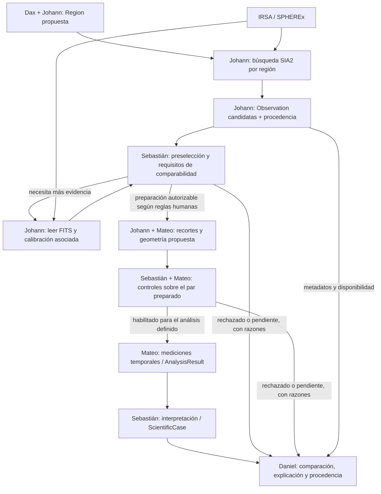

> Estado tras revisión 2026-11-14: ver docs/reviews/2026-11-14-triage-specs-main.md. Implementación vigente: `contracts/openapi.yaml` v0.3 y `docs/specs/0002`; se programa contra ellos. Esta ficha y `contracts/observation.schema.json` son la evolución futura, no implementada (ver `docs/STATE.md`, «Contrato `Observation` vigente»).

# Ficha de tarea para agente — Arquitectura de datos y Observation

- Dueño humano propuesto: **Johann** (arquitectura de datos e integración; ratificación del equipo pendiente).
- Estado: **borrador**, 14 de noviembre de 2026. Documento interno del Ciclo 1; no autoriza implementación.
- Revisores humanos pendientes: **Mateo y Daniel**; **Sebastián** revisa requisitos científicos; **Dax** revisa la frontera con `Region`.
- ADRs relacionados: [0001](../adr/0001-agents-md-fuente-unica.md) y [0002](../adr/0002-reescritura-desde-cero.md), aceptados; [0003](../adr/0003-stack-tecnico.md), recomendación con decisión humana pendiente.
- Base: [plantilla de ficha](0000-plantilla-ficha-agente.md), [onboarding](../Onboarding_Planet_X_SPHEREx_v0.1.md) y **SkyShift_Ciclo1_Guia_Equipo.md**, v1.0, 2026-11-14, §§1–6. Esta última fue proporcionada por Johann desde `Downloads`; no está versionada en el repositorio y sigue siendo una propuesta.
- Redacción con IA: borrador inicial de Codex; Claude Code lo completó con un registro real de SIA2, cabeceras FITS y el producto Spectral WCS (§7.3). Revisión humana pendiente (ver `docs/AI_USAGE.md`).

## 1. Objetivo funcional

Proponer cómo llevar imágenes de SPHEREx desde IRSA hasta una comparación temporal trazable. `Observation` permitirá identificar el producto que se consultó, qué información se conoce, qué falta y qué transformaciones produjeron sus derivados. Su existencia no certificará que pueda compararse con otra observación.

Esta ficha define únicamente la propuesta de Johann y las necesidades hacia los otros contratos. No implementa un catálogo, un servidor, recortes, mediciones ni una interfaz. Tampoco cierra `Region`, `AnalysisResult` o `ScientificCase` por sus titulares.

### 1.1. Autoridad, evidencia y contradicciones

Etiquetas usadas en toda la ficha:

- **[ACUERDO]**: regla o acuerdo humano registrado en `AGENTS.md`, onboarding o ADR aceptado; no una aprobación nueva.
- **[OFICIAL S#]**: documentación primaria identificada en §7. Documentación consultada no equivale a ejecución propia.
- **[COMPROBADO]**: observación directa de esta sesión, con su alcance indicado.
- **[PROPUESTA]**: diseño o inferencia técnica para revisión humana. Todas las estructuras, operaciones, estados y pruebas futuras de esta ficha llevan esta categoría, aunque no se repita en cada celda.
- **[VERIFICAR]**: evidencia concreta que falta. **[DECISIÓN EQUIPO]**: acuerdo humano pendiente.

| Tema | Evidencia y tensión | Tratamiento en esta ficha |
| --- | --- | --- |
| Alcance | [ACUERDO] `AGENTS.md` §1 y README describen elección libre de región. Onboarding §1.4 propone pocos casos guiados; guía Ciclo 1 §§0–1 propone cinco regiones, todavía por ratificar. | Conservar ambas posibilidades. Recomendar preparación de un caso candidato; cantidad y experiencia inicial requieren ADR humano. Cinco regiones no significan cinco detecciones ni cinco pares válidos. |
| Roles | [COMPROBADO] `STATE.md` conserva dueños sin asignar. La guía propone nombres y revisores. | Los responsables del diagrama son **propuestos**, no asignaciones confirmadas. |
| Backend | ADR 0003 recomienda Python/backend y dice «backend obligatorio» entre consecuencias; onboarding §3.2 admite preparación offline con web estática. | ADR 0003 no está aceptado. La arquitectura lógica no exige servicios separados ni un backend desplegado. API y hosting siguen abiertos. |
| Espectro | `context/03` §3 usa mismo detector y cercanía de `em_min/em_max`; `context/06` §5 y onboarding §2.3 apuntan a `WCS-WAVE`. [OFICIAL S3] limita este último a visualización y recomienda `CWAVE`/`CBAND` para ciencia. | Usar metadatos de búsqueda solo para preselección. No adoptar esas simplificaciones como controles científicos. Sebastián debe revisar y coordinar la corrección de los documentos rectores. |
| Estado de los datos | `context/03` reporta consultas, latencias y visitas de otra sesión, con scripts fuera del repo. | [COMPROBADO] §7.3 reproduce una consulta SIA2 y lee cabeceras reales de un producto. Las cuentas de visitas por mes de `context/03` no se reprodujeron. No se afirma movimiento medido, disponibilidad de un par ni rendimiento sostenido. |
| Formato de FLAGS | `context/03` §2 describe el archivo como `IMAGE` float32 sin comprimir seguido de FLAGS, VARIANCE, etc. | [COMPROBADO] `FLAGS` está comprimida en tiles (RICE_1): no se lee por rangos de bytes como `IMAGE`. Afecta a cualquier lectura parcial desde el navegador. |
| QR3 | `STATE.md` y `context/03` §3 avisan que QR3 devolvió 0 filas en WISE 0855 y piden revisarlo «en los 5 objetos». | [COMPROBADO §7.4] sigue en 0 para WISE 0855, pero QR3 sí añade observaciones **posteriores** a DR1 para Barnard (ago–sep 2026), RW Aur (sep 2026) y R Dra (may–jul 2026), con la misma versión de pipeline `v27` y la misma calibración espectral. No usar el caso de WISE 0855 para descartar QR3. |
| Convención de nombres | [OFICIAL S3] `…_spx_l2b-v[Version]-[Processing Date].fits` | [COMPROBADO] también existen archivos `…_spx_l2b_retry-v27-…` (imágenes repasadas por el módulo de reintento de astrometría, `WCSRETRY=T`). Son la única versión de esa observación, no duplicados. Un analizador que exija `l2b-v` las perdería. |
| Ruta de calibración espectral | [OFICIAL S2] indica `spectral_wcs/cal-wcs-v[Version]-[Processing Date]/`. | [COMPROBADO] en S3 la ruta real es `dr1/spectral_wcs/cal-swcs-v5-2026-191/{1..6}/`. Guardar la clave real leída, no la reconstruida desde la documentación. |
| Semáforo | [ACUERDO] `AGENTS.md` §1 distingue observado, evaluado y confirmado. El ejemplo del onboarding §3.3 utiliza otra lista informal. | Prevalece `AGENTS.md`: una diferencia aparente puede ser observada; evaluada exige controles y evidencia; confirmado nunca se asigna automáticamente. |

No se modifican los documentos rectores en este encargo: se explicitan las discrepancias para revisión conjunta. La aprobación posterior debe resolverlas antes de delegar desarrollo apoyado en instrucciones contradictorias.

### 1.2. Arquitectura lógica propuesta



La preselección no puede aprobar controles que requieren píxeles todavía no leídos. El bucle de enriquecimiento aporta esa evidencia; después de preparar imágenes se reevalúan los controles afectados por recorte, máscara o reproyección. Habilitar un método no equivale a demostrar una diferencia persistente.

| Etapa y responsable propuesto | Entrada → salida conceptual | Qué conserva | Ausencias o fallos | Qué existe hoy |
| --- | --- | --- | --- | --- |
| Región — Dax, con Johann | Selección geométrica → referencia a `Region` | ID/revisión de región, geometría y referencia celeste | Región mal definida, referencia desconocida, cobertura parcial | Visión documental; contrato no aprobado |
| Búsqueda — Johann | Geometría y filtros → resultado de búsqueda limitado | Parámetros, servicio, colección consultada, momento de consulta, filas originales y estado de completitud | Timeout, respuesta inválida, vacía o truncada | [OFICIAL S2/S4] SIA2 existe; adaptador SkyShift no existe |
| Candidatas — Johann | Filas → `Observation` incompletas pero trazables | IDs originales, unidades y localizadores de cada campo | Falta de tiempo, identidad o URL; duplicados/versiones | Contrato propuesto aquí |
| Selección científica — Sebastián, con Mateo | Candidatas y propósito del análisis → par candidato, requisitos, rechazo o pendiente | IDs exactos, región/posición analizada, reglas y razones | Dos archivos de una misma adquisición; λ local desconocida; cobertura insuficiente | Requisitos generales acordados; política verificable pendiente |
| Enriquecimiento/preparación — Johann, con Mateo | Productos elegidos → metadatos FITS/calibración y, después, derivados | Originales, versiones, cabeceras, rejilla, unidades, transformaciones | Descarga fallida, calibración sin asociación verificable, WCS incompleta | [OFICIAL S2/S3/S6] fuentes y tutoriales; proceso SkyShift no implementado |
| Control y análisis — Sebastián define reglas; Mateo mide | Par preparado y evidencia → evaluación del par, luego `AnalysisResult` o no evaluable | Entradas exactas, método, máscaras, incertidumbre, unidades y configuración | Calidad insuficiente, alineación no demostrada, método inaplicable | Sin mediciones realizadas en este encargo |
| Interpretación — Sebastián | Medición y controles → `ScientificCase` y afirmación permitida | Evidencia, límites, citas y revisión | Ninguna diferencia defendible, explicación pendiente | Esquema de su responsabilidad, no definido aquí |
| Presentación — Daniel | Contratos y recursos visibles → experiencia y estados | Fecha/λ, colección, vínculo al original y avisos junto a la imagen | Sin datos, carga parcial, sin red, respaldo incompleto | Estándares de UI; no se construye UI aquí |

### 1.3. Cuatro clases de información que no se intercambian

| Clase | Representa | Uso y límite |
| --- | --- | --- |
| Producto científico original de archivo | MEF espectral Level 2 de una adquisición/detector y una versión publicada | [OFICIAL S3] Es un producto **calibrado**, no datos crudos de telemetría. Conservarlo como origen de la preparación. |
| Metadatos de búsqueda | Fila SIA2 que describe un producto y permite localizarlo | Permite encontrar candidatos; no contiene por sí sola todos los píxeles, WCS y controles necesarios. |
| Producto preparado/derivado | Recorte, imagen reproyectada u otra transformación explícita del original | Solo sirve para medición si método, unidades, calidad e incertidumbre cumplen los requisitos que aprueben Mateo y Sebastián. «Preparado» no significa «validado». |
| Representación de pantalla | PNG, textura, contraste, paleta o vista blink | Debe enlazar al recurso científico que representa y a sus transformaciones visuales. No medir brillo sobre valores reescalados para pantalla. |

Los cubos combinados y los HiPS tienen un papel distinto al de exposiciones individuales. [OFICIAL S3] los canales del cubo representan información espectral; no se transforman en épocas. Esta propuesta acota `Observation` temporal a imágenes espectrales nativas; contexto con cubos/HiPS requiere identificarlo como tal, sin hacerlo pasar por una observación temporal individual.

## 2. Entradas exactas propuestas

### 2.1. Frontera de búsqueda, sin cerrar Region

| Entrada | Tipo, unidad y validación propuesta | Titular / pendiente |
| --- | --- | --- |
| Referencia de región | ID estable y revisión o huella de su geometría; texto no vacío | Dax + Johann: mecanismo de revisión y relación con casos |
| Geometría de consulta | Para una primera interfaz: círculo con centro y radio explícitos. RA en `[0,360)`, Dec en `[-90,90]`, radio positivo, todo en grados ICRS; sin NaN/Infinity. [OFICIAL S4] `POS` usa ICRS/grados. | Forma definitiva y tamaño máximo operativo: Dax + Johann. No se impone este esquema al contrato `Region`. |
| Colecciones | Lista explícita de colecciones, preservando qué se consultó | [OFICIAL S2] imágenes en `spherex_dr1`, `spherex_dr1_deep`, `spherex_qr3`, `spherex_qr3_deep`; `spherex_dr1_cube` es otro tipo de producto. Selección MVP pendiente. |
| Filtros opcionales | Intervalo temporal con representación/escala documentadas; rango espectral con unidad; sin asumir filtros por defecto invisibles | [OFICIAL S4/S5] `TIME` usa MJD y `BAND` metros. La compatibilidad local no queda validada por estos filtros. [COMPROBADO §7.4] `TIME` funciona con `+`, `%20`, enteros y decimales (6 de 6 intentos con `QUERY_STATUS` válido). Los 502 en HTML también afectaron a consultas sin `TIME`: es intermitencia del servicio, no sintaxis. Propuesta: usar `TIME` con reintento finito y, si falla, filtrar sobre `t_min/t_max` de las filas recibidas. |
| Presupuesto de consulta | Límite explícito de filas, timeout, cancelación y política de reintentos finitos | Johann + Daniel fijan valores operativos; no son umbrales científicos. Se conserva si la respuesta quedó truncada. |

[OFICIAL S4] una coincidencia espacial significa intersección con la huella, no que toda la región quede cubierta. RA cercana a cero y regiones polares requieren geometría esférica; una caja rectangular en pantalla no demuestra cobertura. No se añadirá propagación de posiciones de objetos móviles sin que Dax/Sebastián acuerden su fuente y época de referencia.

### 2.2. Entradas de enriquecimiento

- Producto nativo identificado y su fila original: nunca sustituir silenciosamente por «la última versión».
- FITS: inventario de extensiones, cabeceras pertinentes y acceso a sus datos. Referenciar el archivo y la extensión; el nombre esperado por documentación no prueba que se haya inspeccionado.
- Calibración espectral: producto, detector, versión y asociación demostrable con el archivo científico. [OFICIAL S2] no se obtiene de SIA2; procede de directorios de calibración. Mecanismo de vínculo comprobado en §3.5 y §7.4: UUID del `HISTORY` + versión única publicada + igualdad byte a byte de la tabla `WCS-WAVE`.
- Reglas de comparabilidad de Sebastián y necesidades de medición de Mateo. Esta ficha no inventa tolerancias ni autoriza restar fondos o reproyectar con cualquier método.

## 3. Salidas exactas: contrato Observation propuesto

### 3.1. Identidad y significado

**Una `Observation` describe un producto nativo versionado que representa una adquisición de un detector**, con sus metadatos, referencias y derivados. Es una unidad de intercambio de SkyShift, no un objeto astronómico, un caso, una detección ni una aprobación científica.

[OFICIAL S3/S5] el identificador de adquisición puede estar compartido por varios productos. En SPHEREx el nombre del archivo distingue adquisición, detector, versión y fecha de procesamiento. Por ello se proponen tres identidades separadas:

1. `observation_id`: ID interno estable del registro asociado a una revisión concreta de un producto. No cambia si solo cambia la URL de acceso.
2. `source.obs_id` y `source.acquisition_id`: conservar el primero tal como llega de SIA; el segundo es el `OBSID` del FITS o la adquisición extraída de una convención de nombre comprobada. No presuponer que sean cadenas idénticas.
3. `products.native.product_id`: ID interno del archivo científico versionado, más `source.publisher_did` original. No reutilizarlo para recortes, calibraciones ni representaciones.

La clave de reconciliación propuesta considera colección, identificador publicado, adquisición, detector, nombre completo, versión y fecha de procesamiento; el checksum distingue contenidos si se descargan. Ningún campo aislado se presume suficiente para todas las versiones. [COMPROBADO §7.4] el segmento de proceso puede ser `l2b` o `l2b_retry`; se conserva completo, junto con el prefijo de colección del camino (`dr1/`, `qr3/`). En R Dra, DR1 y QR3 no comparten ningún par `(obs_id, banda)`: son observaciones distintas, no reprocesamientos. Una revisión nueva conserva el vínculo a la adquisición pero recibe otra identidad de producto/registro; no cuenta como otra época.

**Regla de IDs [PROPUESTA, validada con 906 filas reales en §7.4 J].** A partir de la clave del archivo en el archivo oficial (`cloud_access.key`, p. ej. `dr1/level2/2025W19_1B/l2b-v27-2026-197/3/level2_2025W19_1B_0116_1D3_spx_l2b-v27-2026-197.fits`):

| Identificador | Regla | Ejemplo real |
| --- | --- | --- |
| `products.native.product_id` | `spherex-file:` + clave completa | `spherex-file:dr1/level2/2025W19_1B/…D3_spx_l2b-v27-2026-197.fits` |
| `observation_id` (resuelto) | `spherex:<publicación>:<obs_id>:D<detector>:<proceso>-v<versión>-<fecha de proceso>`, donde la publicación es el primer segmento de la clave (`dr1`, `qr3`) y el resto sale del nombre con `^level2_(.+)D([1-6])_spx_(l2b(?:_[a-z]+)?)-v(\d+)-(\d{4}-\d{3})\.fits$` | `spherex:dr1:2025W19_1B_0116_1:D3:l2b-v27-2026-197` |
| `observation_id` (sin resolver) | `unresolved:` + primeros 16 hex de `sha256(access_url)`, o de `publisher_did` si no hay URL. Sin ninguno de los dos, no se crea el registro | — |
| Calibración y otros archivos oficiales | `spherex-file:` + clave | `spherex-file:dr1/spectral_wcs/cal-swcs-v5-2026-191/3/…` |
| Derivados y representaciones | `derived:` / `display:` + `sha256` del contenido | — |
| Fixtures sintéticas | `synthetic:<nombre>` | `synthetic:observation-a` |

Por qué la publicación y no la colección: Wide y Deep comparten el camino `dr1/level2/`, y la colección es un atributo de la búsqueda, no del archivo. `identity_status = resolved` exige que el nombre analice y que `obs_id` y detector coincidan con la fila SIA y con `OBSID`/`DETECTOR` de la cabecera cuando se lean; si no, se usa `identity_unresolved` y el ID provisional. Nunca consolidar ni usar en mediciones publicadas un registro sin resolver.

### 3.2. Convenciones de estructura y ausencias

**Versión verificable por máquina:** [`contracts/observation.schema.json`](../../contracts/observation.schema.json) (JSON Schema 2020-12, borrador `0.1-draft`). Las tablas explican el significado; el schema fija la estructura. Si discrepan, es un error que se corrige en el mismo PR, y mientras tanto manda el schema (`AGENTS.md` §4.7, contrato primero). `mise run check-contracts` valida los schemas, los ejemplos de esta ficha, los de `contracts/examples/`, la regla de IDs y 11 casos que deben fallar; no usa la red.

Todos los campos de las tablas son **[PROPUESTA]**; la columna «origen» distingue el respaldo del dato de la decisión de exponerlo. `O` = obligatorio; `O?` = clave obligatoria cuyo valor puede ser `null`; `C` = obligatorio cuando existe el objeto/recurso correspondiente; `P` = decisión pendiente. Las claves opcionales se indican expresamente. `null` significa desconocido, no cero, falso ni aprobado; `issues` explica las ausencias relevantes. Un array vacío significa que no se adjuntaron elementos, no que se haya probado su inexistencia.

Los IDs son cadenas opacas no vacías. No usar rutas absolutas del equipo como identificadores públicos. Los números JSON son finitos. Unidades y escalas acompañan a los valores o están fijadas explícitamente por el nombre/estructura de campo. Una conversión conserva fuente, valor original, unidad original y método en la procedencia. Cambiar el significado, unidad o nulabilidad de un campo requiere nueva revisión del contrato con consumidores.

### 3.3. Campos compartidos e identidad

| Campo | Significado; tipo/estructura | Obligación y motivo | Unidad/referencia | Origen del valor | Consumidores y revisión |
| --- | --- | --- | --- | --- | --- |
| `schema_version` | Versión del contrato; string, propuesta `0.1-draft` | O: evita mezclar contratos | Versión SkyShift, no SPHEREx | Decisión documental | Todos; versionado definitivo pendiente |
| `observation_id` | ID del registro versionado; string | O: referencias estables incluso con datos incompletos | Espacio de IDs SkyShift | Asignación interna documentada | Todos; Johann consolida con consumidores |
| `identity_status` | `resolved` o `unresolved` | O: distingue identidad reconciliada de provisional | No expresa calidad | Verificación de procedencia, pendiente de implementar | Mateo/Sebastián: impedir mezcla de versiones |
| `mission` | Misión; string | O: contextualiza el origen | `SPHEREx` en este alcance | [OFICIAL S1], contrastable con `facility_name` | Daniel/Sebastián |
| `instrument` | Nombre del instrumento; string o null | O?: no fabricar literal del servicio | Conservar nombre original | SIA `instrument_name` [S6]; [COMPROBADO] valor `SPHEREx` en §7.3. El nombre descriptivo de [S1] no sustituye el valor leído | Sebastián; homologación pendiente |
| `source.collection` | Colección usada en consulta; string | O: delimita búsqueda y origen | Ej. `spherex_dr1` | Parámetro `COLLECTION` [S2/S4] | Todos |
| `source.archive_collection` | Etiqueta de colección devuelta; string o null | O?: no asumir igualdad con el parámetro | Literal del archivo | SIA `obs_collection` [S5/S6] | Johann; comprobar mapeo real |
| `source.obs_id` / `source.publisher_did` | Identificadores originales; string o null cada uno | O?: preservar o explicar ausencia | Namespace del publicador | SIA `obs_id`, `obs_publisher_did` [S5/S6]. [COMPROBADO] `obs_id` (`2025W19_1B_0116_1`) lo comparten las filas de varios detectores; `publisher_did` (`ivo://irsa.ipac/spherex_dr1?…_0116_1/D3`) añade el detector pero **no la versión**, que solo aparece en `access_url` (`l2b-v27-2026-197`) | Mateo/Sebastián: ninguno de los dos distingue reprocesamientos |
| `source.acquisition_id` | Identidad de adquisición; string o null | O?: desconocida hasta verificar | No incluye por sí sola todos los detectores/versiones | FITS `OBSID` [S6] o extracción documentada del nombre [S3] | Mateo: agrupar exposiciones, sin contar versiones como fechas |
| `detector` | Número entero de detector o null | O?: requerido antes de asociar calibración | Entero 1–6 [S3] | FITS `DETECTOR` [S6] o nombre validado [S3]. [COMPROBADO] SIA no tiene columna `detector`, pero lo codifican `energy_bandpassname` (`SPHEREx-D3`) y el sufijo `/D3` de `publisher_did`; si se extrae de ahí, registrar el localizador | Mateo/Sebastián: mismo detector no demuestra λ compatible |
| `product_type` / `product_subtype` | Tipo y subtipo declarados; string o null | O?: distinguir imagen/cubo | Literales originales | SIA `dataproduct_type`, `dataproduct_subtype` [S6]. [COMPROBADO] `image` / `science` con `calib_level=2` en las 806 filas revisadas (DR1 y QR3) | Todos |
| `calibration_level` | Nivel del servicio; entero o null | O?: conservar clasificación, no aprobación | ObsCore; no confundir con versión de procesamiento | SIA `calib_level` [S5/S6] | Sebastián/Mateo |
| `region_refs` | Referencias a regiones conocidas; array de strings | O; puede ser `[]`: un producto puede intersectar varias regiones | IDs de Dax; revisión registrada en consulta/evaluación | Asociación interna, no columna NASA | Dax/Daniel; no significa cobertura completa |

### 3.4. Tiempo, cobertura, espectro y calidad

| Campo | Significado; tipo/estructura | Obligación y motivo | Unidad/referencia | Origen del valor | Consumidores y revisión |
| --- | --- | --- | --- | --- | --- |
| `time.samples` | Array de `TimeSample` (§3.5): inicio, medio o final, preservando representaciones | O; `[]` si no hay dato | MJD en días o ISO8601; escala explícita o null | SIA `t_min/t_max` [S5]; FITS `DATE-BEG/AVG/END`, `MJD-BEG/AVG/END`, `TIMESYS`, `MJDREF` [S7]. [COMPROBADO] la cabecera `IMAGE` declara `TIMESYS='UTC'` y `MJDREF=0` (258/258). Ni la VOTable ni ObsCore §4.14 declaran escala para `t_min/t_max`. Pero en 258/258 filas el punto medio SIA coincide con `DATE-AVG` (UTC) con un error ≤ 0,026 s, que es el redondeo a 6 decimales; TT o TAI se separarían 69,2 s o 37 s | Mateo/Sebastián: política para elegir tiempo efectivo y conflictos |
| `time.exposure_s` | Duración de integración; number o null | O?: no deducirla siempre del intervalo | s | SIA `t_exptime` [S5] o FITS `XPOSURE` [S7], con origen | Mateo: no confundir con tiempo transcurrido `TELAPSE` |
| `time.release_date` | Fecha publicada por el archivo; string o null | O?: informativa; no sustituye adquisición | Representación original documentada | SIA `obs_release_date` [S5/S6]. [COMPROBADO] en §7.3 hay tres fechas distintas: adquisición 2025-05-05 (`DATE-BEG`), procesamiento 2026-07-17 (`DATE`, creación del HDU) y publicación 2026-09-27 | Daniel; fecha de procesamiento va en `ProductRef` |
| `coverage.center` | `{ra_deg:number, dec_deg:number, frame:string}` o null | O?: no reconstruir centro sin fuente | grados; ICRS en ObsCore | SIA `s_ra/s_dec` [S5/S6] | Dax; centro del producto no es la posición de una fuente |
| `coverage.footprint` | `{value:string, format:string, frame:string o null}` o null | O?: geometría preservada con formato | `STC-S` si eso entrega el servicio; referencia explícita | SIA `s_region` [S5]. [COMPROBADO] llega como texto `POLYGON ICRS ra1 dec1 … ra1 dec1` (grados, primer vértice repetido al final); huella de ~3,5° de lado (`s_fov=3.485`) | Dax/Sebastián; no tratar huella como máscara de píxeles útiles |
| `spatial_wcs` | `{product_id:string, hdu:string, header_ref:string}` o null | O?: solo completar cuando se obtuvo la referencia real | Cabecera WCS completa, incluidos distorsión y sistema celeste | Cabecera `IMAGE`, WCS espacial principal [S6] | Mateo; RA/Dec centrales no sustituyen WCS |
| `spectral.search_range_m` | `{min:number, max:number}` o null; positivos y ordenados | O?: solo cobertura global de búsqueda | Metros, longitud en vacío | SIA `em_min/em_max` [S4/S5]. [COMPROBADO] vienen en metros y son el rango del detector completo: todas las filas D3 dan `1.63010e-06`–`2.43460e-06`; no distinguen dónde cayó una fuente | Sebastián: no interpretar como λ local |
| `spectral.local` | `LocalSpectral` (§3.5) o null | O?: depende de posición, píxel y calibración | µm para centro y anchura | `WCS-WAVE` aproximado o calibración `CWAVE`/`CBAND` [S3], con método distinto explícito | Mateo/Sebastián: compatibilidad se revisa por objetivo/área |
| `quality.flags` | `HduRef` o null | O?: null hasta inspeccionar existencia/referencia | Bitmap sin unidad; interpretación por versión de tabla | HDU `FLAGS`; definiciones remitidas por [S3] a suplemento, tabla 16. [COMPROBADO] la propia cabecera de `FLAGS` define cada bit (`MSKNnnnn` nombre, `MSKMnnnn` máscara, `MSKDnnnn` descripción). El bit 21 `SOURCE` ("píxel asociado a una fuente conocida") cubre el 51 % de los píxeles del archivo contrastado: «cualquier bit encendido = píxel malo» descartaría justo las fuentes | Sebastián fija política de bits; Mateo aplica |
| `quality.variance` | `HduRef` o null | O?: requerido según método, no sustituir ausencia por cero | Unidad leída; [S3] documenta `(MJy/sr)^2` | HDU `VARIANCE`, cabecera y píxeles | Mateo define propagación y límites |
| `quality.pipeline_assessment` | `{l1_dqa:string o null, l2_dqa:string o null, fine_astrometry:number o null, source_locator:string}` o null | O?: conservar lo que dice la pipeline sin convertirlo en aprobación de SkyShift | Literales originales | [COMPROBADO] cabecera `IMAGE`: `L1DQAFLG='Pass'`, `L2DQAFLG='Pass'`, `FINAST=0`. [OFICIAL S7 §3.2.12, p. 42] L2 DQA son 11 controles automáticos de cordura; PASS si se cumple al menos la mitad. IRSA solo archiva imágenes con `L2DQA=PASS` y `FINAST=0` (§3.2.8, p. 37: 0 bueno, 1 parcial, mayor = no usar). Las 258 filas de §7.4 dan Pass y 0: **el campo no distingue nada entre productos publicados** y se guarda solo como procedencia | Sebastián: no sirve como control de comparabilidad; Daniel no lo muestra como «evaluado» |
| `quality.review_ref` | Referencia a revisión de este producto o null | O?: referencia no equivale a aprobar todos sus usos | Registro externo, no `ScientificCase` inventado | Evidencia de controles realmente ejecutados | Sebastián; comparabilidad del par permanece separada |
| `ancillary` | Array de `HduRef` | O; `[]` si no adjuntos | Unidad por recurso | `ZODI`, `EPSF` u otros inspeccionados [S3/S6] | Mateo/Sebastián deciden cuáles exige cada método |
| `metadata_stage` | `discovery`, `file_inspected` o `calibration_linked` | O: etapa técnica alcanzada | No es semáforo científico ni garantiza completitud | Historial de acceso real | Daniel muestra pendientes, no «validada» |
| `availability` | `{native, prepared, display, offline}`; estados de §4.4 | O: distingue accesos y respaldo | Operativo, no científico | Intentos de acceso y manifiesto local | Daniel/Johann |
| `issues` | Array de `{code:string, paths:string[], detail:string}` | O; sin problemas conocidos puede ser `[]` | Rutas de campos; códigos propuestos | Fallos/ausencias detectados, sin diagnósticos astronómicos | Todos; mensaje de UI en inglés lo redacta Daniel |

### 3.5. Tipos auxiliares y procedencia de recursos

Estas estructuras pertenecen solo a la propuesta `Observation`. En los objetos presentes, todas las claves listadas son obligatorias salvo indicación contraria.

| Tipo/campo | Estructura y obligación | Origen/unidad y revisión |
| --- | --- | --- |
| `TimeSample` | `{role, value, format, scale, reference_position, source_locator}`. `role`: `start`, `midpoint`, `end` o `observation`; `value`: number para `MJD`, string para `ISO8601`; `scale` y `reference_position`: string o null; `source_locator`: string | El localizador identifica columna o keyword y recurso. No calcular midpoint sin documentar derivación. Un MJD no identifica por sí solo UTC. Si hay referencia MJD adicional, se conserva en la evidencia de cabecera antes de interpretar valores. |
| `HduRef` | `{product_id:string, extname:string, unit:string o null}` | Referencia a un archivo registrado; `unit=null` para bitmap u otra unidad aún no leída, explicado si hace falta. Extensiones por nombre y versión; no confiar en un índice fijo para toda colección. |
| `LocalSpectral` | `{sky_position, original_pixel, central_um, bandwidth_um, method, resources, transform_ref}`. `sky_position`: mismo tipo que `coverage.center`; `original_pixel`: `{x:number,y:number,origin:0 o 1}`; centro/anchura: number positivo; `method`: `wcs_wave_approximation` o `cwave_cband`; `resources`: `HduRef[]` no vacío; `transform_ref`: string o null si posición nativa sin transformación | [OFICIAL S3] ambos valores de calibración en µm. [PROPUESTA] `cwave_cband` exige referencia a ambas extensiones y asociación de versión verificada. Valores aproximados nunca se anuncian como calibración científica. Muestreo/interpolación y paso cielo↔píxel quedan en procedencia. Sebastián decide representación de aperturas/áreas; un solo punto no certifica toda `Region`. |
| `products` | `{native:ProductRef, calibrations:ProductRef[], derived:DerivedRef[], display:DisplayRef[]}` | Los arrays vacíos no prueban que no existan productos externos; indican cuáles están vinculados aquí. |
| `ProductRef` | `{product_id, uri, format, filename, version, processing_date, sha256}`. ID string obligatorio; las otras claves son string o null | URI/MIME originales de SIA `access_url/access_format` [S6], o directorio de calibración [S2]; nombre/versión/fecha del archivo [S3], sin confundir fecha de procesamiento con adquisición. `sha256` se calcula al descargar, nunca se inventa. URI faltante es válida para candidato incompleto, no para preparación. |
| `DerivedRef` | `{asset:ProductRef, parent_product_ids:string[], transformations:Transformation[], wcs_ref:string o null, quality_refs:HduRef[], scientific_unit:string o null}` | C: al preparar, padres no vacíos y transformaciones ordenadas, sin ciclos. Deben conservarse referencias de calidad y su tratamiento; incertidumbre/huella válida de salida requieren revisión de Mateo. Una unidad desconocida bloquea medición que la necesite. |
| `DisplayRef` | `{asset:ProductRef, source_product_id:string, transformations:Transformation[], purpose:"display_only"}` | C: al visualizar, conservar cadena hasta el original. Contraste y paleta no modifican el recurso usado para medir. |
| `Transformation` | `{operation:string, method:string, software:{name:string,version:string}, parameters:object, executed_at:string, evidence_ref:string}` | C: operación real, parámetros explícitos con unidades, versión exacta y evidencia; `executed_at` ISO8601 UTC del proceso. Para reproyección: rejilla/WCS de destino, interpolación, unidades, tratamiento de FLAGS, varianza y píxeles sin cobertura. Para pantalla: contraste, límites, paleta y orientación. No registrar operaciones que no se hicieron. |
| `provenance` | `{query_uri:string o null, retrieved_at:string o null, raw_metadata_ref:string o null, calibration_history:{kind:string, uuid:string}[], field_sources:FieldSource[]}` | O: consulta, momento de recuperación (ISO8601 UTC del sistema, no adquisición), fila/cabecera conservada y origen de campos. `calibration_history` copia las líneas `HISTORY [CALIB] <tipo> <UUID>` del MEF ([COMPROBADO] §7.3); `[]` hasta leer la cabecera. No equivale a haber resuelto el archivo de calibración. En una preparación reproducible deben existir evidencias recuperables; no basta un enlace web mutable. |
| `FieldSource` | `{paths:string[], kind:string, reference:string, locator:string}`; `kind`: `sia`, `fits_header`, `calibration`, `derivation`, `documentation` o `synthetic` | Origen por campo/grupo; `reference` resuelve a producto, evidencia guardada o fuente documental. `locator` nombra columna, keyword, HDU o cálculo. Todo dato científico no nulo tiene fuente; en ejemplos sintéticos `/` cubre el objeto completo. [PROPUESTA] no usar `synthetic` en la lista de datos reales. |

**SIA frente a FITS.** [OFICIAL S6] publica columnas de búsqueda, pero no incluye una cabecera WCS completa ni demuestra que se hayan leído FLAGS o VARIANCE. [COMPROBADO §7.3] la cabecera real de `IMAGE` trae `TIMESYS='UTC'`, `MJDREF=0`, `DATE-BEG/AVG/END` en ISO y `MJD-BEG/AVG/END`, `XPOSURE` y `TELAPSE`; la fila SIA del mismo producto da `t_min/t_max` en días sin escala. La coincidencia se comprobó en 258 filas DR1 (§7.4), pero ni IRSA ni ObsCore la documentan como regla. **Propuesta:** `scale="UTC"` en muestras leídas de la cabecera; en muestras SIA, `scale=null` con la nota de que la comprobación empírica es consistente con UTC. La escala se fija cuando se lee la cabecera, no antes. No añadir `Z`, ordenar como UTC ni convertir silenciosamente. Si FITS y búsqueda discrepan, conservar ambos, abrir una incidencia y pedir criterio a Sebastián.

**Qué se sabe en cada etapa** (contrastado con un producto DR1 real):

| Dato | Búsqueda SIA2 | Cabecera FITS del MEF | Producto Spectral WCS |
| --- | --- | --- | --- |
| Apuntado, detector, versión | `obs_id`; detector solo codificado en `energy_bandpassname`/`publisher_did`; versión solo en `access_url` | `OBSID`, `DETECTOR`, `EXPIDN`; versión del software en HDU primaria (`VERSION`) | Detector y versión en la ruta (`cal-swcs-v5-2026-191`) |
| Tiempo | `t_min/t_max` (d), `t_exptime` (s), sin escala | `DATE-*`, `MJD-*`, `TIMESYS`, `XPOSURE`, `TELAPSE` | — |
| Cobertura y WCS | Centro, polígono `s_region`, escala de píxel | WCS completa `RA---TAN-SIP` de orden 3, `RADESYS='ICRS'` | — |
| Espectro | Rango del detector entero (m), `em_res_power` | Tabla aproximada `WCS-WAVE` (µm) | `CWAVE` y `CBAND` por píxel (µm) |
| Calidad | Nada | `FLAGS` (con definiciones de bits), `VARIANCE`, `ZODI`, resumen DQA de la pipeline | Errores máximos de la tabla aproximada (`WLERRMAX`, `WLERRP99`) |
| Calibraciones usadas | Nada | `HISTORY [CALIB] <tipo> <UUID>` | No se encontró el UUID en la cabecera leída |

**Identidad de archivo.** [OFICIAL S3] publica la convención `level2_[Observation ID]D[Detector]_spx_l2b-v[Version]-[Processing Date].fits`. Guardar el nombre entero y el texto original de fecha de procesamiento; no convertir un código año/día-del-año en hora de observación. `DATE` tampoco reemplaza `DATE-AVG` o los límites de adquisición.

**Calibración espectral.** [OFICIAL S3] `WCS-WAVE` aproxima centro y anchura para visualización; `CWAVE` y `CBAND` son los recursos recomendados para análisis. [PROPUESTA] registrar detector, archivo y revisión de calibración, píxel nativo, posición celeste, unidades y transformación desde el recorte. Un recorte o una rejilla reproyectada no se indexa directamente sobre la calibración original sin esa relación. La elección de valores por apertura y la compatibilidad entre respuestas espectrales quedan a Sebastián/Mateo: no se deriva una tolerancia científica de la precisión aproximada de `WCS-WAVE`.

[COMPROBADO §7.3] la cabecera del Spectral WCS del detector 3 declara `WLERRP99=0.001161` µm y `WLERRMAX=0.655422` µm como errores de la tabla de consulta («wavelength lookup»). El «≈1 nm» de [S3] describe el percentil 99, no el peor caso. [COMPROBADO §7.4] sobre el detector 3 completo, muestreado cada 4 px, el error de `WCS-WAVE` frente a `CWAVE` da p50 0,59 nm, p99 1,16 nm (reproduce `WLERRP99`) y un máximo de 0,52 µm en un píxel del borde (x=2028, y=1820). Todos los píxeles con error > 10 nm están a menos de 40 px del borde y son el 0,0004 % de la muestra. En el punto de prueba, el error es ≤ 1,3 nm en las 258 observaciones. El 0,655 µm exacto de `WLERRMAX` no se reprodujo porque no se evaluó cada píxel; es coherente con un borde. La tabla `WCS-WAVE` es una rejilla de 9×14 puntos de control: sirve para mostrar, no para decidir comparabilidad.

**Vínculo imagen ↔ calibración.** Ninguna de las cuatro cabeceras del archivo Spectral WCS contiene el UUID que cita el MEF (`HISTORY [CALIB] spectral_wcs <UUID>`), ni el Suplemento publica una tabla UUID→archivo. El vínculo se demuestra así [COMPROBADO §7.4]:

1. El UUID es constante por detector en las 258 imágenes DR1 del punto de prueba (uno distinto por detector) y en el archivo QR3 revisado.
2. `dr1/spectral_wcs/` y `qr3/spectral_wcs/` publican una sola versión, `cal-swcs-v5-2026-191`.
3. La tabla `WCS-WAVE` embebida en cada imagen es **idéntica byte a byte** a la del archivo Spectral WCS del mismo detector, en 258/258 DR1 y 1/1 QR3. [OFICIAL S7 §4.3.1, p. 61] esa tabla se construye con los valores por píxel de ese archivo.

**Quién calcula λ para medir** (respuesta a la ficha 0010 anexo E; se acepta la propuesta de Mateo). `spectral.local` de `Observation` es la λ en **un punto de referencia fijo** del registro (por ejemplo, el centro de una región), y sirve para preseleccionar y mostrar. **No es la λ de una medición.** Para un objeto que se mueve, la posición cambia en cada fecha: `AnalysisResult` lee `CWAVE`/`CBAND` en el píxel original que midió, usando `products.calibrations` de cada observación, y registra método y recurso en su propio contrato. `Observation` garantiza el vínculo con la calibración, no el valor en la posición del objeto.

**Recortes como derivados** (segunda pregunta del anexo E). Sí: un recorte de IRSA entra en `products.derived` con `parent_product_ids` = [`product_id` del original] y una `Transformation` `operation="cutout"`, `method="irsa_cutout_service"`. Sus `parameters` llevan `center_ra_deg`, `center_dec_deg`, `size_deg` y el desplazamiento de píxel leído de `CRPIX1A`/`CRPIX2A` (píxel original base 0 = píxel del recorte base 0 + 1 − `CRPIXnA`, §7.4 I). `quality_refs` apunta a FLAGS y VARIANCE del recorte, y `wcs_ref` a su cabecera.

**Regla propuesta:** `products.calibrations` apunta al archivo Spectral WCS de la misma colección y detector solo si se cumplen (2) y (3). Si aparece más de una versión, o la tabla no coincide, se registra `calibration_unresolved` y no se usa `cwave_cband`.

### 3.6. Ejemplos sintéticos de estructura

**Ejemplo real.** [`contracts/examples/observation-real-dr1-2025W19_1B_0116_1-D3.json`](../../contracts/examples/observation-real-dr1-2025W19_1B_0116_1-D3.json) es el registro completo, en etapa `calibration_linked`, del producto DR1 de §7.3. Se generó con una consulta SIA2 nueva y lecturas por rango, sin transcribir valores a mano, el 2026-11-14 a las 22:07 UTC (`provenance.retrieved_at`). Cada campo indica su fuente en `field_sources`.

**Los dos ejemplos siguientes son completamente sintéticos.** Los IDs, coordenadas, tiempos y recursos no describen observaciones NASA reales; `example.invalid` no es un archivo descargable. No son fixtures científicas ni evidencia de un par. Solo ilustran candidatos de descubrimiento, sin FLAGS leídas, calibración vinculada ni calidad aprobada.

**Ejemplo 1 — candidato sintético con metadatos de búsqueda y escala temporal aún desconocida.**

<!-- contract-example: observation -->
```json
{
  "schema_version": "0.1-draft",
  "observation_id": "synthetic:observation-a",
  "identity_status": "unresolved",
  "mission": "SPHEREx",
  "instrument": null,
  "source": {
    "collection": "spherex_dr1",
    "archive_collection": null,
    "obs_id": "synthetic-source-a",
    "publisher_did": "urn:synthetic:product-a",
    "acquisition_id": null
  },
  "detector": null,
  "product_type": "image",
  "product_subtype": null,
  "calibration_level": null,
  "region_refs": ["synthetic-region-a"],
  "time": {
    "samples": [
      {"role": "start", "value": 61000.0, "format": "MJD", "scale": null, "reference_position": null, "source_locator": "synthetic-row-a:t_min"},
      {"role": "end", "value": 61000.001, "format": "MJD", "scale": null, "reference_position": null, "source_locator": "synthetic-row-a:t_max"}
    ],
    "exposure_s": null,
    "release_date": null
  },
  "coverage": {
    "center": {"ra_deg": 120.0, "dec_deg": -10.0, "frame": "ICRS"},
    "footprint": null
  },
  "spatial_wcs": null,
  "spectral": {"search_range_m": {"min": 0.8e-6, "max": 1.0e-6}, "local": null},
  "quality": {"flags": null, "variance": null, "pipeline_assessment": null, "review_ref": null},
  "ancillary": [],
  "products": {
    "native": {"product_id": "synthetic:product-a", "uri": "https://example.invalid/synthetic-a.fits", "format": "image/fits", "filename": "synthetic-a.fits", "version": null, "processing_date": null, "sha256": null},
    "calibrations": [],
    "derived": [],
    "display": []
  },
  "metadata_stage": "discovery",
  "availability": {"native": "unverified", "prepared": "not_prepared", "display": "not_prepared", "offline": "not_prepared"},
  "issues": [
    {"code": "metadata_pending", "paths": ["/identity_status", "/source", "/instrument", "/detector", "/product_subtype", "/calibration_level", "/products/native/version", "/products/native/processing_date", "/time"], "detail": "Synthetic candidate; identity reconciliation and acquisition time scale remain pending."},
    {"code": "file_not_inspected", "paths": ["/coverage/footprint", "/spatial_wcs", "/spectral/local", "/quality"], "detail": "No file inspection or scientific comparability review has occurred."}
  ],
  "provenance": {
    "query_uri": null,
    "retrieved_at": null,
    "raw_metadata_ref": null,
    "calibration_history": [],
    "field_sources": [{"paths": ["/"], "kind": "synthetic", "reference": "this-document:example-1", "locator": "entire example; no NASA data retrieved"}]
  }
}
```

**Ejemplo 2 — candidato sintético sin tiempo ni acceso al producto.** El registro se puede mostrar como incompleto; no se convierte en una época comparable. `unverified` no afirma que una URL haya fallado: no hay URL conocida.

<!-- contract-example: observation -->
```json
{
  "schema_version": "0.1-draft",
  "observation_id": "synthetic:observation-b",
  "identity_status": "unresolved",
  "mission": "SPHEREx",
  "instrument": null,
  "source": {
    "collection": "spherex_qr3",
    "archive_collection": null,
    "obs_id": "synthetic-source-b",
    "publisher_did": null,
    "acquisition_id": null
  },
  "detector": null,
  "product_type": "image",
  "product_subtype": null,
  "calibration_level": null,
  "region_refs": ["synthetic-region-a"],
  "time": {"samples": [], "exposure_s": null, "release_date": null},
  "coverage": {"center": null, "footprint": null},
  "spatial_wcs": null,
  "spectral": {"search_range_m": null, "local": null},
  "quality": {"flags": null, "variance": null, "pipeline_assessment": null, "review_ref": null},
  "ancillary": [],
  "products": {
    "native": {"product_id": "synthetic:product-b", "uri": null, "format": null, "filename": null, "version": null, "processing_date": null, "sha256": null},
    "calibrations": [],
    "derived": [],
    "display": []
  },
  "metadata_stage": "discovery",
  "availability": {"native": "unverified", "prepared": "not_prepared", "display": "not_prepared", "offline": "not_prepared"},
  "issues": [
    {"code": "metadata_missing", "paths": ["/time", "/coverage", "/spectral", "/products/native/uri"], "detail": "Synthetic incomplete record: acquisition time, coverage, wavelength and access URL are unknown."},
    {"code": "metadata_pending", "paths": ["/identity_status", "/source", "/instrument", "/detector", "/product_subtype", "/calibration_level", "/products/native"], "detail": "Product identity and remaining metadata have not been reconciled."},
    {"code": "file_not_inspected", "paths": ["/spatial_wcs", "/quality"], "detail": "File contents and quality information have not been inspected."}
  ],
  "provenance": {
    "query_uri": null,
    "retrieved_at": null,
    "raw_metadata_ref": null,
    "calibration_history": [],
    "field_sources": [{"paths": ["/"], "kind": "synthetic", "reference": "this-document:example-2", "locator": "entire example; no NASA data retrieved"}]
  }
}
```

### 3.7. Matriz de integración para revisión conjunta

Nombres de campos ajenos son necesidades conceptuales, no esquemas aprobados. Todos los roles siguientes proceden de la propuesta del Ciclo 1.

| Frontera y titular → consumidor | Identificadores y datos mínimos propuestos | Unidades, ausencias y revisión conjunta |
| --- | --- | --- |
| `Region`: Dax + Johann → Johann, Daniel | ID/revisión, geometría, referencia celeste; evento de selección con ID; vínculo a casos si existe | RA/Dec/extensión en grados. Huella ausente no se reemplaza por el centro. Acordar región sin datos, cruce RA=0 y cobertura parcial. Daniel revisa consumo. |
| `Observation`: Johann → Mateo y Sebastián | ID versionado, producto, adquisición, tiempo/escala, WCS, λ local y calibración, unidades físicas, calidad y procedencia | Metros solo en rango SIA; µm en λ local; MJD/d o ISO con escala; brillo/varianza según FITS. Ausencias bloquean el método que las necesite; no se rellenan. |
| `Observation`: Johann → Daniel y Dax | IDs y asociaciones, fechas rotuladas, cobertura, detector/λ con alcance, recursos visibles, fuentes, advertencias y disponibilidad | Sin conversión implícita de una fecha desconocida a UTC ni del centro de imagen a ubicación de un objeto. Sin recurso visible, mostrar estado explicativo. Mateo y Daniel revisan esta ficha; Sebastián sus requisitos científicos. |
| Comparabilidad: Sebastián → Johann, Mateo, Daniel | Referencias exactas al par/productos y región/revisión/área; propósito, reglas versionadas, controles ejecutados, evidencia, razones y revisión | Propuesta de estados: `pending`, `rejected`, `eligible_for_method`. Nombres y contenido los define Sebastián con Mateo. No insertar un `comparable=true` universal en una observación. |
| Preparación: Johann + Mateo → Mateo, Daniel | IDs originales y derivados, transformaciones, WCS/rejilla, máscaras, varianza y unidades | Acordar propietario del procedimiento, formatos y propagación de incertidumbre. PNG válido para pantalla no es matriz científica válida para medir. |
| `AnalysisResult`: Mateo → Sebastián, Daniel, Johann | IDs exactos de entradas/derivados y evaluación del par, región/área, método/configuración, medición o no evaluable, incertidumbre, advertencias | Desplazamiento angular y brillo con unidad definida por Mateo/Sebastián. Ausencia de medición no significa cero ni «no cambió». No fijar aquí esquema ni umbral. |
| `ScientificCase`: Sebastián → Daniel, Johann | ID/revisión, región, observaciones/resultados, evidencia, conclusión permitida, límites, citas y revisión | Puede ser candidato sin resultado; no publicar relato como validado por tener texto. Revisión de contenido con Mateo; consumo con Daniel. |
| Estados de experiencia: Daniel → todos | Necesidades por pantalla, mensajes y acciones de carga/reintento/respaldo; IDs que debe conservar la navegación | Datos faltantes visibles; fecha/λ y procedencia permanecen junto a la imagen. Daniel no infiere calidad de `availability` ni de `metadata_stage`. |

## 4. Restricciones científicas, fallos y arquitectura operativa

### 4.1. Controles pendientes de Sebastián y Mateo

| Control | Evidencia necesaria antes de análisis | Lo que esta ficha no decide |
| --- | --- | --- |
| Tiempo | Dos adquisiciones distintas, tiempos y escalas documentados; distinguir múltiples detectores/reprocesamientos de nuevas fechas. [COMPROBADO] los seis detectores de un `obs_id` comparten tiempo, y apuntados consecutivos (`…_0116_1`, `…_0116_2`) empiezan con ~129 s de diferencia y huellas solapadas: muchas filas no equivalen a muchas épocas | Separación temporal útil, agrupación en épocas, tiempo efectivo que usa cada medición |
| Región/geometría | Cobertura útil en el área analizada, WCS completa, transformación de rejilla y evidencia de alineación | Tolerancia de registro, método de reproyección y criterio de cobertura |
| Espectro local | Ubicación sobre detector, `CWAVE`/`CBAND` asociados a revisión del archivo, método de muestreo y respuesta relevante | Tolerancia espectral, tratamiento de aperturas y si se requieren funciones de respuesta adicionales |
| Calidad | FLAGS interpretadas con su tabla/versionado, píxeles válidos, varianza y límites del producto | Bits excluyentes, condiciones advertibles, saturación, umbral de señal y manejo de correlación tras remuestreo |
| Brillo y fondo | Unidad científica, calibración, método y PSF/fondo cuando corresponda | Restar ZODI, normalizar, igualar PSF o convertir superficie a flujo requiere justificación; no una decisión visual |
| Procedencia | Productos/versiones y transformaciones reproducibles; referencias de evidencia accesibles | Aprobación del caso y afirmación que puede hacerse en el pitch |

[OFICIAL S3/S6] `IMAGE` expresa brillo superficial calibrado; `VARIANCE` es varianza, no directamente una desviación estándar. `ZODI` es un modelo de fondo que no viene sustraído de `IMAGE`. [PROPUESTA] no interpretar normalización por fotograma, igualdad de detector ni lectura correcta del archivo como controles suficientes. El mismo par puede servir para un propósito y no para otro; la evaluación depende también de la posición/área analizada.

[ACUERDO] **observado** requiere una diferencia aparente mostrada; **evaluado** requiere evidencia de que persiste tras los controles; **confirmado** necesita evidencia científica suficiente y nunca lo asigna el software por sí solo. Un par autorizado para medir, un resultado sin diferencia defendible, un rechazo explicado y una evaluación pendiente son salidas válidas.

### 4.2. Datos preparados frente a consulta en vivo

| Alternativa propuesta | Ventaja | Riesgo/dependencias | Implicación para demo |
| --- | --- | --- | --- |
| Caso preparado reproducible | Fija versiones, permite revisión previa y reduce dependencia de servicios durante presentación | Requiere encontrar un par defendible; puede quedar desactualizado; preparación completa y almacenamiento local | Paquete con recursos científicos/visuales, manifiesto, controles y procedencia. Una carpeta con PNG sin evidencia no basta. |
| Consulta en vivo | Explora regiones y productos recientes; aproxima la visión de selección libre | Latencia, fallos/red, volumen, nuevos datos incompletos y necesidad de validar cada par; caché/proxy sujetos a pruebas | No prometer respuesta inmediata ni una comparación válida para cualquier región. |
| Preparación + consulta opcional | Reutiliza contrato y conserva experiencia estable mientras permite explorar | Dos modos operativos; hay que distinguir fecha del paquete de fecha de adquisición y evitar mezclar versiones | Cambiar de modo explícitamente; nunca reemplazar una región fallida por otro caso sin avisar. |

**Recomendación [PROPUESTA]:** priorizar un caso candidato preparado y reproducible, y diseñar el mismo contrato para una consulta en vivo posterior u opcional. Reduce la dependencia de red y permite revisar ciencia antes de la demo. No garantiza que exista un par válido ni fija cinco regiones como alcance. Un backend, un Service Worker o un formato Float32 son opciones del ADR 0003, no requisitos aprobados aquí.

**Respaldo propuesto:** un manifiesto versionado con IDs, archivos locales, checksum, metadatos, fuentes, transformaciones, evaluaciones y contenido explicativo revisado. Recursos de pantalla y navegación también deben estar disponibles localmente. Una caché remota o una web que nunca se cargó en ese dispositivo no garantiza modo offline. Probar el paquete en el equipo de demo con red desactivada; si falta un recurso crítico, comunicarlo y no rellenar con datos sintéticos. Un video previamente grabado podría servir de respaldo explicativo, claramente rotulado como grabación, no como consulta en vivo.

Las consultas documentales de esta sesión no requieren claves ni un servicio de pago. Esta ficha no recomienda ni configura un proveedor de hosting; almacenamiento y despliegue se decidirán con costos explícitos antes de configurarlos. No se instala ni activa infraestructura.

### 4.3. Operaciones y errores de una API futura

Propuestas conceptuales, también realizables sobre archivos locales; **sin rutas, endpoints ni códigos HTTP definitivos**:

| Operación | Entrada → salida que debe discutir el equipo |
| --- | --- |
| Buscar candidatas | Región/revisión, filtros y límites → lista, consulta trazable, completitud (`complete`, `truncated` o `unknown`) y problemas |
| Consultar/enriquecer Observation | ID y revisión de producto → metadatos conocidos, evidencia nueva y pendientes; sin sustituir el producto original |
| Resolver recurso | ID de producto/derivado/representación → localizador, formato, procedencia y disponibilidad comprobada |
| Solicitar preparación | Par candidato, región y especificación de preparación aprobada → recursos derivados y controles o rechazo/pendiente |
| Consultar evaluación del par | IDs exactos, propósito y área → evaluación mantenida por el contrato de Sebastián |

Si se acuerda una API, [ACUERDO] se redactará `contracts/openapi.yaml` **antes de implementar endpoints** y se generarán tipos de frontend desde ese contrato. Los errores técnicos usarán el formato ya requerido en `context/05` §5, RFC 9457 (`application/problem+json`), con asignación HTTP por revisar. Resultado vacío, falta de épocas y rechazo científico no se convierten automáticamente en fallos de servidor.

### 4.4. Matriz de fallos y estados

Para `availability`: `native` admite `unverified`, `reachable`, `unavailable`; `prepared` y `display` admiten `not_prepared`, `available`, `unavailable`; `offline` admite `not_prepared`, `available`, `incomplete`. `reachable` exige acceso comprobado, no solo URL presente. `available` offline exige todos los recursos que necesita ese caso verificados en el dispositivo. Registrar momento y resultado de la comprobación en la evidencia; estos estados pueden caducar y no dicen nada de calidad científica.

| Situación | Código conceptual / respuesta propuesta | Acción y responsable |
| --- | --- | --- |
| IRSA lento o sin respuesta | `upstream_timeout` / `upstream_unavailable`; no devolver lista vacía fingiendo éxito | Johann conserva consulta/error y limita reintentos; Daniel ofrece cancelar, reintentar o paquete disponible |
| Búsqueda válida sin resultados | `no_results`; lista vacía y filtros visibles | No afirmar que no existen objetos ni que todo el archivo fue agotado; considerar colecciones y completitud |
| Resultado truncado o formato inválido | `search_truncated` / `invalid_upstream_response` | Johann registra límite/estado; una lista parcial no prueba ausencia de más épocas. [COMPROBADO] SIA marca el truncado con `QUERY_STATUS=OVERFLOW` dentro de una respuesta HTTP 200 |
| Error del servicio con HTTP 200 | `upstream_query_error` | [COMPROBADO] una RA fuera de rango devolvió HTTP 200 con `QUERY_STATUS=ERROR` y el texto `UsageFault`. Leer siempre `QUERY_STATUS`; nunca tratar «200 sin filas» como `no_results` sin mirarlo |
| Proxy de IRSA caído (HTML en lugar de VOTable) | `upstream_unavailable` | [COMPROBADO] HTTP 502 con página HTML, intermitente y con o sin `TIME` (§7.4 G). Validar el tipo de contenido antes de interpretar; reintento finito |
| Una adquisición o tiempo insuficiente | `insufficient_epochs` (contrato de comparabilidad, Sebastián) / `required_metadata_missing` en `/time` | Puede mostrarse una imagen con aviso; no análisis temporal. Varias revisiones del mismo registro no añaden épocas |
| Tiempo de SIA y de cabecera discrepan | `time_conflict` | Conservar ambas muestras; Sebastián decide cuál usar. En las 258 filas de §7.4 no hubo discrepancia |
| Nombre de archivo que no sigue la regla de IDs | `identity_unresolved` | ID provisional `unresolved:…` (§3.1); no se usa en mediciones publicadas |
| Archivo/URL ausente o inaccesible | `asset_unavailable` / `metadata_missing` | Conservar ID/versión. Buscar nueva URL del mismo producto si es posible; no cambiar de versión sin registrarlo |
| Falta λ local, WCS, FLAGS, VARIANCE u otra entrada necesaria | `required_metadata_missing` | Mantener pendiente, nombrar campos y operación bloqueada; no interpretar null como buena calidad |
| Calibración sin asociación a la imagen | `calibration_unresolved` | Johann aporta procedencia; Sebastián/Mateo revisan asociación; no habilitar ciencia con aproximación visual |
| Par incompatible | `comparison_rejected` con regla/evidencia | Sebastián define razón y alternativa permitida; Daniel muestra rechazo comprensible |
| Par aún no evaluado | `comparison_pending` | Indicar qué control falta y quién lo revisa; nunca rotular «evaluado» |
| Sin red y paquete completo | manifiesto `completeness.status = complete` (§4.5) | Usar exactamente el paquete identificado; mostrar origen y fecha de preparación, sin aparentar actualización en vivo |
| Sin red y paquete ausente/incompleto | manifiesto `completeness.status = incomplete` o `unverified`, con `missing` | Mostrar limitación y recursos faltantes; no afirmar que la demo offline está disponible |
| Derivado huérfano, unidad desconocida o checksum inconsistente | `provenance_incomplete` / `integrity_mismatch` | Bloquear medición/publicación afectada hasta resolver origen, unidades o integridad |

**Dónde vive cada código.** Los de nivel `Observation` (`issues[].code`) y los de búsqueda forman listas cerradas en [`contracts/observation.schema.json`](../../contracts/observation.schema.json) (`ObservationIssueCode`, `SearchIssueCode`). Un código fuera de la lista no valida. Los de un par (`comparison_pending`, `comparison_rejected`, `insufficient_epochs`) los define el contrato de comparabilidad de Sebastián. El estado offline lo da el manifiesto (§4.5). Daniel escribe el texto de pantalla de cada código, en inglés, usando el código como clave.

| Código `Observation` | Significa | Lo emite |
| --- | --- | --- |
| `metadata_pending` | El dato se obtiene en una etapa posterior (p. ej., aún no se leyó la cabecera) | Adquisición (Johann) |
| `metadata_missing` | La fuente no entregó el dato | Adquisición |
| `required_metadata_missing` | Falta un dato que una operación concreta necesita; esa operación queda bloqueada | Quien intenta la operación |
| `file_not_inspected` | El archivo no se abrió; no hay WCS, FLAGS ni calidad leídas | Adquisición |
| `time_conflict` | Los tiempos de SIA y de la cabecera no coinciden | Adquisición |
| `identity_unresolved` | El nombre de archivo no sigue la regla de IDs | Adquisición |
| `calibration_unresolved` | No se cumple la regla de vínculo con Spectral WCS (§3.5) | Adquisición |
| `asset_unavailable` | El archivo o la URL no respondió al comprobarlo | Adquisición o preparación |
| `provenance_incomplete` | Un derivado no tiene padres, transformaciones o unidades | Preparación |
| `integrity_mismatch` | El checksum no coincide | Preparación o paquete |

### 4.5. Manifiesto del paquete preparado (offline)

Schema: [`contracts/package-manifest.schema.json`](../../contracts/package-manifest.schema.json). Ejemplo sintético, en estado `incomplete` a propósito: [`contracts/examples/package-manifest-synthetic.json`](../../contracts/examples/package-manifest-synthetic.json). El manifiesto es el índice del respaldo de la demo: dice qué observaciones trae, qué archivos locales existen y de dónde salió cada byte.

| Campo | Qué guarda | Regla |
| --- | --- | --- |
| `package_id`, `package_version` | Nombre estable y revisión entera creciente | Un cambio de contenido sube la versión |
| `content_origin` | `irsa_snapshot` (datos reales capturados) o `synthetic_fixture` (inventados, para pruebas o maquetas) | Un `irsa_snapshot` no puede contener observaciones sintéticas ni con identidad sin resolver; un `synthetic_fixture` no puede mezclar reales. La interfaz rotula siempre el segundo |
| `prepared_at`, `prepared_with` | Hora UTC de preparación, software con versión exacta y commit del repo | La fecha del paquete no es la fecha de adquisición |
| `sources[]` | Cada consulta o descarga usada (`irsa_sia2`, `irsa_cutout`, `spherex_s3`…), con hora y estado | Sin fuentes no hay paquete |
| `cases[]` | `case_ref` (de `ScientificCase`, Sebastián), `region_ref` con revisión (Dax), `observation_ids` y `analysis_refs` (Mateo) | IDs opacos de los otros contratos; el contenido vive en ellos. Todo `observation_id` citado debe estar en `observations` |
| `observations[]` | Registros `Observation` completos | Validan contra `observation.schema.json` |
| `assets[]` | Ruta relativa POSIX, `sha256`, tamaño, tipo, `product_id` y rol | Sin `..` ni rutas absolutas; cada `product_id` existe en alguna observación |
| `completeness` | `complete`, `incomplete` o `unverified`, hora de verificación y lista de faltantes | `complete` exige 0 faltantes y checksums verificados **en el equipo de la demo** |
| `acknowledgements[]` | Página de agradecimiento y cita de SPHEREx | [S1] pide agradecimiento en el uso publicado |

**Responsable propuesto:** Johann mantiene el manifiesto y la procedencia; Mateo produce los derivados científicos que se registran en él (§6.4, DECISIÓN de Johann y Mateo).

## 5. Casos de prueba propuestos

Son criterios para desarrollo posterior; **no tests ejecutados ni ejemplos de ciencia validada**. Los ejemplos JSON de §3.6 solo comprueban estructura documental.

| Caso | Entrada / escenario | Resultado esperado y responsable de revisión |
| --- | --- | --- |
| Válido estructural | Candidato con metadatos documentados, unidades explícitas y referencias resolubles | Se conserva como candidato; no adquiere automáticamente semáforo. Johann/Daniel |
| Válido científico futuro | Par real con adquisiciones distintas y controles/método aprobados y ejecutados | Mateo puede medir; Sebastián revisa interpretación e incertidumbre. Resultado puede no mostrar diferencia defendible |
| Entrada incompleta | Ejemplo sintético 2 | Se conserva ausencia, se indican campos y se bloquea comparación; nunca ceros por defecto |
| Identidad/versiones | Misma adquisición/detector con dos versiones o dos URLs del mismo contenido | Versiones separadas y URLs reconciliables; ninguna añade una nueva época por sí sola |
| Tiempo | Publicación posterior a adquisición; escala desconocida; discrepancia SIA/FITS | No ordenar por publicación; conservar conflicto/escala pendiente; sin conversión silenciosa |
| Espacio | Región en RA=0, polo, intersección parcial o WCS con distorsión | No perder cobertura por límites de pantalla; comparar en coordenadas celestes; falta de evidencia queda pendiente |
| Espectro | Mismo detector y rangos globales solapados, pero λ local sin calibración o incompatible | No aprobar por detector/rango; solicitar evidencia local o rechazar según reglas de Sebastián |
| Píxel/calibración | Recorte con desplazamiento de origen, índices 0/1 o rejilla reproyectada | Trazar al píxel/calibración original; un error de origen debe impedir usar la λ resultante |
| Calidad | FLAGS presentes pero no interpretadas; VARIANCE ausente; píxeles inválidos | Presencia de HDU no aprueba calidad. Método bloqueado o advertido solo según política humana |
| Brillo | Misma imagen científica con dos contrastes distintos de pantalla | No producir cambio de brillo medido a partir del contraste |
| Derivación | Recorte/reproyección sin parámetros, origen o tratamiento de varianza/máscara | No etiquetar como preparado para ciencia; exigir procedencia y controles |
| Fallo externo | Timeout, respuesta inválida, cero filas, límite de filas, URL caída | Cada estado distinto y reproducible; ningún fallo se convierte en ausencia astronómica |
| Sin conexión | Paquete completo frente a manifiesto con un archivo faltante | Primer caso accesible sin red; segundo informa recurso faltante. Ensayo real pendiente |
| Compatibilidad de módulos | Consumidores resuelven los mismos IDs, unidades, versiones y null | Dax/Mateo/Sebastián/Daniel revisan ejemplos de sus fronteras antes de cerrar contratos |

## 6. Criterio de aceptación y revisión humana

### 6.1. Qué puede aceptarse en este ciclo

- [ ] Johann y consumidores acuerdan semántica de `Observation`, identidad, versiones, nulabilidad y fuentes.
- [ ] Dax y Johann acuerdan cómo referir `Region`, geometría/revisión y cobertura; Daniel confirma consumo.
- [ ] Mateo confirma insumos reproducibles para su método, unidades, calidad y derivados; no necesita inferir campos faltantes.
- [ ] Sebastián define controles, causas de rechazo/advertencia y evidencia necesaria para cada nivel de interpretación.
- [ ] Daniel confirma estados y metadatos visibles; la ausencia de datos no puede parecer un resultado científico.
- [ ] El equipo ratifica roles y alcance guiado/libre, número de regiones y arquitectura operativa; se registran decisiones reales.
- [ ] Se contrasta un registro real con SIA/FITS/calibración y se documentan diferencias frente a esta propuesta.
- [ ] Las fichas relevantes se aprueban por humanos antes de delegar implementación.

Esta entrega permite revisar la propuesta documental. Ninguna casilla anterior se marca por una revisión automática de texto. No demuestra que el proyecto ni el Ciclo 1 estén terminados.

### 6.2. Preguntas concretas por responsable

| Persona | Preguntas para la revisión |
| --- | --- |
| Dax | ¿Region es una zona geométrica fija o puede tener posición dependiente del tiempo? ¿Cómo versionamos geometría sin romper el ID? ¿Qué representación de huella admite el selector y qué muestra ante cobertura parcial? ¿La malla representa direcciones celestes o algo distinto? |
| Mateo | ¿Qué medición se prioriza y sobre qué área? ¿Necesita píxeles nativos o reproyectados, qué WCS/rejilla, FLAGS, varianza, PSF/fondo y calibraciones? ¿Cómo conserva incertidumbre tras preparación y qué ausencia obliga a devolver no evaluable? ¿Qué IDs/revisiones de entrada incluirá en AnalysisResult? `FLAGS` viene comprimida: ¿basta con recortes del servidor de IRSA o necesitas el archivo completo? ¿Usarás `XPOSURE` o `TELAPSE`, y qué tiempo (inicio, medio, fin) asignas a cada medición? |
| Sebastián | ¿Qué evidencia vincula calibración espectral y revisión del MEF? ¿Cómo evalúa λ/anchura en un punto o apertura? ¿Qué controles bloquean y cuáles admiten advertencias para cada método? ¿Cómo define épocas y decide entre tiempos discrepantes? ¿Qué evidencia permite decir observado/evaluado sin insinuar confirmación? ¿Qué bits de `FLAGS` bloquean, cuáles solo advierten y qué se hace con `SOURCE`? ¿Cuenta el `L2DQAFLG='Pass'` de la pipeline como condición, o se ignora? ¿Dónde aparece el error máximo de 0,66 µm de `WCS-WAVE` y afecta a nuestras regiones? ¿Se permite mezclar DR1 con QR3, o Wide con Deep? |
| Daniel | ¿Qué necesita cargar cada vista y qué datos deben permanecer junto a la imagen? ¿Cómo distingue candidato, pendiente, rechazado, sin resultado, fallo técnico y modo offline? ¿Qué recurso mínimo exige el respaldo en el dispositivo? ¿Cómo navega si existe una región pero no un caso o imagen disponibles? Hay tres fechas por producto (adquisición, procesamiento y publicación): ¿cuál se ve junto a la imagen y dónde van las otras? ¿Cómo se marca un registro `synthetic` en una maqueta para que nunca parezca dato real? |
| Johann + equipo | ¿Se ratifican roles/revisores? ¿Guiado primero, cuántas regiones y qué relación con exploración libre? ¿Preparación local basta para MVP o habrá API? ¿Quién prepara derivados y quién conserva/actualiza el manifiesto? ¿Cuál es el criterio de deduplicación/versionado tras ver datos reales? |

**ADRs a considerar tras acuerdos**, sin crearlos vacíos: (1) alcance guiado/libre y significado del selector, si cambia la visión; (2) preparación, respaldo y necesidad de API, aclarando ADR 0003; (3) identidad/versionado compartidos si el acuerdo afecta a todos los contratos. Los criterios científicos concretos deben vivir en la ficha de Sebastián y referenciarse, no duplicarse como decisiones de Johann.

### 6.3. Dependencias y trabajo posterior a aprobación

1. Todos ratifican alcance y responsables; Dax/Johann revisan `Region` y consumidores revisan esta ficha.
2. Johann verifica un registro real: fila, cabeceras, identidad y enlace de calibración. **Hecho** (§7.3–§7.4): filas, cabeceras de las 7 extensiones, vínculo de calibración, épocas y λ por observación en la zona de prueba. ε Indi B lo resolvió Mateo (0010 B.1). Sebastián decide si hay un par candidato defendible; no se promete resultado positivo.
3. Tras aprobar fichas/contratos: Dax puede construir selección; Johann adquisición/procedencia/preparación acordadas; Mateo mediciones; Sebastián reglas/casos; Daniel consumo y estados. Son permisos futuros, no tareas ejecutadas aquí.
4. `Observation` se acuerda antes de cerrar entradas de Mateo; `AnalysisResult` antes de cerrar interpretación; `Region` antes de cerrar selección; `ScientificCase` antes del panel de conclusiones. Si hay API, primero OpenAPI y después implementación.

### 6.4. Respuestas propuestas a §6.2, validadas contra evidencia

Un subagente (Antigravity, modelo `gemini-3.8-flash-medium`, solo lectura) redactó una respuesta por pregunta. Claude las contrastó con §7.3–§7.4 y con las fuentes oficiales, y corrigió las que no se sostenían. **Ninguna respuesta sustituye la decisión de su dueño:** las marcadas DECISIÓN son recomendaciones para la reunión. **Las filas de Mateo ya tienen respuesta de su dueño** en la ficha [0010](0010-analysis-result.md) anexo D, que manda sobre esta tabla. Coinciden en lo esencial: medir en píxeles nativos, usar los recortes de IRSA, `XPOSURE` y `MJD-AVG`.

| Persona | Pregunta | Respuesta validada | Estado | Corrección aplicada |
| --- | --- | --- | --- | --- |
| Dax | ¿Region fija o dependiente del tiempo? | Fija en ICRS (centro + radio o polígono) para el MVP. Las posiciones de objetos con movimiento propio se tratan en `ScientificCase`/`AnalysisResult`, no en la geometría | DECISIÓN de Dax | Se quitó un tamaño de radio sugerido sin fuente |
| Dax | ¿Cómo versionar la geometría sin romper el ID? | `region_id` estable + `revision`; las referencias guardan ambos | PROPUESTA | — |
| Dax | Huella y cobertura parcial | `s_region` llega como polígono ICRS; SIA devuelve imágenes que **intersectan** el círculo de búsqueda. La cobertura parcial se muestra como tal | EVIDENCIA (formato, §7.3) + PROPUESTA (UI) | — |
| Dax | ¿La malla representa direcciones? | Sí: direcciones en la esfera celeste ICRS, no distancias | EVIDENCIA (`RADESYS='ICRS'`) + DECISIÓN de Dax sobre el producto | — |
| Mateo | ¿Qué medición y sobre qué área? | Elegir entre desplazamiento relativo, cambio de brillo o ambos; área y apertura sin fijar | DECISIÓN de Mateo con Sebastián | Se quitaron «10–20 px» y «1–2′», que no tenían fuente |
| Mateo | ¿Píxeles nativos o reproyectados? | Hay dos opciones válidas: centroides en píxeles nativos convertidos a cielo con la WCS de cada época (sin remuestrear), o reproyección a una rejilla común (necesaria para la imagen diferencia). Si se remuestrea, se propagan FLAGS y varianza | PROPUESTA; elige Mateo | Se añadió la alternativa sin remuestreo, que el subagente omitió |
| Mateo | Incertidumbre y «no evaluable» | La varianza se propaga con los pesos de interpolación (asume píxeles independientes; tras remuestrear hay correlación). «No evaluable» si falta `VARIANCE`, la cobertura o la WCS, o si los píxeles críticos tienen bits bloqueantes según la lista de Sebastián | PROPUESTA | Se quitó `FINAST≠0` como causa: IRSA no publica imágenes con `FINAST≠0` (§7.4 E) |
| Mateo | IDs en AnalysisResult | `observation_id` de cada entrada, IDs de derivados, `region_id`+`revision`, posición analizada, método+versión y hora de ejecución | PROPUESTA (el esquema es de Mateo) | — |
| Mateo | FLAGS comprimida: ¿recorte o archivo completo? | El recorte de IRSA trae FLAGS ya descomprimida junto con IMAGE, VARIANCE, ZODI, EPSF y WCS-WAVE, en ~10 s y 4 MB. También conserva el origen de píxel para buscar CWAVE (§7.4 I). Leer el archivo completo es la alternativa offline | EVIDENCIA comprobada | El subagente dijo que leer FLAGS por partes era «de complejidad extrema». En realidad está comprimida en tiles de una fila (`ZTILE2=1`); es posible pero no se probó |
| Mateo | ¿`XPOSURE` o `TELAPSE`? ¿Qué tiempo? | `XPOSURE` es el tiempo de integración (lo dice la propia cabecera); `DATE-AVG`/`MJD-AVG` en UTC es el candidato para fechar una medición | EVIDENCIA (cabecera) + DECISIÓN de Mateo | — |
| Sebastián | ¿Qué vincula calibración y MEF? | UUID constante + versión única + tabla `WCS-WAVE` idéntica byte a byte (§3.5) | EVIDENCIA comprobada | El subagente lo daba como no demostrado; quedó cerrado en §7.4 C |
| Sebastián | ¿Cómo evaluar λ en un punto? | (RA, Dec) → píxel con la WCS espacial de `IMAGE` → `CWAVE`/`CBAND` en ese píxel. Para una apertura, usar el rango de CWAVE dentro de ella | EVIDENCIA ([S3], [S7 §4.3.1]) + método probado en §7.4 B | — |
| Sebastián | Controles bloqueantes y de advertencia | Lista por definir; candidatos a bloqueo: misma adquisición, Δλ fuera de la tolerancia que se fije, cobertura nula y bits bloqueantes | DECISIÓN de Sebastián | Se quitaron «3 < SNR < 5» y otros umbrales inventados |
| Sebastián | ¿Qué es una época? | Los datos muestran grupos de fechas separados ~6 meses (§7.4 A), y dentro de cada grupo hay observaciones de días o semanas distintos | EVIDENCIA (datos) + DECISIÓN de Sebastián | Se quitó «≥ 5–6 meses» como regla impuesta |
| Sebastián | Evidencia para observado/evaluado | Observado = diferencia aparente; evaluado = persiste tras los controles que fije Sebastián; confirmado nunca lo asigna el software | EVIDENCIA (`AGENTS.md` §1) + DECISIÓN de Sebastián | Se quitó «SNR > 3σ» |
| Sebastián | Bits de FLAGS y `SOURCE` | `SOURCE` no puede bloquear por sí solo (cubre el 51 % de los píxeles). La lista de bloqueo/advertencia sale de la Tabla 16 de [S7] y de los 22 bits de la cabecera | EVIDENCIA (SOURCE) + DECISIÓN de Sebastián | — |
| Sebastián | ¿`L2DQAFLG='Pass'` cuenta? | No sirve como control: todo lo publicado es Pass (§3.4) | EVIDENCIA comprobada | El subagente proponía bloquear si no es Pass; ese caso no existe en lo publicado |
| Sebastián | Error máximo de `WCS-WAVE` | Ocurre en el borde del detector; en el punto de prueba es ≤ 1,3 nm. Para ciencia se usa `CWAVE` | EVIDENCIA comprobada | El subagente lo daba como desconocido |
| Sebastián | ¿Mezclar DR1 con QR3, Wide con Deep? | DR1 y QR3 son fechas distintas con el mismo pipeline `v27` y las mismas 15 calibraciones en los archivos revisados. Mezclarlos no está prohibido por las fuentes. Wide y Deep: sin datos aquí | EVIDENCIA (DR1/QR3) + DECISIÓN de Sebastián | Se quitó «QR3 es preliminar con otra calibración»: los datos no lo respaldan |
| Daniel | Datos junto a la imagen | Fecha de adquisición UTC, detector y λ en el punto (o rango, con su etiqueta), colección y enlace al producto | EVIDENCIA (`AGENTS.md` §1) + PROPUESTA | — |
| Daniel | Distinguir estados | Candidato, pendiente, rechazado, sin resultado, fallo técnico y offline como estados distintos y siempre rotulados, con el sistema visual de `07-estandar-ui.md` | PROPUESTA; diseña Daniel | Se quitaron los colores concretos (los fija la norma de UI) |
| Daniel | Recurso mínimo offline | Manifiesto con checksums, recortes científicos, representaciones de pantalla y textos revisados por Sebastián, por caso preparado | PROPUESTA | — |
| Daniel | Región sin caso | Estado vacío explícito, sin cambiar de coordenadas ni rellenar | EVIDENCIA (`AGENTS.md` §4) + PROPUESTA | — |
| Daniel | Tres fechas | Adquisición junto a la imagen; procesamiento y publicación en el panel de procedencia, rotuladas | EVIDENCIA (§7.3) + PROPUESTA | — |
| Daniel | Datos sintéticos | `field_sources.kind="synthetic"` + rótulo visible permanente + nunca estados «evaluado» | EVIDENCIA (`AGENTS.md` §4) + PROPUESTA | — |
| Equipo | Roles | Los propuestos en la guía del Ciclo 1 | DECISIÓN del equipo | — |
| Equipo | Guiado/libre y cuántas regiones | Guiado primero con al menos un caso candidato. Según 0010 B.4, de los cinco objetos solo ε Indi B está en rango para medir (los demás saturan o son demasiado débiles): cinco regiones no garantizan cinco casos | DECISIÓN del equipo | Se corrigió el candidato D3 de WISE 0855, que no es medible |
| Equipo | ¿Preparación local o API? | Preparación local basta para la demo; una API exige primero `contracts/openapi.yaml` | DECISIÓN de Johann y Daniel (ADR) | — |
| Equipo | ¿Quién prepara derivados y el manifiesto? | Propuesta: Mateo, derivados científicos; Johann, manifiesto y procedencia | DECISIÓN de Johann y Mateo | — |
| Equipo | Clave de deduplicación | Colección + `obs_id` + detector + segmento de proceso completo (`l2b`/`l2b_retry`) + versión + fecha de proceso. En los datos revisados no hay dos versiones de la misma observación | EVIDENCIA comprobada + PROPUESTA | Se añadieron `l2b_retry` y la fecha de proceso, que el subagente omitió |

## 7. Fuentes y alcance de verificación

### 7.1. Documentación primaria consultada el 14-11-2026

| ID | Fuente | Afirmaciones respaldadas / límite |
| --- | --- | --- |
| S1 | [IRSA: SPHEREx](https://irsa.ipac.caltech.edu/Missions/spherex.html) | Misión, instrumento y enlaces oficiales de datos/calibraciones; no comprueba un caso temporal. |
| S2 | [SPHEREx Data Access](https://caltech-ipac.github.io/spherex-archive-documentation/spherex-data-access/) — actualización 12-11-2026 | Colecciones, `access_url`/`cloud_access`, calibraciones por directorios y acceso a recortes. DR1/QR3 reemplazan QR2 en búsqueda; disponibilidad de búsqueda puede retrasarse respecto de otras vías. |
| S3 | [SPHEREx Data Products](https://caltech-ipac.github.io/spherex-archive-documentation/spherex-data-products/) — actualización 12-11-2026 | Identidad de adquisición/archivo, extensiones y unidades, productos espectrales/calibración, distinción explícita WCS-WAVE frente a CWAVE/CBAND. No fija umbrales de comparabilidad para SkyShift. |
| S4 | [IRSA SIA v2 Queries](https://irsa.ipac.caltech.edu/ibe/sia.html) — POS, BAND, TIME, MAXREC y resultados | Geometría/filtros, límite de filas y metadatos del servicio. No se adoptan ejemplos antiguos de colección como vigentes frente a S2. |
| S5 | [IVOA ObsCore 1.1](https://www.ivoa.net/documents/ObsCore/20170509/REC-ObsCore-v1.1-20170509.pdf), §§4.3–4.17 | Semántica estándar de identificadores, acceso, coordenadas, tiempos y límites espectrales. No prueba los valores de una fila SPHEREx ni su correspondencia exacta con un FITS. |
| S6 | [Tutoriales SPHEREx](https://caltech-ipac.github.io/irsa-tutorials/spherex/) e [Introduction to SPHEREx Spectral Images](https://caltech-ipac.github.io/irsa-tutorials/spherex-intro/), §§5 y 8 | Columnas SIA publicadas, ejemplo de `OBSID`/`DETECTOR` y WCS espacial/espectral. Son salidas del tutorial, no ejecución propia. El texto del ejemplo dice detector 2 donde la salida muestra 1: verificar siempre el producto concreto. |
| S7 | [SPHEREx Explanatory Supplement v2.1, 10-11-2026](https://irsa.ipac.caltech.edu/data/SPHEREx/docs/SPHEREx_Expsupp.pdf), tabla de cabeceras, p. impresa 77 | `TIMESYS`, `MJDREF`, tiempos de adquisición y duración. Se consultó la tabla indexada por búsqueda; el lector web rechazó el PDF completo por tamaño. Las claves de tiempo se comprobaron después en una cabecera FITS real (§7.3); el significado de `L1DQAFLG/L2DQAFLG` y la tabla 16 de FLAGS siguen sin leerse aquí. |

Fuentes de autoridad humana: [AGENTS.md](../../AGENTS.md), [onboarding](../Onboarding_Planet_X_SPHEREx_v0.1.md), [STATE](../STATE.md), [reto y alcance documentados](../context/01-reto-y-jurado.md), [contratos del repo](../context/05-estandares-agentes.md) y ADRs citados al inicio. [Datos/APIs](../context/03-datos-y-apis.md) y [stack](../context/06-stack-propuesto.md) se trataron como antecedentes con las reservas de §1.1. No se usó `docs/archive/` para asignar roles o afirmar resultados actuales.

### 7.2. Evidencia directa y límites de esta sesión

- [COMPROBADO] rama `docs/arquitectura-observation`, árbol inicialmente limpio; nombre de esta ficha libre. Existían documentación, plantilla y tareas de sincronización de skills; no `frontend/`, `backend/`, `contracts/openapi.yaml` ni `TASKS.md` en el inventario consultado.
- [COMPROBADO] primer intento (sesión de Codex): `https://irsa.ipac.caltech.edu/SIA?COLLECTION=spherex_dr1&POS=circle+127.69444+-39.17760+0.0001&MAXREC=1`, timeout de 20 s. Falló por resolución DNS y otra lectura dio HTTP 502. Esas coordenadas solo servían para probar acceso.
- [COMPROBADO] segundo intento (sesión de Claude Code, misma tarde): consultas SIA2 y lecturas parciales por rango de bytes desde el bucket público, sin claves ni servicios de pago. Resultados en §7.3. Se leyeron solo cabeceras (≈115 KB del MEF de 65,8 MB y ≈40 KB del Spectral WCS de 33 MB); no se descargaron imágenes completas ni se ejecutaron tutoriales, recortes, conversiones temporales o análisis.
- Tercera ronda (misma tarde): segunda época, vínculo de calibración, error de `WCS-WAVE`, DQA, `TIME`, QR3 y recortes cerrados con datos en §7.4.
- **No se cierra con datos, porque es decisión o fase posterior:** comparabilidad de un par (reglas de Sebastián), rendimiento sostenido y funcionamiento sin red (se miden cuando exista implementación). No hay cinco casos listos ni un par aprobado.
- ε Indi B no se pudo resolver por nombre en esta sesión (SIMBAD respondió 404 y NED no tiene estrellas). Lo resolvió Mateo con 2MASS vía IRSA Gator (ficha 0010 anexo B.1).
- Verificación documental: análisis de JSON, referencias locales, coherencia de campos y revisión de diff se registran al entregar. `mise.toml` no define tareas de test/lint/build del producto: quedan para cuando exista implementación. No se presenta su ausencia como prueba superada.

### 7.3. Registro real contrastado (14-11-2026, ~16:05 UTC−5)

Un solo producto, elegido porque cae en la zona de prueba de `context/03` (WISE 0855). **No es un caso seleccionado por el equipo ni evidencia de cambio.** Sirve para saber qué trae cada fuente.

Consulta: `https://irsa.ipac.caltech.edu/SIA?COLLECTION=spherex_dr1&POS=circle+133.7951+-7.2451+0.01&MAXREC=3`, con respuesta en 4,8 s: 3 filas, 51 columnas y `QUERY_STATUS=OVERFLOW`. Producto leído: `dr1/level2/2025W19_1B/l2b-v27-2026-197/3/level2_2025W19_1B_0116_1D3_spx_l2b-v27-2026-197.fits` del bucket `nasa-irsa-spherex`, la clave que entregó `cloud_access`.

| Hallazgo | Valor observado | Consecuencia para el contrato |
| --- | --- | --- |
| Identidad | `obs_id=2025W19_1B_0116_1`, compartido por las filas D3 y D6. `publisher_did=…_0116_1/D3`. Versión `l2b-v27-2026-197` solo en la URL. FITS: `OBSID`, `DETECTOR=3`, `EXPIDN=202519102011613`; HDU primaria `VERSION='7.0.5'` | La clave de reconciliación de §3.1 necesita el nombre de archivo o la URL; `obs_id` y `publisher_did` no bastan |
| Tiempo | FITS: `TIMESYS='UTC'`, `DATE-BEG=2025-05-05T16:48:02.459`, `DATE-AVG=…16:49:00.018`, `DATE-END=…16:49:57.577`, `MJD-BEG=60800.700028461`, `MJD-END=60800.701360839`, `XPOSURE=113.5826` s, `TELAPSE=118.1873` s. SIA: `t_min=60800.700028`, `t_max=60800.701361`, unidad `d`, sin escala | `TimeSample` con escala solo cuando viene de la cabecera. `XPOSURE` es el tiempo de integración que la propia cabecera llama científicamente significativo |
| Otras fechas | `DATE=2026-07-17T10:16:06.188` (creación del HDU), `obs_release_date=2026-09-27 23:59:28` | Tres fechas distintas; ninguna sustituye a la adquisición |
| Cobertura y WCS | `s_region=POLYGON ICRS …`, `s_fov=3.485`°, `s_pixel_scale=6.150`″; FITS `RADESYS='ICRS'`, `RA---TAN-SIP` de orden 3; WCS alterna `A` con píxeles base 0 | `spatial_wcs` debe referir la cabecera completa (SIP incluida). Registrar el origen de píxel 0/1 en `LocalSpectral` |
| Resolución | SIA `s_resolution=3.075`″; FITS `PSF_FWHM=7.448`″ | `s_resolution` = exactamente `s_pixel_scale/2` en 258/258 filas. [OFICIAL S5 §4.13] es «un valor de referencia elegido por el proveedor», no una medida de la PSF. Decisión de contrato: no se expone; la resolución real sale de `PSF_FWHM` o de `EPSF` |
| Espectro | SIA D3: `em_min=1.63010e-06`, `em_max=2.43460e-06` m, `em_res_power=40.6`. FITS: WCS `W` = `WAVE-TAB`, `WCSNAMEW='Approximated per-pixel wavelength and bandwidth'`, en µm | Rango de búsqueda ≠ λ local; la propia cabecera dice «aproximada» |
| Spectral WCS | Ruta real `dr1/spectral_wcs/cal-swcs-v5-2026-191/{1..6}/…` (33 312 960 bytes por detector). Cabecera D3: `WLERRMAX=0.655422` µm, `WLERRP99=0.001161` µm, `BWERRMAX=0.029171` µm; `CWAVE` en float32 sin comprimir | Ver §3.5: vínculo con el MEF todavía no demostrado |
| Calibraciones usadas | MEF: `HISTORY [CALIB] spectral_wcs 019f4f99-…`, más `sip`, `epsf`, `abs_gain_matrix`, `zodi_scaling_v2`, etc. | Guardar estos UUID en `provenance.calibration_history`: son la mejor pista de qué calibración produjo el archivo |
| Calidad | `L1DQAFLG='Pass'`, `L2DQAFLG='Pass'`, `FINAST=0`, `PXSRCMSK=51.16`; `FLAGS` comprimida RICE_1 y autodescrita (bits 0, 1, 2, 6, 7, 9–12, 14, 15, 17, 19–21 leídos; el resto de la cabecera no se leyó) | `quality.pipeline_assessment` ≠ evaluación de SkyShift; la política de bits la fija Sebastián |
| Otras colecciones | `spherex_qr3` y `spherex_dr1_deep` en el mismo punto: 0 filas, `QUERY_STATUS=OK` | Solo vale para este punto; ver QR3 en otros objetos en §7.4 |
| Errores del servicio | RA=400 → HTTP 200 + `QUERY_STATUS=ERROR`; HTTP 502 en HTML de forma intermitente, con y sin `TIME` | Filas nuevas en §4.4 |

### 7.4. Cierre de pendientes con datos reales (14-11-2026, tarde)

Procedimiento reproducible: consultas SIA2 públicas y lecturas por rango de bytes desde `nasa-irsa-spherex` (sin claves, sin costo). Se usaron astropy 8.0.2 y numpy 2.5.4 en un entorno temporal fuera del repo; no se añadió ninguna dependencia al proyecto. **Ningún resultado de esta sección es una detección, una medición de cambio ni la aprobación de un par.**

**A. Épocas en la zona de prueba (WISE 0855, punto fijo RA 133.7951°, Dec −7.2451°, radio 0,01°).** DR1 devuelve 258 filas (`QUERY_STATUS=OK`), lo mismo que reportaba `context/03`. Agrupadas por huecos de más de 30 días (agrupación descriptiva, no una definición científica de época):

| Grupo de fechas (UTC) | Filas | Apuntados (`obs_id`) | Filas por detector D1–D6 |
| --- | --- | --- | --- |
| 2025-05-05 … 2025-05-06 | 30 | 15 | 4 · 8 · 3 · 4 · 8 · 3 |
| 2025-10-31 … 2025-12-13 | 128 | 64 | 18 · 25 · 21 · 18 · 25 · 21 |
| 2026-04-21 … 2026-05-14 | 100 | 50 | 14 · 15 · 21 · 14 · 15 · 21 |

El punto cae dentro del detector en las 258 filas (posición calculada con la WCS TAN-SIP de cada cabecera). Hay, por tanto, **varias fechas reales de la misma zona en los seis detectores**. Que sean comparables depende de las reglas de Sebastián.

**B. Longitud de onda en ese punto, por observación.** Con la WCS de cada imagen se calculó el píxel del punto y se leyeron `CWAVE`/`CBAND` en ese píxel del Spectral WCS (`cal-swcs-v5-2026-191`):

| Detector | Rango de CWAVE en el punto, entre todas sus observaciones (µm) | CBAND, rango de medianas por grupo de fechas (µm) |
| --- | --- | --- |
| D1 | 0,744 – 1,115 | 0,022 – 0,027 |
| D2 | 1,099 – 1,629 | 0,032 – 0,037 |
| D3 | 1,629 – 2,414 | 0,049 – 0,055 |
| D4 | 2,428 – 3,831 | 0,085 – 0,101 |
| D5 | 3,819 – 4,407 | ≈ 0,037 |
| D6 | 4,416 – 5,005 | ≈ 0,036 – 0,037 |

**Con datos reales: el mismo detector y el mismo punto del cielo recorren casi todo el rango espectral del detector, según la observación.** Una regla «mismo detector» no garantiza λ compatible. Ejemplos de las parejas de distintas fechas con λ más parecida, sin juzgar si son comparables:

| Detector | Fechas | Δλ mínima (µm) | Δλ / CBAND | Observaciones |
| --- | --- | --- | --- | --- |
| D3 | may-2025 vs may-2026 | < 0,0001 | ≈ 0 | `2025W19_1B_0116_1` (2,3642) / `2026W20_1A_0033_1` (2,3642) |
| D6 | may-2025 vs may-2026 | 0,0001 | 0,003 | `2025W19_1B_0116_1` / `2026W20_1A_0033_1` |
| D3 | may-2025 vs oct–dic-2025 | 0,0168 | 0,30 | `2025W19_1B_0138_1` / `2025W46_2A_0226_2` |
| D4 | may-2025 vs may-2026 | 0,0893 | 0,94 | `2025W19_1B_0241_1` / `2026W19_1A_0201_1` |

El par D3 de mayo 2025 y mayo 2026 es un **candidato espectral** para que Sebastián lo evalúe. Aún no pasó controles de calidad, alineación ni movimiento propio. WISE 0855 se mueve; λ se evaluó en el punto fijo, no en la posición del objeto en cada fecha.

**Actualización (ficha [0010](0010-analysis-result.md) anexo B.4, medido por Mateo):** WISE 0855 no se detecta en una sola exposición (SNR de 0 a 4,7 en D5/D6, donde más brilla; en D3 es aún más débil, según su inferencia). **Este par no es medible.** Queda como ejemplo de compatibilidad espectral y del resultado `target_not_detected`, no como caso de cambio. El candidato técnico de movimiento es ε Indi B (0010 B.2: 6,45″ en 1,42 años, SNR 95–163). La elección del caso sigue siendo de Sebastián y del equipo.

**C. Vínculo imagen ↔ calibración espectral.** UUID de `HISTORY [CALIB] spectral_wcs` constante por detector en 258/258 (D1 `019f4f98-edf0-…`, D2 `019f4f99-03f1-…`, D3 `019f4f99-19af-…`, D4 `019f4f99-3265-…`, D5 `019f4f99-48fc-…`, D6 `019f4f99-5f21-…`). Tabla `WCS-WAVE` embebida idéntica a la del Spectral WCS en 258/258 DR1 y 1/1 QR3. Un archivo QR3 (`2026W20_2A_0294_4D3`) y uno DR1 (`2025W19_1B_0116_1D3`) citan las mismas 15 calibraciones (`HISTORY [CALIB]`). Regla resultante en §3.5.

**D. Error de la tabla aproximada.** En el punto de prueba, |`WCS-WAVE` − `CWAVE`| ≤ 1,3 nm (mediana 0,34 nm) en las 258 observaciones. Sobre el detector 3 completo (muestreo cada 4 px): p99 1,16 nm, igual que `WLERRP99`; máximo 0,52 µm en el borde (x=2028, y=1820). Detalle en §3.5.

**E. Calidad de pipeline y astrometría.** `TIMESYS='UTC'`, `FINAST=0` y `L2DQAFLG='Pass'` en 258/258, como predice [S7 §3.2.12]. 3 de las 258 imágenes llevan `WCSRETRY=T` y nombre `l2b_retry`; ninguna duplica otra fila. `FLAGS` define 22 bits en su cabecera: 0, 1, 2, 6, 7, 9–12, 14, 15, 17 y 19–28 (de TRANSIENT a HALO), con la descripción de cada uno en `MSKDnnnn`. [S7] Tabla 16 (pp. 33–35) los documenta. Unidad de `VARIANCE`: `MJy2 / sr2`.

**F. Tiempo SIA frente a cabecera.** El punto medio de `t_min/t_max` coincide con `DATE-AVG` (UTC) con un error máximo de 0,026 s en 258/258. Detalle en §3.4.

**G. `TIME` y fallos del servicio.** `TIME=60800+60801`, `TIME=60800%2060801` y `TIME=60800.5%2060801.5` respondieron bien dos veces cada uno (`QUERY_STATUS=OVERFLOW` con `MAXREC=5`). Hubo respuestas HTML en lugar de VOTable de forma intermitente, también sin `TIME`: un 502 en QR3 de WISE 0855 y una respuesta no analizable en DR1 de R Dra. Al reintentar, ambas respondieron bien.

**H. QR3 en los objetos de prueba del reto** (`context/01`; coordenadas J2000 del resolvedor Sesame de CDS para RW Aur, R Dra y Barnard, este último como V2500 Oph en GCVS; WISE 0855 de `context/01`). Las estrellas de alto movimiento propio ya no están en su posición J2000: estos números cuentan imágenes que cubren ese punto, no detecciones del objeto.

| Objeto | DR1: filas por mes | QR3: filas por mes |
| --- | --- | --- |
| WISE 0855 | 258: may-25 30 · oct-25 24 · nov-25 86 · dic-25 18 · abr-26 32 · may-26 68 | 0 (dos consultas, `OK`) |
| Barnard (269.4520833, +4.6933889) | 240: ago-25 106 · sep-25 10 · oct-25 4 · mar-26 110 · abr-26 2 · may-26 8 | 123: ago-26 117 · sep-26 6 |
| RW Aur (76.956453, +30.401333) | 226: sep-25 112 · feb-26 28 · mar-26 86 | 110: sep-26 110 |
| R Dra (248.167472, +66.754988) | 422: may-25 12 · jun-25 98 · jul-25 51 · oct-25 39 · nov-25 70 · dic-25 84 · ene-26 20 · abr-26 22 · may-26 26 | 126: may-26 23 · jun-26 56 · jul-26 47 |
| ε Indi B (331.043836, −56.782707; 2MASS vía IRSA Gator, resuelto por Mateo) | abr–jun-25 · sep–nov-25 · abr–may-26 (0010 B.1; conteo de Mateo, no repetido aquí) | sep–oct-26 |

En R Dra, QR3 empieza en MJD 61176,4, justo después del último DR1 (61173,2), y no comparte ningún `(obs_id, banda)` con DR1. Los archivos QR3 usan pipeline `v27`, igual que DR1.

**I. Recortes del servicio de IRSA.** `access_url?center=133.7951,-7.2451&size=0.02` respondió en 10,1 s con 4,0 MB y 7 extensiones: IMAGE, FLAGS, VARIANCE y ZODI de 12×12 px, más EPSF y WCS-WAVE completas. FLAGS llega descomprimida (`ImageHDU`, int32). El recorte conserva el origen en el detector: `CRPIX1A=CRPIX1W=-375`, `CRPIX2A=CRPIX2W=-147`, así que píxel original (base 0) = píxel del recorte + (376, 148). Comprobado: (5,20; 5,71) → (381,20; 153,71), igual al cálculo sobre el archivo completo. **Trampa:** astropy aplica la distorsión SIP también a las WCS alternas `A` y `W` si los coeficientes están en la cabecera. Hay que quitarlos antes; si no, el error es de ~0,15 px en este caso.

**J. Regla de IDs contra nombres reales.** La regla de §3.1 se aplicó a 906 filas: WISE 0855 en DR1 (258), R Dra en DR1 (422) y QR3 (126), y el campo profundo del polo norte de la eclíptica (RA 270°, Dec +66,56°) en `spherex_dr1_deep` (50) y `spherex_qr3_deep` (50). Resultado: 0 nombres sin analizar, 0 discrepancias de `obs_id` o detector con SIA y 906 IDs únicos. Combinaciones vistas: `dr1`+`spherex_dr1`+`l2b` (677), `dr1`+`spherex_dr1`+`l2b_retry` (3), `qr3`+`spherex_qr3`+`l2b` (126), `dr1`+`spherex_dr1_deep`+`l2b` (50) y `qr3`+`spherex_qr3_deep`+`l2b` (50). En el campo profundo, Wide (439 archivos) y Deep (5000, respuesta truncada) no comparten ningún nombre de archivo. Es una muestra, no una garantía; si aparece un archivo compartido, la regla basada en la publicación le da un solo ID.
